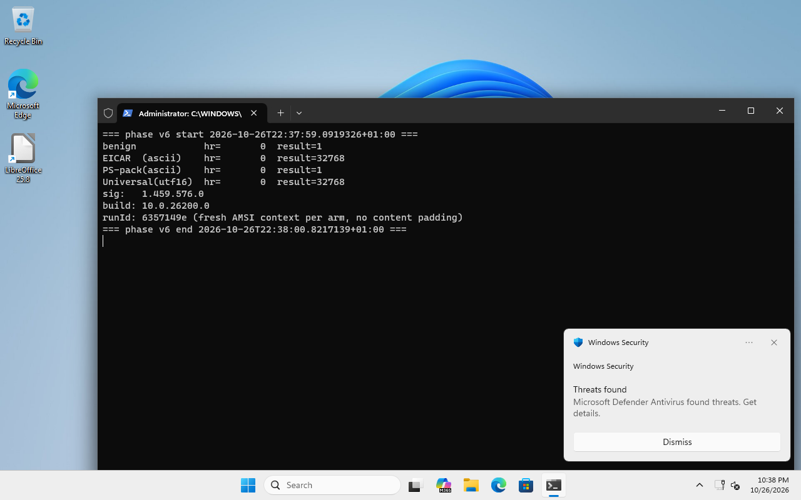

_Related research: [shedskin](/shedskin/) covers mpengine's appname dispatcher; [the CLR slot](/clr-amsi-slot/) covers a separate native call site. These posts trace three user-mode AMSI decisions._

Microsoft documents three bands for `AMSI_RESULT`: clean (0 or 1), admin-blocked (16384 to 20479), malware (anything at or above 32768). PowerShell's `PerformSecurityChecks` reads that return and decides whether to throw. On SMA.dll v10.0.26100.7920 the comparison is one `ldc.i4` and one `bne.un.s`. The literal is `32768`. The branch is "if not equal, skip the throw". A provider returning 32769 does not block, a provider returning 20000 does not block, nothing on that axis blocks except the single integer the parser was taught in 2017. Issue #5308 noticed the admin-range bit in November 2017. It is still there.

> **Advisory metadata.** Project: PowerShell (`System.Management.Automation.dll`). Measured version: 10.0.26100.7920 (one build; full version sweep deferred to the companion bundle). CWE: CWE-697 (Incorrect Comparison). Illustrative CVSS 3.1 vector for an administrator-registered provider scenario: `AV:L/AC:H/PR:H/UI:N/S:U/C:N/I:H/A:N` (4.1, Medium). This is not a severity claim for stock Defender: the provider-override control remains inconclusive. PR:H reflects the HKLM admin-write precondition; the effect of a pre-existing policy provider is not scored here. Fix locus: `CompiledScriptBlockData.PerformSecurityChecks` method token `0x060026eb`, compare against the documented blocked-by-admin range and use `AmsiResultIsMalware` for malware results.

## the finding

`CompiledScriptBlockData.PerformSecurityChecks` in `System.Management.Automation.dll` v10.0.26100.7920 compares the `AmsiUtils.ScanContent` return value against the literal `32768` exactly. Microsoft documents `16384..20479` as blocked by administrator policy and every result `>= 32768` as malware. The decoded IL handles those ranges as follows:

- `result == 32768` -> throw `ScriptBlockAmsiBlockException` (fatal, the one PS actually blocks on).
- `result ∈ [16384..20479]` -> log `SuspiciousScriptContent`, continue (non-fatal), although this is the documented administrator-blocked range.
- `result ∈ [32769..INT_MAX]` -> silent pass, although Microsoft classifies these results as malware.
- `result ∈ [20480..32767]` -> silent pass. These are provider-specific risk values, not a documented mandatory-block range.

The two specification mismatches are the non-fatal handling of `16384..20479` and the exact-equality check that misses values above `32768`. A provider registered under `HKLM\SOFTWARE\Microsoft\AMSI\Providers` can supply such a result, but registering one requires administrator access. The eight-input stock Defender sample below did not produce either range.

## prior art and scope

PowerShell/PowerShell issue [#5308](https://github.com/PowerShell/PowerShell/issues/5308) was opened in late 2017 and asks about the administrator-blocked result range. The issue was closed as answered. The exact-equality compare in `PerformSecurityChecks` is still present in the IL of the build I measured (SMA.dll v10.0.26100.7920, SHA256 `929048467e..`); whether every supported PowerShell build still carries the same opcode shape is a version-sweep question this post does not answer.

The contribution of this post is the CURRENT-BUILD re-verification plus three measurements the 2017 thread does not carry:
- the three-band map including the `[16384..20479]` warning branch (not just the fatal `== 32768` compare);
- an 8-payload MpOav hunt that bounds weaponisation on a stock Defender install (which values MpOav itself actually emits);
- the attempted composition with the [shedskin](/shedskin/) dispatcher-route primitive via a sibling lab provider, including the control gap.

The underlying code defect is not novel. This post establishes that the exact-equality compare remains in the measured build and reports what the sampled stock provider returned. The administrator-preconditioned provider experiment produced `32769`, but its direct probe does not prove an override of a simultaneous Defender detection.

## `AMSI_RESULT` ranges, separated

Microsoft's `AMSI_RESULT` documentation reserves `16384..20479` for administrator-blocked content and classifies `>= 32768` as malware. Other values from 1 through 32767 are provider-specific risk scores. The measured IL treats these bands differently:

| range | symbol | mpengine normally emits | SMA.dll handling |
|---|---|---|---|
| 0 | `AMSI_RESULT_CLEAN` | yes, clean content | passes without warning |
| 1 | `AMSI_RESULT_NOT_DETECTED` | yes, non-matching content | passes without warning |
| 2-16383 | provider-specific risk values | not seen in the eight-input sample | passes without warning |
| 16384-20479 | `AMSI_RESULT_BLOCKED_BY_ADMIN_START..END` | not seen in the eight-input sample | logs `SuspiciousScriptContent`, continues |
| 20480-32767 | provider-specific risk values | not seen in the eight-input sample | passes without warning |
| 32768 | `AMSI_RESULT_DETECTED` (plain) | yes, matched content | throws `ScriptBlockAmsiBlockException` |
| 32769-INT_MAX | malware results above `_DETECTED` | not seen in the eight-input sample | silently passes |

The 2017 issue asks why PowerShell did not block the `16384..20479` administrator range. The measured IL still logs and continues for that range. The separate `>= 32769` mismatch follows from the same exact-equality check. Values in `20480..32767` also pass, but Microsoft documents them as risk scores; their treatment alone does not establish a block bypass.

In the eight-input stock Defender sample, MpOav returned only `32768` or `1`. That sample does not establish how other providers or signatures behave. The lab composition uses an administrator-registered sibling provider, as described below.

## the IL

Pulled from `System.Management.Automation.dll` SHA256 `929048467e..` by locating method token `0x060026eb` (RVA `0x941d4`) and decoding the IL body directly from the file. The result header is `flags=0x13 (FAT) max_stack=4 code_size=160 local_sig=0x11000005f7`. The relevant IL slice:

```
; CompiledScriptBlockData.PerformSecurityChecks (method token 0x060026eb, RVA 0x941d4)
IL_0023: call      token(0x06002b4e)        ; AmsiUtils.ScanContent, returns int AMSI_RESULT
IL_0028: stloc.2                            ; result -> local 2
IL_0029: ldloc.2
IL_002a: ldc.i4    32768                    ; AMSI_RESULT_DETECTED, literal
IL_002f: bne.un.s  33                       ; if result != 32768, skip the throw block
IL_0031: ldloc.1
IL_0032: ldstr     token(0x7000e52a)        ; "ScriptContainedMaliciousContent" (error id)
IL_0037: call      token(0x060004f4)        ; log + throw ScriptBlockAmsiBlockException
...
IL_0051: ldloc.2                            ; result (unchanged, outside the bne path)
IL_0053: ldc.i4    16384                    ; blocked-by-admin range lower bound
IL_0058: blt.s     54                       ; if result < 16384, skip the warning branch
IL_005a: ldloc.2
IL_005b: ldc.i4    20479                    ; blocked-by-admin range upper bound
IL_0060: bgt.s     46                       ; if result > 20479, skip the warning branch
IL_0062: ldloc.1
IL_0063: ldstr     token(0x7000e56a)        ; "SuspiciousScriptContent" (or similar warning id)
IL_0068: call      token(0x060004f5)        ; log + continue (non-fatal)
```

The fatal check uses `bne.un.s` (equal / not-equal), so a result above `32768` skips the throw. The later warning branch covers exactly `16384..20479`, the documented administrator-blocked range, yet continues execution in this decoded IL. The stock-provider sample below does not exercise either mismatch. `ScanContent` also maps some failed HRESULTs to `1`; the full error-path audit remains open.

## weaponisation precondition on the current Defender build

> **Artifact bundle, live at [`/artifacts/exact-32768/`]({{ '/artifacts/exact-32768/' | relative_url }}).** The bundle currently ships the dnfile 0.18.0 `dnfile_find_psc.py` script that resolves `CompiledScriptBlockData.PerformSecurityChecks`. Not yet included: the 8-payload MpOav hunt table, the raw IL dump of the method body at RVA `0x941d4`, and the three-arm log captures; those pieces are lab-dependent and are explicitly flagged as pending in-post.

An eight-input sample on 2026-10-22 yielded only `32768` or `1` from MpOav. It did not demonstrate a stock-Defender path to either mismatched range; it cannot exclude other content or future provider behavior. The compare is in `System.Management.Automation.dll`, so a signature update alone does not change that IL. The raw sample table will ship with the companion bundle on publication.

## proposed composition with shedskin

Can an attacker who already runs code reach a result in `[16384..20479]` or above `32768` without an administrator precondition? Shedskin reroutes scans away from the PS pack by changing the appname in `AmsiUtils.amsiContext`. The exact-equality check lets an aggregated result above `32768` pass PowerShell's block path. A lab provider returned `32769` on marked content, and a separate PowerShell run passed after that provider was installed. The direct five-arm matrix in the [lead post](/shedskin/#second-order-chain) does not establish that the provider overrode a Defender detection: its Mimikatz-only arm returned `1`, and its EICAR-plus-marker arm also returned `1`. Until those arms are explained and a same-content control shows both provider verdicts, this is a candidate composition, not a confirmed bypass chain. Provider registration required administrator access; shedskin's standard-user result is separate.

## the 8-payload MpOav hunt that bounds weaponisation

The question that bounds this finding is which values MpOav actually emits in the field. Measured 2026-10-22, Defender platform 1.1.26080.3, sig 1.459.576.0, direct `AmsiScanBuffer` under appname `PowerShell_test`, UTF-16LE encoding, per-scan noncing to defeat the AmsiResultCache SHA-1 content hash:

| payload shape | observed `AMSI_RESULT` |
|---|---|
| EICAR | `32768` |
| AMSI Test Sample (`7e72c3ce-...`) | `32768` |
| Rastamouse `amsiInitFailed=$true` one-liner | `32768` |
| `function Invoke-Mimikatz { "sekurlsa::logonpasswords" }` | `32768` |
| `function Invoke-ReflectivePEInjection { ... }` function-header | `32768` |
| benign `Write-Host hello` | `1` |
| benign empty string | `1` |
| random 256-byte binary blob | `1` |

Eight shapes produced two values: `32768` on detection and `1` otherwise. None of these inputs exercised the administrator-blocked range or a result above `32768`. The demonstrated composition uses a sibling provider registered under HKLM, which requires administrator access. Other stock-provider inputs were not exhausted.

## live capture

Captured 2026-10-26 on a fresh win11 26200 guest, Defender sig `1.459.576.0`, build `10.0.26200.0` (the local on-screen timestamp in the capture is the authoritative date; an earlier draft of this paragraph wrote 2026-10-27, which was wrong). The buffer passed to `AmsiScanBuffer` is the raw sig bytes, not padded; EICAR's 68-byte offset-anchor and length constraint stay intact. Cache note: `AmsiResultCache` in `MsMpEng.exe` keys on `SHA-1` of the scanned content, not on the context handle, so what makes each arm an independent scan is that the four buffers are literally different byte sequences (benign, EICAR ASCII, PS-pack mimikatz-wrapper ASCII, universal UTF-16LE one-liner). An earlier version of this paragraph said "the probe cycles `AmsiInitialize` per arm so the cache cannot serve a prior scan's result"; that is wrong, cycling the context does not evict the cache, distinct bytes do.



<video controls muted playsinline preload="metadata" poster="/assets/img/posts/amsi-exact-32768/live.png" style="max-width:100%">
  <source src="/assets/img/posts/amsi-exact-32768/live.mp4" type="video/mp4">
</video>

Raw console output, four arms, one line each:

```
benign            hr=       0  result=1
EICAR  (ascii)    hr=       0  result=32768
PS-pack(ascii)    hr=       0  result=1
Universal(utf16)  hr=       0  result=32768
sig:   1.459.576.0
build: 10.0.26200.0
runId: 6357149e (distinct bytes per arm, no content padding; cache is content-SHA1 keyed, so independence rides on byte distinctness, not on cycling the context)
```

Two of four arms returned the literal `32768` SMA.dll compares against. EICAR is Defender's offset-anchor-plus-length canary; the UTF-16LE reflection-chain one-liner is the published universal AMSI bypass pattern. The PS-pack mimikatz-wrapper ASCII string returned `1` on this probe (short ASCII buffer under a short appname is not the shape of its indexed sig family), which is an honest null arm, not a defect. Benign returned `1` as expected.

The value SMA.dll compares against is one Defender's shipped sig DB actively emits in production. Nothing in the measurement proves a provider ever emits `32769` or anything in `[16384..20479]`; the exact-equality mismatch is a code defect, and its reachability from an unprivileged attacker depends on a provider whose output lands outside that one integer.

## reproduction

Prerequisites: Win11 26200 or Win10 19045 with Defender in Normal mode. Standard user is sufficient for reading the IL and running the direct `AmsiScanBuffer` test; the end-to-end provider-chain demo needs admin to register the sibling CLSID.

Resolve `PerformSecurityChecks` by walking the dnfile metadata tables. The real path for `System.Management.Automation.dll` on Win11 26200 lives under `C:\Windows\Microsoft.NET\assembly\GAC_MSIL\System.Management.Automation\<version-tag>\`; replace `<version-tag>` with the directory you see on the host (for example `v4.0_10.0.0.0__31bf3856ad364e35`).

```bash
pip install dnfile==0.18.0
```

```python
# Resolve the (token, RVA) of CompiledScriptBlockData.PerformSecurityChecks on a
# given System.Management.Automation.dll. API shape: dnfile 0.18.0 exposes each
# MethodDef row with .Name (str), .Rva (int), no get_declaring_type / get_body_size
# helpers; the declaring type is reconstructed by walking TypeDef.MethodList ranges.
import sys
import dnfile

def find_psc(dll_path):
    pe = dnfile.dnPE(dll_path)
    pe.parse_data_directories()
    tdefs = pe.net.mdtables.TypeDef
    mdefs = pe.net.mdtables.MethodDef
    for ti, t in enumerate(tdefs.rows, start=1):
        if t.TypeName != "CompiledScriptBlockData":
            continue
        if not t.MethodList:
            continue
        start = t.MethodList[0].row_index
        if ti < len(tdefs.rows) and tdefs.rows[ti].MethodList:
            end = tdefs.rows[ti].MethodList[0].row_index
        else:
            end = len(mdefs.rows) + 1
        for mi in range(start, end):
            m = mdefs.rows[mi - 1]
            if m.Name == "PerformSecurityChecks":
                print(f"token=0x{0x06000000 | mi:08x}  rva=0x{m.Rva:x}  name={m.Name}")

if __name__ == "__main__":
    find_psc(sys.argv[1])
```

Dump the IL bytes at the reported RVA with any PE walker (`dnSpy`, `ILSpy`, `dnlib`, `dotPeek`). The three literals to look for are `ldc.i4 32768`, `ldc.i4 16384`, `ldc.i4 20479` and the branch opcodes `bne.un.s`, `blt.s`, `bgt.s`. The method body size is read off the first-byte header at RVA (`fat` header is 12 bytes, `tiny` header is 1 byte); dnlib or ILSpy decode that header natively.

Direct `AmsiScanBuffer` probe to measure MpOav's return value under a chosen appname:

```powershell
Add-Type -Name A -Namespace W -MemberDefinition @'
  [DllImport("amsi")] public static extern int AmsiInitialize(string an, out IntPtr ctx);
  [DllImport("amsi")] public static extern int AmsiScanBuffer(IntPtr ctx, byte[] b, uint n, string cn, IntPtr s, out int r);
'@
$ctx = [IntPtr]::Zero; [W.A]::AmsiInitialize("PowerShell_test", [ref]$ctx) | Out-Null
$b = [System.Text.Encoding]::Unicode.GetBytes('function Invoke-Mimikatz { "sekurlsa::logonpasswords" }')
$r = 0; [W.A]::AmsiScanBuffer($ctx, $b, $b.Length, "probe", [IntPtr]::Zero, [ref]$r)
"result=$r"
```

For the silent-allow demo you need a sibling AMSI provider that returns `32769`. A minimal CRT-free C stub (~180 KB DLL) is in the companion bundle; registration is a single key write under `HKLM\SOFTWARE\Microsoft\AMSI\Providers\{...-DEAD-BEEF-C0DE-...}` plus the CLSID's `InprocServer32` pointing at the DLL. Choose a GUID that sorts BEFORE MpOav's `{2781761E-28E0-4109-99FE-B9D127C57AFE}` so your provider is called first in amsi.dll's aggregator loop.

## detection pair (the house rule: every evasion paired with its detection)

A result in `[16384..20479]` or above `32768` landing in an AMSI event-1101 record is the detection signature. The query below reads that signature out of a SIEM feed, assuming the feed carries per-scan result values. `EtwTable` and `EventData.scanResult` are schema placeholders; the raw Event 1101 capture and field mapping are still pending in the artifact bundle, so this is not a validated deployable rule:

```kql
// Microsoft-Antimalware-Scan-Interface provider, event 1101 carries scanResult.
// Flag results in the documented administrator-blocked or malware-above-32768 bands.
EtwTable
| where ProviderName == "Microsoft-Antimalware-Scan-Interface" and EventId == 1101
| extend scanResult = toint(EventData.scanResult)
| where (scanResult between (16384 .. 20479)) or (scanResult between (32769 .. 2147483647))
| summarize events = count(), appnames = make_set(appname), examples = make_set(scanResult, 5)
          by ProcessId, bin(TimeGenerated, 60s)
| extend pattern = "amsi-result-outside-standard-detected-literal"
```

Static detection at the source: inspect each shipped `System.Management.Automation.dll` and flag a `PerformSecurityChecks` path that throws only for the exact value `32768`. A fix could change the surrounding control flow; do not key verification to one replacement opcode.

The fix belongs in the caller's result handling: block the documented administrator-policy range and use the malware threshold for values at or above `32768`. Recheck the behavior with one value from each band after any change.

## limits and open questions

- **Measurement scope.** The IL is read on `System.Management.Automation.dll` v10.0.26100.7920 only. The 2017 thread suggests the compare was present on an earlier release, but this post does NOT re-measure every build; a full version sweep is in the companion bundle plan, not in this post. "Still present on this build" is the honest claim here; "present on every supported build" would be an extrapolation.
- **PowerShell 7 (`pwsh`).** PS 7 ships its own SMA.dll independent of the Windows one. The IL compare in PS 7's `PerformSecurityChecks` has not been re-measured in this round. The companion bundle will carry the version-sweep when it ships.
- **Non-PowerShell AMSI hosts.** `wscript.exe`, `cscript.exe`, Office VBA, and the DotNet gate each have their own callers of `AmsiScanBuffer`. The exact-equality compare I measured is specific to SMA.dll's `PerformSecurityChecks`. Other hosts may or may not carry the same shape.
- **ScanContent's HRESULT handling.** The full audit of its error paths is pending. This post does not infer a result value from an HRESULT alone.
- **Aggregator semantics.** The proposed override relies on how amsi.dll combines provider results. The displayed five-arm matrix does not show Defender producing `32768` on the same marked content, so it cannot establish that override at runtime.

## references

- PowerShell/PowerShell issue [#5308, "Question regarding Antimalware Scan Interface"](https://github.com/PowerShell/PowerShell/issues/5308), opened November 2, 2017.
- Microsoft, [`AMSI_RESULT` enumeration](https://learn.microsoft.com/en-us/windows/win32/api/amsi/ne-amsi-amsi_result) and [`AmsiResultIsMalware`](https://learn.microsoft.com/en-us/windows/win32/api/amsi/nf-amsi-amsiresultismalware).
- CWE-697, "Incorrect Comparison".
- Companion artifact bundle (pending publication): the 8-payload MpOav hunt table in CSV form, the dnfile script that decodes method token `0x060026eb`, the raw IL dump of `PerformSecurityChecks` as emitted by `dnlib`, the minimal CRT-free C stub for the sibling AMSI provider, the registry-write snippet, and the three-arm log captures (shedskin only; shedskin + provider; shedskin + provider + nonce control).
- Lead post for the provider experiment and its control gap: [shedskin](/shedskin/#second-order-chain).
